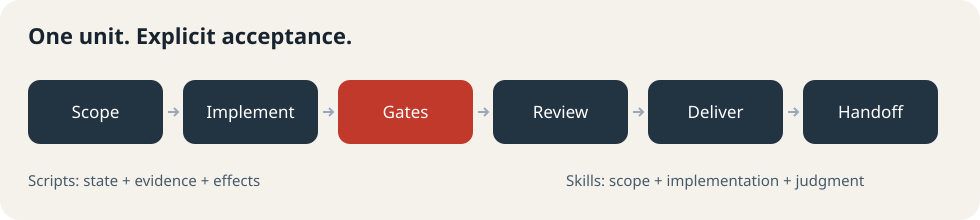
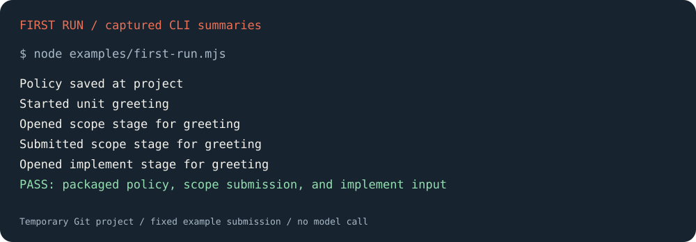

<p align="center"></p>

# forge-harness

**개발 작업 단위를 같은 절차와 품질 기준으로 처리한다.**

Run development work through scope → implementation → deterministic gates → independent acceptance → delivery → handoff. Scripts own state, evidence, and side effects; shared Claude Code and Codex skills own judgment.



- **수용 기준과 증거**: 게이트 결과는 입력 fingerprint에 결속된다. 같은 입력의 증거는 재사용하며, 리뷰는 정책에 따라 독립 세션에서 수행한다.
- **명시적 권한**: 단건 태스크·출시 전 제품·출시된 제품의 정책으로 권한과 리뷰를 정한다. 설치만으로 commit·push·배포 권한을 주지 않는다.
- **중단과 재개**: 실패를 분류하고 같은 원인에 대한 재시도 상한을 지킨다. 원장을 통해 외부 효과를 재관찰하며 앞으로 수정한다.

## 준비

Node.js **22 이상**, Git, 플러그인 명령을 지원하는 Claude Code 또는 Codex가 필요하다. 런타임 Node 의존성은 없다. 개발 검증에만 pnpm을 쓴다. 호스트의 모델 사용에는 해당 호스트의 로그인·구독 또는 API 설정이 필요하다.

이 패키지는 제어면과 스킬을 제공한다. 정책·scope·implement 입력 생성은 바로 실행한다. 전체 게이트·전달·세션 전환은 사용 환경의 [런타임 어댑터](docs/runtime-adapters.md)를 명시적으로 연결한다.

## 설치

Claude Code 대화에서:

```text
/plugin marketplace add Seungwoo321/forge-harness
/plugin install forge-harness@forge-harness
```

터미널에서도 설치할 수 있다:

```sh
claude plugin marketplace add Seungwoo321/forge-harness
claude plugin install forge-harness@forge-harness
claude plugin list
```

Codex 터미널에서:

```sh
codex plugin marketplace add Seungwoo321/forge-harness
codex plugin add forge-harness@forge-harness
codex plugin list
```

설치 후 새 대화를 열고 정책 설정 스킬을 선택한다. Claude Code에서는 `/forge-harness:policy-setup`, Codex에서는 스킬 선택기에서 `policy-setup`을 선택한다. 예: **“이 프로젝트의 작업 정책을 설정해줘. 목표는 단건 태스크이고 전달은 하지 않아.”** 그다음 `unit` 스킬에 요청과 수용 기준을 전달한다.

## 첫 실행

호스트에서 스킬을 선택하면 설치된 스킬 경로로 패키지 루트를 찾는다. 수동 CLI 사용 시 그 루트를 `PLUGIN_ROOT`로 지정한다. 저장소를 별도로 clone해 실행해도 같은 코드다.

```sh
# 실제 설치 디렉터리 또는 clone한 패키지 경로로 바꾼다.
export PLUGIN_ROOT=/absolute/path/to/installed/plugin
node "$PLUGIN_ROOT/examples/first-run.mjs"
```

이 예제는 임시 Git 프로젝트에서 실제 공개 CLI를 호출하고 프로젝트를 정리한다. 고정된 예제 정책과 scope 제출로 설치 경계를 검사하며, 모델을 호출하거나 현재 프로젝트를 고치지 않는다. 실제 프로젝트 설정과 단계 출력 제출 방법은 [첫 실행 안내](docs/getting-started.md)를 따른다.

아래는 위 명령이 실제로 출력한 요약이다. 호스트 UI나 모델 실행의 캡처가 아니다.



원문: [first-run.txt](examples/first-run.txt). 재현: `node "$PLUGIN_ROOT/examples/first-run.mjs"`.

## 업데이트와 제거

```sh
# Claude Code: 새 버전 설치 후 대화를 재시작한다.
claude plugin marketplace update forge-harness
claude plugin update forge-harness@forge-harness

# Codex: 카탈로그를 갱신하고 설치를 다시 적용한다.
codex plugin marketplace upgrade forge-harness
codex plugin add forge-harness@forge-harness
```

제거는 `claude plugin uninstall forge-harness@forge-harness` 또는 `codex plugin remove forge-harness@forge-harness`다. 프로젝트의 작업 기록은 별도이며 플러그인 캐시 제거와 함께 삭제하지 않는다.

## 실행 모델과 설정

| 구성 | 역할 |
|---|---|
| `policy-setup`, `unit`, `gates` | 사용자 설정·제어면 명령 실행 |
| `scope`, `implement`, `root-cause`, `review`, `handoff` | StageInput을 읽고 계약에 맞는 StageOutput 반환 |
| `scripts/policy.mjs`, `scripts/unit.mjs` | 정책·상태 전이·증거·체크포인트·원장 소유 |
| 런타임 모듈 `--adapters` | Git 관찰·게이트·작업관리·전달·세션 실행 연결 |

기본 상태 위치는 Git 공통 디렉터리의 `work-state/`다. worktree끼리 공유한다. workspace/global 정책은 별도 루트로 지정한다. 설정 값과 출처는 [첫 실행 안내](docs/getting-started.md), 어댑터 API는 [런타임 연결](docs/runtime-adapters.md), 전체 계약은 [제품 명세](docs/spec.md)에 있다.

플러그인은 Node·Git 명령을 실행하고 프로젝트 파일, Git 체크포인트 ref, 로컬 작업 기록을 쓸 수 있다. 연결한 어댑터와 호스트 권한이 실제 외부 효과를 결정한다. 런타임 모듈은 신뢰하는 로컬 코드만 사용한다. 모델 호출은 호스트가 맡으며 패키지 자체에는 원격 MCP 서버나 분석 수집 코드가 없다. Claude Code의 시작 훅은 정책 유무 안내를 출력한다.

## 문제 해결

| 결과 | 다음 행동 |
|---|---|
| `POLICY_UNSET` / exit 3 | 정책 설정 스킬에서 사용자 값을 확인한 뒤 동일 단위 시작 명령 재실행 |
| `unit` 또는 `policy` command not found | PATH 명령이 아니다. `node "$PLUGIN_ROOT/scripts/unit.mjs" unit ...` 또는 `scripts/policy.mjs policy ...` 사용 |
| `ADAPTER_MISSING` / exit 4 | [런타임 모듈](docs/runtime-adapters.md)을 연결하고 같은 `--adapters`를 다음 명령에도 전달 |
| `STAGE_CONTRACT_INVALID` / exit 2 | RESULT의 `issues`를 확인하고 해당 입력의 digest·attempt와 필수 필드 유지 |
| exit 20 | 정책이 독립 리뷰를 요구한다. 해당 head·fingerprint의 review 단위를 새 세션에서 수행 |
| 오래된 버전·스킬 미노출 | 카탈로그 갱신 후 재설치·새 대화. `plugin list`로 확인 |
| 설치·인증 실패 | `claude --version` / `codex --version`과 해당 `plugin --help` 확인. 로그인은 호스트 절차 사용 |

## 개발과 지원

```sh
pnpm install
pnpm test
pnpm check
```

로컬 설치는 공개 파일만 담긴 깨끗한 패키지 디렉터리에서 `claude plugin marketplace add .` 또는 `codex plugin marketplace add .` 후 위 설치 명령을 사용한다. 설치 원본에 비밀·로컬 작업 데이터를 포함하지 않는다. 테스트는 임시 패키지를 원본 checkout 밖으로 옮겨 첫 단계 흐름과 배포 참조를 검사한다. 설치 검증 시에는 `CLAUDE_CONFIG_DIR`·`CODEX_HOME`을 각각 빈 임시 디렉터리로 지정하며, **설치 원본 밖에** 둔다. 로컬 패키지 복사가 설정 캐시를 재귀 복사하지 않게 한다.

[설계 결정](docs/adr/) · [MIT License](LICENSE) · [버그 제보](https://github.com/Seungwoo321/forge-harness/issues)

플랫폼 문서: [Claude 플러그인](https://code.claude.com/docs/en/plugins-reference), [마켓플레이스](https://code.claude.com/docs/en/plugin-marketplaces), [Codex 패키징](https://developers.openai.com/plugins/build/plugins), [배포 에셋 규격](https://developers.openai.com/plugins/deploy/submission).
