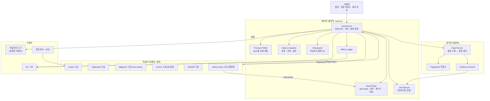
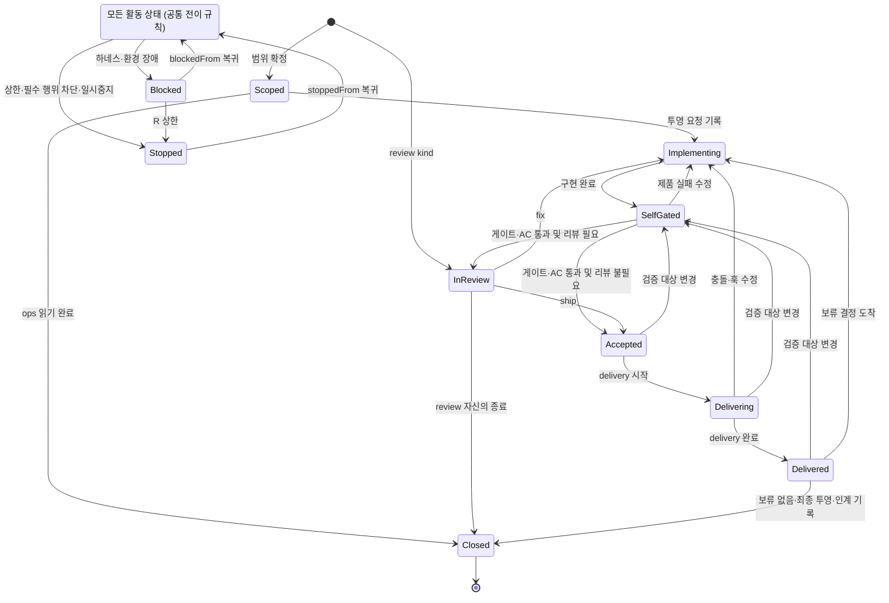
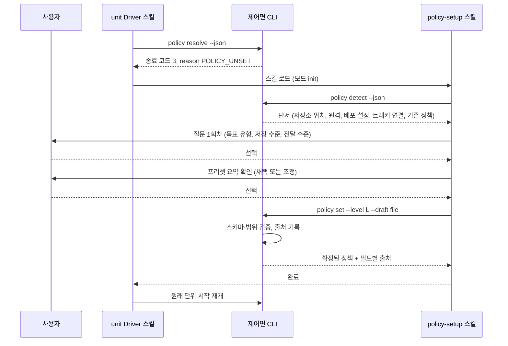
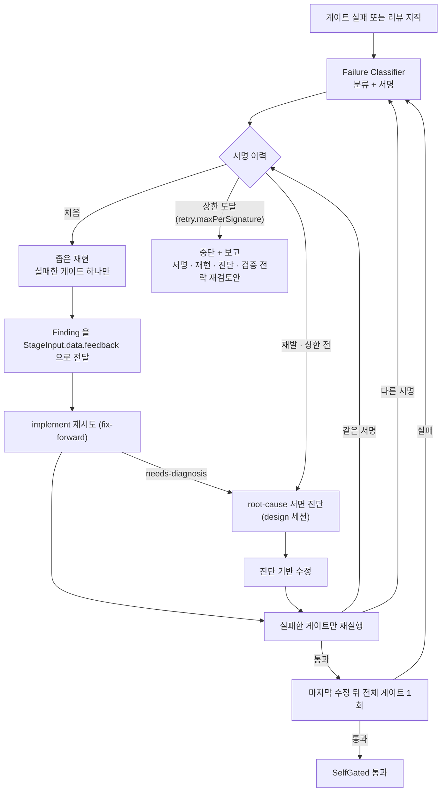

# 개발 프로세스 하네스: TO-BE 스냅샷

이 문서는 하네스의 최종 모습을 현재형으로 정의한다. 현재 구현과의 비교, 진행 상태, 이력은 담지 않는다. 구현 갭은 §12 의 적합성 목록(H-ID)을 기준으로 별도 스캔한 결과에서 도출한다.

제품의 전체 목표와 경계는 [Forge Harness 목표 상태](goals/forge-harness.md)다. 특정 외부 애플리케이션이나 별도 엔진의 설계는 정본이 아니다.

## 1. 목적과 범위

하네스는 **개발 작업을 항상 같은 절차와 같은 품질 기준으로 처리**한다. 같은 종류의 작업(`kind`)은 같은 단계, 같은 게이트, 같은 증거 형식, 같은 보고 형식을 거친다. 일관성의 대상은 문서 한 장이 아니라 **작업 단위의 수명주기 전체**다: 범위 확정, 구현, 자체 게이트, 독립 리뷰, 전달(commit·push·PR·merge), 작업관리 기록, 다음 단위 인계.

| 포함                               | 제외                               |
| -------------------------------- | -------------------------------- |
| 작업 단위(Unit) 수명주기와 단계 계약          | 제품 코드의 설계 내용                     |
| 결정 로직(스크립트)과 비결정 로직(스킬·프롬프트)의 경계 | 특정 레포의 빌드·테스트 명령 자체(레포가 계약으로 선언) |
| 실패 분류, 복구, 중단 정책                 | LLM 모델 품질 개선                     |
| 증거·상태·원장의 단일 진실                  | 병렬 단위 간 스케줄링 최적화                 |

## 2. 설계 원칙

| # | 원칙 | 의미 |
|---|---|---|
| P1 | 결정/비결정 분리 | 흐름·상태·게이트·재시도·증거 해시는 스크립트가 소유한다. 생성·판단·진단은 LLM 이 소유한다. 섞지 않는다. |
| P2 | 상태 단일 진실 | 단위의 상태는 Unit Record 하나에 있다. 대화, 작업관리 도구, 화면 문구는 상태의 근거가 아니라 그 투영이다. |
| P3 | 생산자 ≠ 검증자 | 구현 세션은 자기 산출의 수용을 선언하지 않는다. 수용의 근거는 결정적 게이트 증거(수용 기준 커버리지 포함)이고, 정책이 요구하면 독립 리뷰 판정이 더해진다. |
| P4 | 증거 단일 생산 | 게이트 원문(명령·fingerprint·종료 상태·보고서 경로·digest)은 러너가 한 곳에 한 번 만든다. 다른 곳은 경로와 digest 만 참조한다. |
| P5 | 앞으로 고친다(fix-forward) | 실패한 변경을 과거 상태로 되돌려 복구하지 않는다. 원인을 진단해 새 변경으로 고친다. 되돌리기는 사용자가 명시한 경우에만 있다. |
| P6 | 부작용은 원장에 기록하고 멱등으로 만든다 | 작업트리 밖에 영향을 주는 모든 행위는 Effect Ledger 에 남기고, 재실행이 같은 결과를 내도록 확인 후 수행한다. |
| P7 | 실패는 분류하고 서명한다 | 제품·하네스·환경·사용자 영역·불명으로 나누고 원인 서명으로 중복과 상한을 센다. 하네스·환경 실패를 제품 진척으로 기록하지 않는다. |
| P8 | 승인 경계는 정책이 정한다 | 허용 범위는 작업 종류(`kind`)가 아니라 **최종 목표의 유형(`goal.class`)** 과 정책 값이 정한다. 하네스는 위임된 범위 안에서 끝까지 진행하고, 사용자만 정할 수 있는 것에서만 멈춘다. |
| P9 | 범위는 정본이 정한다 | 수용 기준은 착수 때 고정한다. 진척은 그 목록 대비로만 보고한다. |
| P10 | 방향이 정해지면 추론으로 결정한다 | 정본의 방향, 수용 기준, 기존 코드 규약으로 선택지가 하나로 좁혀지면 묻지 않고 진행하고 근거를 기록한다. 사용자에게 알리는 것은 추론할 수 없는 실제 이슈뿐이다(§8.10). |

## 3. 구성 요소



| 면 | 소유 | 결정성 |
|---|---|---|
| 제어면 | 단위의 상태, 전이, 재개, 실패 분류, 체크포인트, 부작용 원장 | 결정적. LLM 을 호출하지 않는다 |
| 증거면 | 게이트 실행, fingerprint, 증거 레코드 | 결정적 레인 + 필요한 항목만 판정 레인(LLM) |
| 작업면 | 범위 분석, 구현, 진단, 리뷰, 인계 서술 | 비결정. 스킬(프롬프트·규칙)로 정의한다 |
| 기록면 | 작업관리 도구, 정본, Git | 상태의 투영. 진실은 Unit Record |

## 4. 작업 단위(Unit) 수명주기



`Active`는 상태 값이 아니라 Scoped·Implementing·SelfGated·InReview·Accepted·Delivering·Delivered의 도식 기호다. 일곱 상태 각각에서 Blocked·Stopped로 진입할 수 있다. Blocked→Stopped는 `stoppedFrom = blockedFrom`으로 원 활동 상태를 보존한다.

| 상태 | 진입 조건 | 소유·산출물 | 나가는 조건 |
|---|---|---|---|
| Scoped | 요청·정본 등록, scope가 범위·AC 고정 | scope + 제어면 | 구현 시작, ops 읽기 완료 |
| Implementing | tracker 투영 요청 기록 (실제 반영 성공 불필요) | implement · 작업트리 변경 | 구현 완료 |
| SelfGated | 마지막 변경 이후 검증 | Gate Runner · 증거 | 적용되는 필수 게이트·활성 AC 커버리지 통과 |
| InReview | 검증 완료, 정책이 리뷰 요구 | 독립 review · findings·verdict·reviewedHead | ship 또는 fix |
| Accepted | 게이트·AC 충족, 필요시 ship, 검증 대상 고정 | 제어면 · accepted | Delivering |
| Delivering | 수용된 내용으로 정책 delivery 실행 | 제어면 · Effect Ledger | 해당 수준 완료 시 Delivered |
| Delivered | delivery 완료 (none도 성공한 무부작용 실행) | 제어면 · deliveryResult | 보류 해소·최종 투영·인계 기록 후 Closed |
| Closed | 보류 없음, 선택 tracker 최종 반영, 결과·인계 기록 | 제어면 · 종료 결과 | 없음 |
| Blocked | 기술 장애로 해당 작업 진행 불가 | Failure Record · blockedFrom | 복구 후 같은 세션에서 원 상태 복귀 |
| Stopped | 상한·필수 행위 차단·일시중지, 또는 Scoped·Implementing에서 보류 작업만 남음 | stoppedFrom · 객관 재개 조건 | 조건 충족 후 원 상태 복귀 |

규칙:
1. 전이·수용·복귀 필드는 제어면만 쓴다. stage 이름과 상태 이름은 구분한다(§7.3).
2. `head`는 **단위 브랜치의 tip SHA**다. accepted는 head와 검증 대상 내용 fingerprint를 고정한다. 수용 후 내용·단위 head가 바뀌면 SelfGated부터 재수용한다. 단, 제어면의 전달 commit이 검증 내용과 동일한 트리임을 확인한 경우 §8.6의 SHA 결속으로 수용을 유지한다. target 브랜치의 merge SHA는 deliveryResult.mergeHead에 기록하며 그 자체로 단위 head 변경이 아니다.
3. Accepted는 적용되는 모든 필수 게이트와 deferred·dropped 외 모든 AC의 통과 증거를 요구한다. 검증된 적용 불가 상태는 통과가 아니며 §5.1의 처리와 리뷰를 따른다. 리뷰가 필요하면 같은 대상의 ship 판정도 요구한다. basis는 추가 리뷰 판정 유무다.
4. unresolved must-fix가 있으면 ship은 거부한다. should-fix·nice만 있으면 리뷰어의 ship/fix 판정을 따른다. fix는 Implementing, ship은 Accepted다. reviewedHead·내용 fingerprint가 현재 대상과 다르면 판정을 거부하고 SelfGated로 간다.
5. openDecisions[].blocks의 AC만 deferred다. Scoped·Implementing에서 보류되지 않은 작업이 없으면 Stopped다. SelfGated 이후에는 활성 기준을 검증하고 Delivered까지 진행해 기다린다. 결정 도착 시 Implementing부터 보류 기준을 처리한다. 전달·권한 등 필수 행위 자체가 막히면 blocks가 비어도 Stopped이며 미전달 상태를 Closed로 만들지 않는다.
6. tracker는 선택 사항이다. 동기화 실패는 큐로 남기고 계속한다. tracker가 있으면 Closed 직전에 최종 투영을 확인하며 실패 시 Delivered에 머문다. ops·review는 자기 종료 직전 상태에 머문다. 가용성은 그 외 전이 조건이 아니다.
7. Blocked·Stopped는 모든 kind에 포함한다. 복귀 상태는 해당 kind의 허용 활동 상태여야 한다. 원장 불확실성과 검증 대상 변경을 먼저 검사한다. Blocked는 종료 문구를 쓰지 않는다.
8. 한 세션은 합의된 작업 범위를 맡는다. 같은 범위 안의 단위 완료, 계획 조정, 구현·검증 전환과 자동 압축만으로 세션을 나누지 않는다. 범위·권한·독립 리뷰 책임이 실제로 바뀌면 목표와 인계를 다음 세션에 전달한다.

review kind는 대상 X의 InReview를 수행한다. 자기 정상 경로는 [*]→InReview→Closed이고 공통 Blocked·Stopped도 허용한다. 출력은 X의 review attempt·head에 결속하며 제어면이 X에 반영하고 자기 레코드에는 출력 참조를 쓴다. 두 레코드 갱신은 X 잠금 다음 review 잠금 순서이며 같은 제출 ID 재처리는 멱등이다. 계약 검사는 X의 입력 스냅샷 기준이다.

## 5. Process Profile 과 Work Policy

두 축이 서로 다른 것을 결정한다.

| 축 | 질문 | 결정하는 것 |
|---|---|---|
| `kind` | 이 단위는 어떤 **종류의 작업**인가 | 단계 계획, 필수 게이트 |
| `goal.class` | 이 단위가 속한 **최종 목표**는 무엇인가 | 허용 권한, 리뷰 기본값, 알림 기준 |

### 5.1 Process Profile (kind → 단계 계획)

같은 kind는 같은 기본 계획을 따른다. 모든 kind에 Blocked·Stopped와 원 활동 상태 복귀를 추가한다. 리뷰 여부는 §5.4가 정한다. ops는 E0만 허용하며 삭제·디스크 정리·설정 편집은 chore 또는 impl이다.

| kind | 거치는 상태 | 필수 게이트 |
|---|---|---|
| `ops` | Scoped → Closed (변경 없음) | 없음 |
| `chore` | Scoped → Implementing → SelfGated → (InReview) → Accepted → Delivering → Delivered → Closed | 변경 범위의 린트·타입, 영향 테스트 + AC 커버리지 |
| `impl` | chore 와 같음 | 타입체크·린트·테스트·빌드 (pre-commit 훅과 같은 범위) + AC 커버리지 |
| `impl-risk` | impl + implement의 필수 riskAssessment 하위 계약 (§7.4) | impl + risk 태그 게이트의 보안·결제·권한·정합성 시나리오 테스트 |
| `design` | Scoped → Implementing(정본 작성) → SelfGated(정합성 검사) → (InReview) → Accepted → Delivering → Delivered → Closed | 문서 정합성 검사 + AC 커버리지 |
| `review` | [*] → InReview → Closed (대상 단위 X 의 InReview 를 수행) | 없음 (X 의 증거를 재사용) |

AC 커버리지는 변경이 있는 모든 kind(`chore`·`impl`·`impl-risk`·`design`)의 필수 게이트다. `ops` 와 `review` 는 변경이 없으므로 제외한다.

게이트 결과는 입력 fingerprint(대상 소스·lockfile·명령·설정·도구 버전의 내용 해시)가 같으면 재사용하고, 하나라도 바뀌면 무효다. fingerprint 를 확인할 수 없으면 재실행한다. 재사용은 통과 증거에만 적용하며, **실패 증거는 같은 fingerprint 라도 재실행한다**. 같은 fingerprint의 두 유효 실행이 다른 결과를 내면 비결정 게이트로 분류한다(§8.4). environment·harness·user-domain·unknown 실패는 비교에서 제외하고 product 실패와 정상 완료만 비교한다. 리뷰 세션은 `evidence rerun --gate <id>` 로 통과 증거도 독립 재실행할 수 있고, 그 결과가 다르면 같은 분류를 받는다.

macOS에서 격리 게이트 자체를 검사하는 저장소 테스트는 fingerprint에 포함되는 `config.nestedIsolation: "sibling-sandbox"`를 명시한다. 호스트 제어면의 인증된 실행별 브로커가 내부 게이트를 형제 native sandbox로 실행하며, 외부 캡처 트리·선언된 출력·도구 경계와 원본 트리 차단을 강제한다. 입력 사본은 실행 전후 검증하고 실제 종료 상태와 stdout을 기존 증거 경로에 기록한다. 브로커 부재·유효하지 않은 요청은 실패하며 호스트 실행이나 테스트 제외로 대체하지 않는다. [ADR 0039](adr/0039-sibling-sandbox-self-tests.md)를 따른다.

저장소에 실제로 구성되지 않은 검사에는 `not-applicable`을 기록한다. 이는 통과·실패·미실행과 구분하며 AC 커버리지를 제공하지 않는다. 적용 여부는 프로젝트 정본과 수용 대상의 불변 스냅샷에 결속된 근거로 제어면이 검증하고, 정책이 요구하는 독립 리뷰가 확인한다. 사용자 정책이 리뷰를 금지한 경우 해당 상태로 수용하지 않으며 실제 검사를 구성하거나 명시적 정책 변경을 적용할 수 있도록 안내한다. 검사 명령이 구성돼 있거나 정본·증거가 없고 달라졌거나 실패한 경우 적용 불가로 처리하지 않는다.

제어면은 제공자가 반환한 입력을 현재 프로젝트의 실제 바이트와 독립적으로 대조하고, 검사 실행 대상과 그 결과를 동일한 불변 스냅샷에 결속한다. 실행 전후와 수용 직전에 모든 게이트 입력·대상을 다시 확인한다. 실행 도중 변경됐다 복원된 입력도 성공 근거가 되지 않도록 실행에 사용한 스냅샷을 고정하거나 동등한 무결성을 증명한다. 확인이 불가능하거나 경합이 생기면 결과는 미확정이며 재관찰·재검증한다.

**AC 커버리지**는 수용 기준마다 통과한 검증 증거가 하나 이상 연결됐는지 보는 결정적 게이트다. 연결은 다음 규약으로 만든다.

1. 게이트 설정은 테스트별 결과 보고 형식(TAP·JUnit 등), 보고서 위치와 테스트 이름의 AC ID 정규식을 선언한다.
2. 러너는 성공한 개별 테스트 이름에서만 AC ID를 추출한다. skip·todo·실패·주석·파일 이름·미실행 테스트는 제외한다. 보고서 부재·파싱 실패·불투명 명령은 커버리지 실패다. 전체 exit 0도 필수다. Evidence Record는 보고서 digest와 성공 test ID→AC 연결을 보존한다.
3. 구현 스킬은 StageOutput 의 `coverage` 에 "어느 기준을 어느 테스트가 덮는다"를 제안할 수 있지만, 집계는 2 의 결과로만 한다.
4. 테스트로 검증할 수 없는 기준(예: 문서 존재, 설정값, 정본 문서의 절 존재)은 `exec` 또는 `module` 게이트가 같은 방식으로 `covers` 를 낸다. 예: `design` 단위의 기준 "AC-1: 상태도에 Blocked 복귀 전이가 있다"는 `module` 게이트 `docs/gates/state-diagram.mjs` 가 mermaid 블록을 파싱해 전이를 확인하고 `{ok: true, covers: ["AC-1"]}` 를 낸다. `chore` 단위의 기준 "AC-1: 린트 경고 0"은 린트 게이트 설정의 `covers: ["AC-1"]` 선언으로 연결한다.
5. 커버되지 않은 기준은 `uncovered` 목록으로 구현 단계에 피드백되어 검증을 추가하게 한다.

기준의 기본 검증 방식은 제품·산출물 게이트다. 외부 운영 관찰이나 수용 뒤 전달 의무를 이 방식으로 잘못 기록한 경우 `unit acceptance correct`가 같은 단위의 원문을 유지하며 별도 검증 영수증을 추가한다. 제출된 미수용 SelfGated 단위에서만 허용하며, 진행 중 단계·전달 계획·불확실한 효과가 있으면 거부한다. 정확한 revision·기준 digest·원 요청과 정본 digest·head·내용 fingerprint 및 실제 사용자 승인과 출처 증거가 필요하다. 신뢰 제공자는 원 권한과 기록 불일치를 독립 검증하며 제품 요구나 제품 요구를 포함한 혼합 기준의 재분류를 거부한다.

`observation`은 참조와 바이트 digest로 결속된 외부 관찰이며 제공자가 현재 대상·운영 문맥에서 재검증한다. `delivery`는 commit/push/pr/merge 중 최소 전달 수준과 원 실행 소유자(engine/external)다. 수용과 전달에서 정정 출처와 관찰을 다시 확인한다. 기준·정책·실패·증거·재시도 이력은 유지하고 covered/deferred/dropped를 설정하지 않는다. 분류·전달 소유자 변경·전달 수준 하향은 거부하며 관찰 갱신은 새 영수증으로 남긴다. 정정 뒤 기존 리뷰는 감사 이력에 보존하고 새 검증·리뷰를 요구한다.

커버리지 계산과 acceptance-coverage 제공자는 제품 기준 투영을 사용한다. 제공자의 `record.acceptanceObligations`에는 전체 원문, `record.acceptanceCorrections`에는 정정 이력이 남고 정정 이력은 해당 게이트 fingerprint에 결속된다. 다른 필수 게이트는 유지한다. 관찰은 테스트 성공이나 covers로 바꾸지 않는다. 리뷰 handoff는 전체 기준과 정정 이력을 포함한다. 엔진 소유 의무는 전달 정책과 실제 엔진 전달 수준으로 강제한다. 외부 소유 의무는 원 delivery:none을 유지하고 실제 finish·완료 투영·close/reconcile·finalize 경계에서 신뢰 제공자의 현재 원격 증거를 검증한다. 제품 수용 전에 외부 PR을 요구하지 않는다. 외부 전달 증거는 수용 대상과 실제 repo/branch/base/head/내용에 결속된 별도 영수증이며 테스트나 엔진 실행 원장이 아니다. 동일 트리 직접 자식 외부 commit만 기존 commit 결속 검증으로 SHA를 결속하고 원 검증·리뷰 SHA를 보존한다. 누락·위조·stale 증거는 완료와 세션 종료를 막는다. 목표 완료 사전검사도 제품 증거와 원 정정 영수증으로 기준을 연결하며 관찰·전달을 테스트 성공으로 집계하지 않는다. 실제 목표 완료는 완료 경계 검증을 거친 Closed 단위를 요구한다. 요청·증거 형식과 복구 순서는 [동일 단위 검증 정정](acceptance-recovery.md)에 정의한다.

승인된 goal amend는 열린 결속 단위의 목표 문구와 원 목표의 변경 이력을 함께 기록한다. 기존 정정은 목표 id·source가 같고 단위의 현재 목표 문구가 이력의 amend 결과와 같은 이력에서 objective·criteria만 복원하여 원 출처 digest와 정확히 일치할 때 유지한다. 목표 완료 사전검사는 이력이 목표 원장의 앞부분이고 그 시점 문구와 같은지도 대조한다. 원 정정·수용·리뷰는 보존하고 권한·대상·외부 전달은 기존 경계에서 현재 재검증한다. 다른 요청 필드·정본·기준 변경이나 알려지지 않은 목표 이력은 정정을 복원하지 않는다. 이전 배포본의 목표 변경으로 막힌 단위도 같은 승인된 공개 명령으로 원 이력을 연결한 뒤 기존 finish/finalize를 재개한다. [ADR 0040](adr/0040-goal-amendment-correction-provenance.md)과 [복구 계약](acceptance-recovery.md#목표-문구-변경과-기존-정정)을 따른다.

사용자가 실제 범위를 축소하면 `unit acceptance drop`이 제출된 미수용 SelfGated 단위에서 정확한 한 활성 기준을 제외한다. 사용자 지시 원문·provenance와 정확한 revision·기준/source digest·현재 Git 대상에 결속된 별도 신뢰 검증을 요구한다. 원 id·text를 유지하며 status=dropped로 표시하고 이전 source·기준·리뷰를 acceptanceAmendments에 보존한다. 정책·실패·재시도·단계·증거 이력을 지우지 않으며 최신 증거에 stale 무효화 행을 추가하고 수용/리뷰를 비운다. 모든 게이트 fingerprint와 수용 경합 검증은 범위 변경 epoch에 결속한다. 제외된 기준의 이전 분류 정정은 역사로 유지하고 활성 의무에서 제외한다. 다른 기존 분류 정정은 바뀐 source에 대해 공개 correct로 재검증한다. 목표가 해당 기준을 계속 요구하면 목표 완료는 실패하며 기존 승인된 goal amend로 먼저 맞춘다. 계약과 복구 순서는 [승인된 기준 제외](criteria-changes.md)에 정의한다.

### 5.2 Work Policy 필드

**저장 루트**: Git 어댑터가 `git rev-parse --path-format=absolute --git-common-dir`의 실제 경로 아래 `work-state/`를 stateRoot로 고정한다. 모든 worktree가 같은 루트를 쓴다. project 정책은 `<stateRoot>/policy.json`, 단위·원장·큐·알림·인계도 그 아래다. projectRoot는 공통 Git 디렉터리의 주 checkout(또는 bare 저장소)의 루트로 어댑터가 제공한다. Git 밖에서는 `--state-root`와 `--project-root`를 필수로 받는다. 실행 cwd는 별도이며 정책 검색·상태 저장 기준이 아니다.

정책 파일의 schema는 `harness.policy/1`이다. policy set은 이 버전의 필드만 허용한다. 외부 실행기의 정책 파일은 자동 병합·덮어쓰기하지 않는다. 어댑터의 명시 버전·필드 매핑으로 받은 입력만 검증해 별도 저장한다.

정책은 명시 사용자 변경 > 현재 단위 > 프로젝트 > workspace > global 순으로 **필드별** 상속한다. 각 값의 출처 수준을 Unit Record 의 `policySources: {<field>: <level>}` 에 남긴다.

사용자가 이미 진행 중인 단위의 정책 변경을 명시하면 공개 제어면이 변경 요청·사용자 입력 출처·이전 정책·새 정책·적용 revision을 기록한다. 안전한 단계 경계에서 적용하고, 수용·승인·전달 대상이나 권한이 달라지면 기존 증거를 재평가한다. 실행 중인 효과의 인자·대상·멱등 키는 바꾸지 않으며 불확실한 효과를 먼저 재관찰한다. 프로젝트 기본값의 변경만으로 과거 단위 기록을 소급 편집하지 않는다.

| 필드 | 값 | 기본값 | 설명 |
|---|---|---|---|
| `goal.class` | `task` \| `product-prelaunch` \| `product-live` | 없음 (§5.5 초기 설정; 비대화형만 `task` 를 `unconfirmed-default` 로) | 최종 목표 유형 (§5.3) |
| `goal.defaults` | `[{match, class}]` | 없음 | workspace·global 정책이 기본 유형을 제공하는 데 쓴다. `match` 는 `{cwd: <glob>}` 또는 `{remote: <glob>}` 이며 둘 다 있으면 모두 맞아야 한다. 여러 규칙이 맞으면 먼저 적힌 것이 이긴다 |
| `authority.allow` / `authority.deny` | 부작용 종류 목록 | 없음 | `goal.class` 의 권한을 단위·프로젝트 단위로 조정 |
| `retry.maxPerSignature` | 정수 1–5 | 2 | 같은 원인 서명에 대한 **재시도** 상한. 원 시도는 세지 않는다 (§8.3) |
| `retry.maxResolver` | 정수 1–5 | 2 | 같은 원인에 대한 해결 세션(R) 기동 상한 |
| `retry.onExhaustion` | `stop` / `root-cause` | `stop` | 명시 승인 시 동일 단위 진단·수정·재검증과 검증된 외부 수정의 재개를 허용한다 (§8.3) |
| `review.mode` | `none` \| `conditional` \| `required` | `goal.class` 별 (§5.4) | 독립 리뷰 사용 정책 |
| `review.by` | `session` \| `user` | `session` | 리뷰 주체. 사람 리뷰는 정책이 지정할 때만 |
| `review.triggers` | 목록 | §5.4 | `conditional` 일 때 리뷰를 여는 조건 |
| `delivery` | `none` \| `commit` \| `push` \| `pr` \| `merge` | `none` | 전달 수준 상한. 어느 수준에도 값이 없으면 `none` |
| `checkpoint.retain` | `keep` \| 기간 | `keep` | 체크포인트 ref 보존 (§8.5) |
| `checkpoint.exclude` | glob 목록 | `**/.env*`, `**/*.pem`, `**/*.key`, `**/id_*` | `.gitignore` 에 없어도 체크포인트에 담지 않는 경로 (§8.5) |
| `escalation.canonReviewAt` | 정수 | 5 | 같은 정본(경로 기준) 아래 사용자 알림이 이 수에 이르면 정본 재검토 권고. 정본 내용이 바뀌면 0 으로 돌아간다 (§8.10) |
| `isolation` | `worktree` \| `shared` | `worktree` | 단위가 전용 작업트리를 갖는지. `shared` 면 변경 귀속에 §8.5 의 병행 제외 규칙을 쓴다 |
| `session` | runtime·provider·계정·명령·모델·effort와 역할별 선택 정책 | 없음 | 세션 시작 시 실제 정책과 가용 모델로 결정. 고정된 모델 목록이나 세션 도중 모델 변경을 전제하지 않음 |

정책 파일 위치:

| 수준 | 경로 | 소유 |
|---|---|---|
| global | provider 어댑터가 제공하는 계정 config 디렉터리의 `work-state/policy.json` 하나. 레이어 간 병합은 없다 | 계정 |
| workspace | projectRoot의 부모에서 상위로 올라가며 처음 만나는 `.local/work-state/policy.json` 중 `scope: "workspace"` 가 적힌 것. 없으면 workspace 수준은 비어 있다 | workspace |
| project | `<stateRoot>/policy.json` (`scope` 가 없거나 `"project"`) | 프로젝트 |
| unit | Unit Record 의 `policyOverrides` | 단위 |

같은 파일을 두 수준으로 해석하지 않는다. `/a/.local/work-state/policy.json`(scope: workspace)와 `/a/b/.git/work-state/policy.json`이 있고 projectRoot가 `/a/b`이면 전자가 workspace, 후자가 project다. workspace 파일 신규 저장은 `policy set --level workspace --workspace-root <경로>`를 요구하며 경로는 projectRoot의 실제 조상이어야 한다.

단위 계획의 오버라이드는 policyOverrides, 명시 사용자 오버라이드는 userOverrides에 분리한다. user 출처는 확인된 사용자 입력 참조를 요구하며 스킬이 자기 출력을 승격하지 못한다. 정책 파일은 policy set만 쓴다.

각 수준에서 명시 goal.class를 먼저 보고 없으면 그 수준 goal.defaults의 첫 일치 규칙을 후보로 삼은 뒤 수준 우선순위를 적용한다. workspace defaults는 global class보다 우선한다. goal.defaults의 cwd 비교는 projectRoot 기준이다. `--non-interactive`가 질문 금지를 명시하며 provider에 질문 기능이 없으면 세션 어댑터가 이를 전달한다. TTY 여부로 추론하지 않는다.

### 5.3 목표 유형과 권한

`goal.class` 는 정책 값에서만 읽는다. 경로·티켓 유무 같은 단서로 하네스가 결정하지 않는다(단서는 §5.5 에서 사용자에게 제안하는 데만 쓴다). 어느 수준에도 값이 없으면 단위를 시작하지 않고 §5.5 정책 초기 설정을 먼저 수행한다. 비대화형 실행에서 설정할 수 없으면 가장 보수적인 `task` 로 간주하고 `source: unconfirmed-default` 로 기록한다. 유형 전환(예: 출시)은 정책 값 변경으로만 일어난다.

| 유형 | 의미 |
|---|---|
| `task` | 외부 요청·티켓이 범위를 정하는 단건 작업. 더 큰 목표의 일부 |
| `product-prelaunch` | 출시 전 완제품 개발. 사용자가 없고 제품의 모든 자원이 개발자 소유 |
| `product-live` | 출시되어 사용자가 있는 제품 |

권한 매트릭스(기본값)는 부작용 등급(§8.1)별로 정의한다. authority.allow/deny와 확인된 사용자 지시는 기본값을 조정한다. 같은 종류가 allow와 deny에 모두 있으면 deny가 우선하며 불변 조건은 완화하지 않는다. E1 범위는 scopePaths 또는 제품 소유 경로로 확인하고 E2 이상은 §8.6 등록표를 따른다.

| 등급 | `task` | `product-prelaunch` | `product-live` |
|---|---|---|---|
| E0 읽기·계산 | 허용 | 허용 | 허용 |
| E1 작업트리 변경 | 단위 범위 경로 | 제품 전체 | 단위 범위 경로 |
| E2 로컬 영속 변경 | 단위 범위 경로 | 제품 전체 | 단위 범위 경로 |
| E3 공유·외부 변경 | `delivery` 정책과 명시 지시가 정한 만큼 | 제품 소유 자원 전부 (push·PR·머지·배포·마이그레이션·티켓) | 비운영 변경 허용, 운영 배포·운영 데이터 변경은 사용자 승인 |
| E4 되돌릴 수 없음 | 사용자 승인 | 제품 소유 자원은 허용 | 사용자 승인 |
| E3 보정(compensate) | 정책에 명시된 것만 | 제품 소유 자원은 허용 | 사용자 승인 |

`goal.class` 로 완화되지 않는 불변 조건: ① 대상 제품이 소유하지 않은 자원(타인 저장소, 공유 환경, 제3자 계정)의 변경, ② 비밀의 기록·노출, ③ 계정 규칙이 금지한 명령(과거로 되돌리는 Git 명령, `--no-verify`, 게이트 우회). 이 셋은 해당 규칙을 고치는 방법으로만 바뀐다.

### 5.4 리뷰 정책

독립 리뷰는 **새 LLM 세션**이 diff·증거·인계 파일만 읽고 하는 점검이며, 사람 리뷰가 아니다. 사람 리뷰는 `review.by: user` 를 정책이 지정한 경우에만 있다.

| 유형 | `review.mode` 기본값 | `review.triggers` 기본값 |
|---|---|---|
| `task` | `conditional` | `risk-kind`(`impl-risk`), `out-of-scope`, `unproven-gate` |
| `product-prelaunch` | `none` | (없음) |
| `product-live` | `conditional` | `risk-kind`, `out-of-scope`, `unproven-gate`, `repeated-signature` |

- `none`: 리뷰 단계를 건너뛴다. 수용은 게이트 증거와 AC 커버리지로 한다(`basis: gates`). 세부 리뷰는 열지 않고, 사용자에게 알릴 실제 이슈만 §8.10 으로 올린다.
- `conditional`: 트리거 조건이 하나라도 참일 때만 리뷰를 연다.
- `required`: 항상 연다. unproven-gate 리뷰는 적용되는 필수 게이트 미통과·AC 미커버를 면제하지 않는다. 검증된 적용 불가는 통과와 구분해 검토한다.
- 트리거 정의: `risk-kind` 는 `kind` 가 `impl-risk`, `out-of-scope` 는 이 단위의 이력에 `scope-guard` Finding 이 하나라도 있었음(해소 여부 무관), `unproven-gate` 는 필수 게이트에 결정적 증거가 없는 항목 존재, `repeated-signature` 는 같은 서명이 재발한 이력 존재. 이력 기반 트리거는 Unit Record 의 `findings`(추가 전용, `resolvedAt` 로 해소 표시)와 `failures` 에서 읽는다.

### 5.5 정책 초기 설정 (policy-setup)

정책이 없는 상태에서는 단위를 시작하지 않는다. 제어면이 부재를 판정하고, 대화형 스킬 `policy-setup` 이 provider 어댑터의 질문 도구로 사용자에게 묻고, 결과는 제어면 CLI 가 검증해 기록한다.



**판정 (결정적)**: `policy resolve` 가 `goal.class` 를 어느 수준(단위·프로젝트·workspace·global)에서도 찾지 못하면 종료 코드 3, `reason: POLICY_UNSET` 으로 끝난다. 다른 필드는 기본값이 있으므로 부재 판정에 쓰지 않는다. 세션 시작 훅은 미설정 상태일 때 한 줄 알림만 주입하고 질문하지 않는다.

**단서 수집 (결정적)**: `policy detect` 는 읽기 전용으로 아래를 모아 JSON 으로 낸다. 단서는 제안의 근거일 뿐 결정이 아니다.

| 단서 | 예 |
|---|---|
| 저장소 위치·원격 | 원격 소유자, 로컬 경로 패턴 |
| 배포 흔적 | 배포 설정 파일, 릴리즈 태그 |
| 트래커 연결 | 활성 작업관리 도구, 외부 티켓 키 패턴 |
| 기존 정책 | 다른 수준에 이미 있는 정책 파일과 그 값 |

**질문 (비결정, 스킬)**: 사용자만 정할 수 있는 것만 묻는다. 한 번에 최대 4개를 묻는다.

| 회차 | 질문 | 선택지 | 비고 |
|---|---|---|---|
| 1 | 이 작업의 최종 목표 유형 | `task` / `product-prelaunch` / `product-live` | 단서로 가장 가능성 높은 안을 권고 표시 |
| 1 | 정책을 어느 수준에 저장할지 | 이 프로젝트만 / workspace 패턴 / global | workspace·global 선택 시 `goal.defaults` 규칙(`match`)을 함께 만든다 |
| 1 | 전달 수준 상한 | `none` / `commit` / `push` / `pr` / `merge` | 유형별 프리셋을 기본으로 제시 |
| 2 | 선택한 유형의 프리셋 요약(권한, 리뷰, 재시도)을 채택할지 | 채택 / 항목 조정 | 조정을 고르면 `review.mode`, `retry.*` 를 이어서 묻는다 |

**기록 (결정적)**: 스킬은 정책 파일을 직접 쓰지 않는다. 답을 `PolicyDraft` JSON 으로 만들어 `policy set` 에 넘기면 제어면이 스키마(필드, 열거값, 범위 1–5), 저장 수준, 충돌을 검증하고 `confirmedBy: user`, `confirmedAt`, 출처 수준을 붙여 기록한다.

**재진입**: `policy-setup` 은 세 모드로 열린다. `init`(정책 부재 시 자동), `change`(예: 출시 전 → 출시 후 전환 요청), `show`(해석 결과와 필드별 출처 표시). 모든 변경은 사용자 요청이 있을 때만 쓴다.

**비대화형**: `--non-interactive`가 지정된 실행은 질문하지 않는다. 상위 수준 정책이 있으면 상속하고, 없으면 `task` 프리셋을 `unconfirmed-default` 로 적용한다. 이 값으로는 §5.3 `task` 열이 허용하는 범위만 수행하고, 다음 대화형 세션에서 `policy-setup` 이 확정을 요청한다.

## 6. 결정/비결정 책임 분할

| 책임 | 소유 | 형태 |
|---|---|---|
| 단계 순서, 상태 전이, 재개 지점 | 제어면 | 스크립트 |
| kind → 단계 계획, 정책 상속 해석 | 제어면 | 스크립트 + 데이터 |
| 게이트 실행, fingerprint, 증거 레코드 | 증거면 | 스크립트 (판정 필요 항목만 판정 레인) |
| 실패 분류, 서명, 상한, 중복 검사 | 제어면 | 스크립트 |
| 체크포인트, 변경 범위 가드 | 제어면 | 스크립트 (작업트리·인덱스를 바꾸지 않는 Git 연산) |
| Effect Ledger 기록, 멱등 확인 | 제어면 | 스크립트 |
| 작업관리·정본에 대한 투영 | 제어면 | 스크립트 |
| 목표 유형별 권한 판정, 리뷰 정책 해석, 재시도 상한 | 제어면 | 스크립트 + 정책 데이터 |
| AC 커버리지 계산 | 증거면 | 스크립트 |
| 수용 기준 분석, 범위 초안 | LLM | scope 스킬 |
| 코드 작성·수정 | LLM | implement 스킬 + 프로젝트 규약 |
| 원인 진단, 수정안 | LLM | diagnose 스킬 |
| 리뷰, 판정 서술 | LLM | review 스킬 |
| 인계 요약, 결과 서술 | LLM | 스키마가 있는 필드 + 짧은 서술 |
| 추론 가능한 방향·기술 결정 | LLM + 기록 | `assumptions` 에 근거와 함께 기록 (§8.10) |
| 추론할 수 없는 범위·위험·외부 승인 결정 | 사용자 | 알림 |

LLM 이 제어면의 결정을 우회하지 못하도록 두 가지를 둔다: ① 단계 산출물은 스키마가 있는 StageOutput 으로만 받는다. ② 전이·상태·원장·증거 파일은 스킬이 아닌 제어면 CLI 만 쓴다.

단계 입출력의 통로:

| 방향 | 명령 | 동작 |
|---|---|---|
| 제어면 → 스킬 | `unit stage open <unit> <stage>` | StageInput 을 `<stateRoot>/units/<unit>/stages/<stage>.<attempt>.input.json` 에 쓰고 경로를 출력한다. 세션에는 이 경로와 Stage 스킬 이름만 전달한다 |
| 스킬 → 제어면 | `unit stage submit <unit> <stage> --output <file>` | 스킬이 작성한 StageOutput 파일을 스키마 검증 후 Unit Record 에 반영하고 전이를 판정한다. 검증 실패는 종료 코드 2 와 위반 경로 목록 |
| 스킬 → 제어면 (단계 중) | `unit effect <unit> --effect <종류> --args <file> [--approval <id>]` | Implementing에서 요청한다. 제어면이 등록표로 등급·키를 결정하고 권한 확인·intent·어댑터 실행·result를 소유한다. 스킬은 부작용을 직접 실행하거나 등급·결과를 자기 신고하지 않는다. 전달·투영·인계도 각 상태에서 같은 경로를 사용한다. 거부는 종료 코드 3이다 |
| 리뷰 → 증거면 | `evidence rerun <unit> --gate <id>` | 기존 증거와 같은 fingerprint를 요구하고 통과 재사용 없이 독립 실행·비교·기록한다. 입력이 달라지면 거부하고 비결정 결과는 수용 근거에서 제외한다 |
| 사람 → 제어면 | `unit stage submit <unit> review --output <file> --by user` | `review.by: user` 일 때 사람이 작성한 판정 파일(같은 StageOutput 스키마, `verdict` 필수)을 들여보낸다 |

스킬은 `.input.json`과 그 안의 불변 참조를 읽고, Implementing의 허용 작업트리와 자기 출력 파일을 쓸 뿐, `unit.json`·원장·증거 파일을 직접 열지 않는다. 원장 기록은 `unit effect` 를 통해서만 한다.

## 7. 스킬 구성과 계약

### 7.1 스킬 종류

| 종류 | 정의 | 본문 | 호출 주체 |
|---|---|---|---|
| Driver 스킬 | 제어면 CLI 를 호출하고 출력을 그대로 보여준다 | 명령 한 줄, 가공 금지 | 사용자 또는 상위 스킬 |
| Stage 스킬 | 한 단계의 LLM 작업을 정의한다 | 역할, 입력 계약, 출력 계약, 금지 사항 | 제어면이 세션에 주입 |
| Interactive 스킬 | 사용자에게 도구로 질문해 결정을 모으고 초안을 낸다. 기록은 제어면 CLI 가 한다 | 질문 목록, 선택지, 초안 스키마 | Driver 스킬이 제어면의 차단 사유를 받아 로드 |
| 원칙 스킬 | 사람이 읽는 절차·원칙 | 규칙 | 필요할 때 로드 |

### 7.2 단계 스킬 목록

| 스킬 | 종류 | 단계 | 입력 | 출력 |
|---|---|---|---|---|
| unit | Driver | 전체 | kind·정본·정책 오버라이드 | 시작·재개·조회 결과 |
| policy-setup | Interactive | 단위 시작 전 | 단서·init/change/show | PolicyDraft |
| scope | Stage | Scoped | 요청·정본·정책 | acceptance·scopePaths·열린 결정 |
| implement | Stage | Implementing | 기준·변경 허용 경로·피드백 | 변경 요약·검증 연결 제안 |
| root-cause | Stage | 실패 진단 | 실패 시점 스냅샷 | 서면 진단·분류·수정안 |
| review | Stage | InReview | X의 인계·diff·증거·기준 | findings·verdict·reviewedHead |
| handoff | Stage | Delivered 종료 준비 | 다음 단위·결과·검증 | 인계 초안 |
| gates | Driver | SelfGated | 게이트 설정 | Evidence Record |
| goal-register / goal-add-work | Driver | 전체 목표 | 승인된 목표·계획 | 목표와 남은 작업 기록 |
| goal-block / goal-resume | Driver | 차단·복귀 | 기록된 원인·해결 근거 | 차단 상태·재개 기록 |
| session-start | Driver | 세션 기동 | 목표·정책·불변 인계 | native 목표·착수 영수증 |
| session-finish / session-stop / session-return | Driver | 완료·차단·리뷰 반환 | 결과·소유자·선택적 수신자 | 실제 이전 시 수신 확인, 허용된 종료 시 정확한 소멸 확인 |

각 Driver는 한 lifecycle 동작만 수행하고 해당 제어면 스크립트를 호출한다. 스킬 자체가 상태·원장·증거를 직접 쓰지 않는다. 스크립트는 순수 결정, 파일 저장, 호스트·실행기 부작용을 구분한다.

실제 인계 기동·인수·착수·종료 확인은 세션 어댑터가 맡는다. 외부 개인 스킬은 구성 요소가 아니다. 공개 실행 파일은 `--adapters <module>`의 named export `createRuntimeAdapters({cwd, adapters})`를 호출한다. 명시된 모듈은 제품 cwd와 불변 core 서비스를 받아 `git`·`gates`·`tracker`·`sessionRunner`와 선택적 `repository`·`provider`·`effect`·`effectContext`를 등록한다. `effect`의 `execute`·`verify`와 함수 `effectContext`는 함께 등록하며, 문맥은 전달과 같은 소유권·범위·환경·불가역성·비밀·명령 안전 boolean을 검증한다. 공개 E4 요청은 Accepted 또는 Delivering의 정확한 저장 승인과 현재 수용 대상을 재검증하고 원장으로 실행한다. 모듈 로딩·등록 실패도 구조화된 RESULT로 반환한다. 형제 프로젝트 연결은 단위 시작 요청의 `policyOverrides`를 사용하며 workspace 정책 루트로 해석하지 않는다.

전달 제공자는 `deliveryContext({unit,record,effect,args})`·`execute({effect,args,key,seq})`·`verify(...)`를 구현한다. `git`은 commit·push·원격 통합을, `repository`는 PR 생성·머지를 소유한다. 문맥은 `resourceOwned`·`productOwned`·`inScope`·`operational`·`irreversible`·`containsSecret`·`forbiddenCommand`를 boolean으로 검증한다. `explicitUserInstruction`도 신뢰된 제공자 입력이며 요청의 자기 신고를 사용하지 않는다. 실제 요청한 효과의 메서드만 필수다.

`none` 이외의 수용은 Git 관찰의 `repo`·`branch`·`tree`·`indexTree`·`headTree`·`base`를 accepted에 고정한다. 작업트리의 검증 tree와 기존 HEAD의 headTree는 서로 다를 수 있다. finish 요청의 `delivery`는 `repo`·`branch`·`base` 기대값과 `message`·`title`·`body` 표시값, 선택적 `approvalRef`를 담는다. 기대값은 수용 대상을 덮어쓰지 않는다. Unit의 `deliveryPlan`은 전달 수준·대상·표시값을 고정하며 Delivering 재개에서 바꾸지 않는다.

`unit finish`는 Accepted→Delivering→Delivered를 각각 저장한다. `none`은 외부 효과 없이 `deliveryResult = {level:"none",head:accepted.head,mergeHead:null,effectRefs:[]}`를 기록한다. Delivering 재개에서도 Git 어댑터로 수용 head·내용을 다시 검사하며 변경 시 SelfGated로 돌아간다. 게이트 제공자가 반환한 원 verdict·path·key 참조는 제품 cwd에서 해석되는 원형으로 증거에 보존한다. 승인된 다음 작업을 같은 세션이 계속하면 단위 결과와 남은 목표를 기록하고 해당 단위를 닫는다. 이 경로는 `session.start`, `session.deliver`, `session.close` 또는 종료 finalizer를 만들지 않는다.

부모 세션의 `parentRuntime = {sessionId,cwd,incarnationId}`와 다음 작업의 `successor.cwd`는 서로 다른 경로일 수 있다. 런타임 설정은 부모 신원·cwd를 고정하고 `observe({cwd: parentRuntime.cwd, targetCwd: successor.cwd})`에서 부모의 실제 신원·cwd와 대상 경로를 독립 확인한다. 기동 후에는 다음 세션의 신원·incarnation·대상 cwd를 관찰한다. 기존 parentSessionId 입력은 동일 경로 동작을 유지하며 명시 부모 입력과 충돌하면 기동 전에 거부한다.

네이티브 런타임 바인딩은 `createSessionRunner({runtime,command,parent,launch,runtimeRpc,taskTransport,taskPrompt})`로 구성한다. Orca는 설치된 CLI에 동봉된 런타임 클라이언트로 `terminal.inspectProcess`를 호출하며 명시적 `runtimeRpc`가 있으면 이를 사용한다. foreground PID·시작 시각·tty·프로세스 그룹을 OS 관찰과 대조하고 실제 프로세스 cwd를 확인한 뒤 네이티브 incarnation·프로세스 fence를 다시 검사한다. 등록 worktree 경로는 실제 프로세스 cwd의 증거가 아니다. cmux는 네이티브 caller·terminal·tty와 OS foreground 프로세스 관찰을 결속한다. 부모는 기동 직전에 재관찰한다.

관리 세션은 선택된 호스트의 네이티브 목표를 먼저 설정한다. Codex와 Claude Code의 `/goal` 또는 동등한 공개 목표 API를 사용하며 일반 argv 프롬프트는 목표를 대신하지 않는다. 목표에는 전체 목적·완료 조건·정책·인계 참조·종료 스킬·차단 시 행동이 포함된다. cmux는 식별된 빈 입력란에 명령과 내용을 넣고 준비 상태를 재확인한 뒤 별도 제출한다. Orca는 native 기동·입력 API의 동일 요청 식별자와 재시도 계약을 따른다. paste·Enter 전송·큐 수락은 목표 설정이나 작업 착수의 증거가 아니다.

제어면은 native 목표 상태에서 정확한 목표와 active 또는 실제 착수 이후 complete 상태를 확인하고, 정확한 요청과 그 뒤 실제 응답 또는 도구 실행을 각각 관찰한다. worker transport는 목표·prompt·packet digest와 thread·request·turn·실행 항목을 effect key·session·incarnation·cwd에 결속한다. 불변 인계는 실제로 읽었거나 native 목표 입력에 정확한 본문이 포함됐음을 확인한다. 최초 입력이 이미 제출됐거나 결과가 불확실하면 동일 intent를 재관찰하며 재입력·재기동하지 않는다. 동일 worker의 여러 native lock은 root-session metadata로 유일한 주 thread에 결속한다. busy 큐·composer·startup modal은 착수 증거가 아니다. 작업 착수 이후 interrupted 상태도 구분해 보존한다.

실행기 또는 호스트가 목표 상태·훅 신뢰를 관찰할 수 없으면 미검증으로 남는다. 신뢰 우회 플래그를 자동으로 쓰지 않는다. 사용자 중단과 host의 목표 일시중지·반복 제한을 존중하며, 미완료 목표가 중단될 때는 남은 작업과 재개 조건을 보고한다.

실제 소유권 이전이나 리뷰 반환의 `returnTo`는 기존 수신 세션의 정확한 sessionId·incarnationId·cwd·executable이다. 새 successor와 함께 지정하지 않는다. 제어면은 관찰한 owner·recipient·result·handoff를 `sessionFinalization`에 고정한다. 별도 생존 프로세스의 `unit finalize <unit>`가 `session.deliver`로 결과를 한 번 제출하고 실제 수신·착수를 확인한 뒤 `session.close` intent를 기록한다. 종료 대상은 런타임 설정의 `parent.closable: true`와 `parent.workerExecutable`로 명시한 worker만이다. 셸·오케스트레이터·수신 세션은 종료하지 않는다. 원 session·incarnation·cwd·native thread를 재검사하고 실제 소멸을 생존 프로세스에서 확인한 뒤에만 소유자 종료를 확정한다. 미수신·실패·불확실성은 원래 intent를 유지하며 재관찰한다.

전체 목표 완료 또는 수신자가 없는 실제 차단·사용자 일시중지에는 successor나 returnTo를 만들지 않는다. 목표 완료 근거 또는 Stopped 상태·원인·객관적인 재개 조건과 결과를 영속 기록해 사용자에게 보고한다. 수신자가 없으므로 native 수신·목표 활성·착수 영수증을 요구하지 않는다. 허용된 관리 worker의 자동 종료가 요청된 경우에만 생존 제어면이 정확한 소유자의 소멸을 별도로 확인한다. 허용되지 않은 셸·오케스트레이터와 사용자 소유 terminal은 유지한다.

### 7.3 단계 계약 (공통 봉투)

stage 열거값은 `scope | implement | gates | root-cause | review | handoff`다. CLI·stages[].name·파일·체크포인트·Failure Record는 같은 이름을 사용한다. Scoped→scope, Implementing→implement, SelfGated→gates, InReview→review, Delivered 종료 준비→handoff다. gates는 제어면 단계이며 LLM StageOutput을 받지 않는다. root-cause는 실패 때 삽입하며 원 상태를 보존한다. Accepted·Delivering·Closed에는 LLM 단계가 없다.

**StageInput**

| 필드 | 설명 |
|---|---|
| unit, targetUnit | 실행 단위와 데이터 대상(X). review 외에는 같다 |
| stage, attempt | 위 열거값과 해당 단계 시도 번호 |
| inputRevision, inputDigest | 입력 생성 당시 대상 revision과 불변 입력 digest |
| head, contentFingerprint | 입력 시점의 단위 브랜치 SHA와 검증 내용 해시 |
| data | §7.4 reads 이름을 키로 하는 객체. 값 또는 불변 `{path,digest}` 참조를 운반한다 |

내용 fingerprint는 검증 대상 경로·바이트·파일 모드의 정렬된 트리 해시다. 포함·제외 규칙도 해시에 넣는다. stage open은 스냅샷을 만들고 stage submit은 그 digest·attempt 결속을 검사한다. implement는 의도적으로 내용을 바꾸므로 현재 내용이 입력과 같아야 한다는 조건을 두지 않고 Git으로 변경을 확인해 새 해시를 기록한다. review는 입력 head·내용이 현재 검증 대상과 같아야 한다. tracker 같은 무관 필드의 revision 증가만으로 출력을 거부하지 않는다. 같은 attempt의 입력 변경·중복 소유는 거부하고 review의 오래된 검증 대상도 거부한다.

**StageOutput**

| 필드 | 타입 | 규칙 |
|---|---|---|
| inputDigest, attempt | string, integer | 해당 입력 결속값 |
| submissionId | string | 제출 고유 ID. 동일 ID의 재제출은 같은 payload digest일 때만 멱등이며 다른 payload는 거부 |
| status | done / blocked / needs-decision / needs-diagnosis | 전이 요청. done은 비차단 열린 결정과 함께 가능. needs-decision은 단계 완료 불가, needs-diagnosis는 수정 전 진단 요청 |
| summary | string | 3문장 이내 |
| acceptance, scopePaths | object[], string[] | scope에서 필수. scopePaths는 제품 루트 상대 경로·glob. glob 문자가 없는 경로는 그 파일 또는 디렉터리와 그 아래 전부를 뜻한다. 절대 경로·상위 탈출·소유 밖 symlink 거부. 수용 전 단위의 범위 누락은 사용자 승인으로 `unit scope amend`가 경로를 더하고 이전 범위를 기록한다(수용 기준은 바꾸지 않는다). 이탈 Finding은 그 뒤 `unit scope recheck`로 해소한다 |
| changedPaths | string[] | Git으로 교차 확인 |
| coverage | [{acceptanceRef, evidenceHint}] | 제안만 하며 증거 집계에 사용하지 않음 |
| findings | Finding[] | 지적 목록 |
| verdict, reviewedHead | ship / fix, string | review에서 필수. unresolved must-fix+ship 거부, 입력 SHA 불일치 거부 |
| riskAssessment | object | impl-risk implement에서 필수 (§7.4) |
| handoff | object | handoff에서 목표·기준·결정·변경·검증·남은 일·첫 행동 초안 |
| assumptions | [{decision,basis,reversible}] | 근거 있는 추론 결정 |
| openDecisions | [{id,kind,question,options,blocks,requiredAction,canonRefs}] | §8.10의 알림 종류. blocks는 AC ID 목록 |
| blocker | object 또는 null | class·site·message |

**Finding**

```json
{
  "id": "F-1",
  "kind": "review",
  "severity": "must-fix",
  "site": "src/example.ts:40",
  "claim": "마감이 잘못된 날짜를 쓴다",
  "case": "현지 자정 직후 주문이 전날로 청구된다",
  "fix": "업무 시간대로 날짜를 계산한다",
  "acceptanceRef": "AC-2",
  "classification": null,
  "resolvedAt": null
}
```

kind는 review/diagnosis/scope-guard/coverage/shared-path, severity는 must-fix/should-fix/nice다. case는 필수다. 제어면의 scope-guard·coverage·shared-path는 must-fix다. scope-guard는 목표별 E1 허용 경로 이탈이며 prelaunch의 명시된 제품 소유 경로는 단위 scopePaths 밖이어도 허용된다. productPaths가 없으면 확정된 scopePaths를 사용하며 명시적 빈 productPaths는 허용 경로 없음이다. classification은 diagnosis만 product/harness/environment/user-domain으로 확정해 돌려준다. 불명 실패는 확정 전 재시도·R을 열지 않는다. Finding은 추가 전용이며 해소는 resolvedAt으로 표시한다. `unit scope recheck`는 기존 승인 경로에 모두 포함되는 제어면 생성 scope-guard만 원문·인덱스·digest를 scopeRechecks에 보존하며 해소한다. 현재 승인 Git base가 있는 경우 동일 제출 대상의 root·branch·HEAD·tree·baseRef·merge-base를 검증하고 Git/단위 잠금 아래 상류 전용 경로를 제외한다. 단위 diff·단위 전용 커밋·단계 변경에 포함된 경로는 상류와 겹쳐도 단위 범위를 따른다. 제출 full-content 증거는 체크포인트 inspection의 독립 contentTree와 비교하고 단위 diff도 같은 content view에서 계산한다. Git ignore가 추가로 제거한 checkpoint tree와 제외 목록은 별도 결속해 보존하며, full 내용 변경·위조 관찰·검사 중 projection 변경은 거부한다([ADR 0026](adr/0026-full-content-and-checkpoint-projections.md)). 원 지적과 현재 귀속 근거를 영수증에 보존하며 stale 관찰은 거부한다([ADR 0025](adr/0025-current-base-scope-revalidation.md)). 경로 권한을 추가하거나 리뷰어 지적을 해소하지 않는다.

`unit finding resolve`는 현재 revision·head·내용 fingerprint, 원 지적 인덱스/digest, 완료된 독립 ship 리뷰의 원본 입력·출력, 실제 리뷰어, 지적별 수정 보고서 바이트 digest와 검증된 사용자 권한에 결속한다. 리뷰어 작성 review/coverage 지적만 해소하며 classification은 원인 분류이고 해소 권한을 대신하지 않는다. provider.verifyUserInput은 정확한 요청 digest와 실제 독립성·출처·수정 증거를 검증한다. 최신 대상·수용 기준·게이트 증거가 다르거나 후속 구현/리뷰가 있으면 거부한다. 원 지적·단계·증거·실패는 보존하고 findingResolutions에 영수증을 추가한다. 같은 요청은 멱등이고 충돌·오래된 revision·부분 오류는 쓰지 않는다.

과거 unresolved must-fix로 수용이 막혀도 현재 대상과 일치하는 ship은 유지한다. 구버전이 지운 ship은 같은 명시적 해소 검증을 통과한 원본 완료 리뷰로만 복원하고 이전 판정을 영수증에 보존한다. ship 자체는 해소가 아니며 unit accept가 게이트·커버리지·남은 지적을 별도로 재판정한다. 공개 요청 형태와 provider 튜플은 [첫 실행 안내](getting-started.md#기존-지적의-명시적-해소)에 정의한다.

### 7.4 스킬 간 연결 규칙

StageOutput→Unit Record→다음 StageInput.data로만 데이터를 전달한다. contract.json은 reads/writes를 Unit Record 필드 이름으로 선언한다. 제어면은 단계 진입 전에 선행 작성자와 값의 준비 여부를 검사한다.

각 Stage 스킬 디렉터리는 `contract.json` 하나를 제공한다. 계약은 `contractVersion: "harness.contract/1"`, `schemaVersion: "harness.schema/1"`, stage 이름, Unit Record 필드 이름의 `reads`·`writes`, `input`·`output` 스키마를 갖는다. 스키마 vocabulary는 `type`(object, array, string, integer, number, boolean, null; 둘 이상의 허용 타입은 배열), `properties`, `required`, `items`, `enum`, `additionalProperties: false`, `minLength`, `maxLength`, `minimum`, `maximum`, `minItems`, `maxItems`만 지원한다. object 스키마는 `properties`를 선언한다. `additionalProperties: false`는 미선언 키를 거부하고, 생략하면 불투명한 준비 데이터의 키를 허용한다. 재귀적인 `properties`와 `items`를 허용하며, `$ref`, `oneOf`, `format`, 기본값 또는 알 수 없는 키워드·버전은 거부한다. 입력 준비 검사는 제어면이 계산한 선행 작성자와 준비된 값 정보를 받으며, 모든 read에 작성자와 null이 아닌 값이 있어야 통과한다. 계약 검증은 순수 함수이며 Unit Record를 읽거나 쓰지 않고 전이도 수행하지 않는다.

| 작성자·시점 | writes |
|---|---|
| 제어면 생성 | request, unit, kind, goal, policy, policySources, canon, tracker, isolation, acceptance, scopePaths, evidence, changedPaths, diff, handoff, failures, feedback, assumptions, openDecisions, next |
| 제어면 매 단계·실패 | state, blockedFrom, stoppedFrom, stages, feedback, failures, changedPaths, diff, accepted, next |
| 증거면 SelfGated | evidence, acceptance[].status(covered) |
| 제어면 결정 처리 | acceptance[].status(deferred/open), openDecisions[].answer |
| 제어면 승인된 범위 변경 | acceptance[].status(dropped), acceptanceAmendments |

| 단계 | reads | writes |
|---|---|---|
| scope | request, canon, policy | acceptance, scopePaths, assumptions, openDecisions |
| implement | acceptance, scopePaths, policy, canon, feedback, assumptions | changedPaths, coverage, riskAssessment, assumptions, openDecisions |
| root-cause | failures, evidence, changedPaths, diff | findings, assumptions |
| review | acceptance, changedPaths, diff, handoff, evidence, assumptions | findings, verdict, reviewedHead |
| handoff | acceptance, changedPaths, evidence, assumptions, next | handoff |

생성 시 목록은 빈 배열, diff·handoff·accepted·next는 null이다. scope 완료 전 빈 acceptance·scopePaths로 implement를 열지 않는다. review 전 제어면은 diff와 구현 summary·증거로 만든 인계 요약을 채운다. null을 허용하지 않는 reads는 값 생성 전 열 수 없다. review가 reads: verdict를 선언하면 선행 작성자가 없어 종료 코드 2다.

root-cause의 선행 시점은 실패가 난 단계의 현재 시도다. 제어면이 실패와 그 시점 diff를 먼저 만들고 evidence가 없으면 빈 배열로 전달한다. 진단 뒤 원 단계로 돌아간다. review는 X의 위 스냅샷과 불변 참조만 읽고 구현 대화를 읽지 않는다.

impl-risk의 implement는 `riskAssessment: {threats, boundaries, scenarios: [{acceptanceRef, gate, testId}]}`를 필수로 낸다. 세 목록은 비어 있을 수 없다. 각 testId는 risk 태그 게이트의 테스트별 보고에서 실제 통과해야 하며 skip·누락은 SelfGated 실패다.

## 8. 실패 처리 정책

### 8.1 개발 작업에서 "되돌리기"를 쓰지 않는 이유

작업 단위의 부작용은 파일 한 장이 아니다. 실패 시 복구 방식은 부작용의 종류가 정한다.

| 등급 | 부작용 | 예 | 복구 방식 |
|---|---|---|---|
| E0 | 읽기, 계산 | 조회, 테스트 실행 | 재실행 |
| E1 | 작업트리 변경 (미커밋) | 구현 중 편집 | 앞으로 고침. 체크포인트는 읽기 전용 참조 |
| E2 | 로컬 영속 변경 | 커밋, 의존성 설치, 생성 파일, 로컬 DB | 새 변경으로 고침. 과거로 되돌리는 명령은 사용자가 `git` 을 명시한 경우만 |
| E3 | 공유·외부 변경 | push, PR, 티켓 상태, 알림, 배포, 마이그레이션 | 멱등 확인 후 보정 변경. 보정 가능 여부는 §5.3 권한 매트릭스 |
| E4 | 되돌릴 수 없음 | 데이터 삭제, 비밀 노출, 운영 변경 | 수행 가능 여부는 §5.3 권한 매트릭스. 수행 전 원장에 의도 기록, 자동 재시도 없음 |

백업 파일 복원은 E1 의 일부에만 맞고, 다른 작업자의 변경이 같은 작업트리에 있을 수 있어 비파괴 원칙과도 충돌한다. 그래서 하네스의 기본 복구 방식은 복원이 아니라 **진단 → 앞으로 고침 → 재검증**이다.

### 8.2 실패 분류

| 분류 | 정의 | 예 | 기본 처리 |
|---|---|---|---|
| 제품 | 수용 기준 미충족 | 테스트 실패, 타입 오류, 리뷰 must-fix | 같은 단위에서 수정 |
| 하네스 | 러너·게이트·작업관리 도구·세션 제어·인계 결함 | 게이트 오분류, 세션 인수 실패, 도구 차단 오작동 | 해결 세션(R)으로 수리 후 같은 세션 재개 |
| 환경 | 디스크·네트워크·외부 서비스 | 의존성 서버 장애 | 환경 복구 후 재개 |
| 사용자 영역 | 제품 의미·UX·가격·위험·외부 정책·권한·인증·실제 한도 | 범위 모호, 승인 대기, 토큰 만료 | 알림 한 번(비차단). 의존하는 수용 기준만 보류하고 나머지는 계속 (§8.10) |
| 불명 | 분류 근거 부족 | 재현 안 됨 | 진단 단계로 보내 분류부터 확정 |

하네스·환경 실패를 제품 결함이나 제품 진척으로 기록하지 않는다.

### 8.3 원인 서명과 상한

- causeKey = 정규화한 실패 지점(file:line 또는 명령) + 오류 요지. 태스크 이름·ID는 넣지 않는다. 표시 서명은 확정 분류 + causeKey다. 예산 키는 causeKey로, 불명→확정·재분류에서도 누적 횟수·R 예약을 초기화하지 않는다. causeRegistry는 확정 분류와 근거를 기억해 다음 동일 key 발생에 적용한다.
- 같은 서명의 **재시도**는 태스크·방법 이름을 가로질러 `retry.maxPerSignature`(기본 2, 범위 1–5)회까지다. 원 시도는 세지 않는다. 서명의 n 번째 발생은 "재시도 n−1 회를 소진한 상태"다.
  - 1 번째 발생: Finding 피드백으로 재시도 1.
  - 2 번째 발생(재발): `root-cause` 진단 후 재시도 2.
  - 상한+1 번째 발생: 상한 도달, 중단 보고. 기본값 2 에서는 3 번째 발생이다.
  - `maxPerSignature: 1` 이면 2 번째 발생이 곧 상한이라 진단 단계 없이 보고한다.
- 상한에 이르면 그 서명에 의존하는 작업을 멈추고 서명·재현·진단을 한 번 보고한다. 독립 작업은 계속한다.
- `retry.onExhaustion: root-cause`를 명시한 단위에서 `unit fail --gate <id>`가 현재 격리된 제품 게이트 실패를 원 서명에 결속한다. 상한에 이르면 실패 당시 대상과 증거를 읽은 `root-cause` 제출이 선행한다. `unit retry`가 원 단위를 Implementing으로 복귀시키고 실패·정책 출처·진단을 영수증으로 남긴다. 원 시도, 재시도, 해결 세션 한도는 유지한다.
- 수정 제출은 허용 경로의 변경과 검증 대상을 결속한다. 일반 `unit accept`가 원 검증 명령과 새 입력을 확인해 실패 게이트부터 실행한다. 이전에 시도한 입력은 거부한다. 게이트가 계속 실패하면 이전 실패 사례의 일부가 실제 통과하고 새 실패가 없을 때만 다음 진단을 허용한다. 무진전·불확정 증거는 중단한다. 대상 게이트를 통과하면 나머지 필수 게이트와 리뷰를 그대로 적용한다.
- 외부 효과의 실행 여부가 원장에서 불확정이면 수정 승인과 재검증을 중단하고 기존 효과의 관찰·확정을 요구한다. 상한 후 수정 단계에는 등록된 외부 효과를 실행하지 않는다.
- 제품·하네스의 외부 수정은 원 실패의 진단 후 신뢰 제공자가 실제 수정과 성공한 원 재현을 검증한다. `unit retry --request`는 실패·진단·정책·대상·증거에 결속된 영수증을 남기고 기존 `unit resume`가 이를 재검증해 원 단위의 필수 게이트 재검증을 요구한다. 같은 관찰 재사용과 활성 해결 세션 중복을 거부하며 registry와 단위 영수증 사이의 중단은 같은 요청으로 조정한다. 계약은 [상한 이후 근본 원인 복구](retry-recovery.md)에 정의한다.
- 캡처된 제품 게이트의 실제 원인이 검증기 또는 환경이면 원 보고서·실패·registry 분류를 보존하고 root-cause에 실제 분류를 제출한다. `unit retry --request`의 명시적 classification은 신뢰 제공자가 원 보고서·분류·수정·원 실패 재현 성공을 검증한 경우만 허용한다. 일반 진단은 SelfGated에서, 상한 진단은 기존 resume 뒤 필수 게이트와 기존 독립 리뷰를 거친다. 첫 필수 게이트 재검증 완료 전에 신뢰 검증을 반복하고 대상·게이트 fingerprint를 classificationRevalidations에 보존한다. 후속 리뷰 수정에도 원 보고서·실패 바이트 검증은 유지한다([ADR 0041](adr/0041-captured-gate-classification-correction.md)).
- 첫 발생이라도 구현 스킬이 `needs-diagnosis` 를 내면 재시도 전에 `root-cause` 를 먼저 한다. 그 진단은 재시도 횟수를 쓰지 않는다.
- 해결 세션(R)은 깊이 1, 동일 causeKey 중복 기동 금지, 최대 retry.maxResolver(기본 2, 범위 1–5)회다. 제어면은 공통 저장소 잠금 안에서 횟수·활성 예약을 확인하고 기동 전 슬롯을 예약한다. 실행 불명은 슬롯을 유지해 조사한다. 외부 실행 부재가 확인된 사전 실패만 예약을 반환한다. 참조 문서·진단·R은 상한을 해제하거나 카운터를 지울 수 없다. 상한 도달 시 원 활동 상태를 stoppedFrom에 보존해 Stopped로 간다.
- 두 상한은 Work Policy 의 일반 상속 순서로 바꾼다. 상한을 올려도 서명 단위 집계와 중복 기동 금지는 유지된다.

### 8.4 복구 사다리 (제품 실패)



- 원인이 자명하지 않거나 여러 모듈에 걸치면 수정 전에 `root-cause` 서면 진단을 쓴다. 구현 스킬은 이를 StageOutput `status: needs-diagnosis` 로 요청한다. 임시 우회는 사용자가 hotfix 를 명시했거나 운영 장애가 진행 중일 때만 쓴다.
- 반복 중에는 다음 결정에 필요한 가장 좁은 검사만 한다. 전체 게이트는 마지막 수정 뒤 한 번, pre-commit 훅과 같은 범위로 실행한다.
- environment·harness·user-domain·unknown 실패를 제외한 두 유효 실행이 같은 fingerprint에서 다른 결과를 내면 비결정 게이트다. 그 결과를 증거로 쓰지 않고 하네스 결함으로 등록한다. 비교 기회는 두 곳에서 생긴다: ① 실패 증거는 재사용하지 않고 재실행하므로 "실패 → 같은 fingerprint 로 통과"가 관측되고, ② 리뷰 세션의 `evidence rerun` 이 통과 증거를 독립 재실행한다(§5.1). 비결정으로 분류된 게이트의 통과 증거는 AC 커버리지와 `Accepted` 근거에서 제외된다.

### 8.5 체크포인트: 복원이 아니라 참조

단계 시작 전에 제어면이 작업트리의 읽기 전용 체크포인트를 만든다. (이 문서 전체를 가리키는 "TO-BE 스냅샷"과 무관한, 하네스의 실행 기능이다.)

- 방식: 임시 인덱스에 추적·미추적 파일을 담아 트리 객체와 커밋 객체를 만들고 `refs/harness/<unit>/<stage>.<attempt>` 에 기록한다. `.gitignore` 대상과 `checkpoint.exclude`(비밀 파일 패턴, §5.2)는 담지 않는다. 작업트리와 실제 인덱스는 바꾸지 않는다. `.git` 에 객체와 ref 를 쓰는 연산이므로 "읽기 전용"은 작업트리·인덱스 기준이다.
- 재개: StageInput을 검증·저장한 뒤 체크포인트를 만들고 커밋 메시지에 입력 digest를 결속한다. 단계 기록 전 중단되면 같은 공개 stage open 명령이 입력·부모·트리·생성자 일치를 확인하고 기존 ref를 재사용한다. 충돌한 ref는 덮어쓰지 않는다. 구버전의 결속 없는 첫 리뷰 ref는 저장된 reviewDecision과 원래 생성자의 일치까지 확인한 경우에만 복구한다.
- 용도:
  1. **변경 귀속**: 시도별 diff(`stages[].attempts[].changedPaths`) = 그 시도의 체크포인트 대비 시도 종료 시점의 작업트리 diff. 단위의 `changedPaths` = **단위 첫 체크포인트** 대비 현재 작업트리 diff 이며, 리뷰와 범위 가드는 이것을 쓴다. 시도 1 이 `a.ts`·`b.ts` 를, 시도 2 가 `a.ts` 만 바꿨으면 단위 `changedPaths` 는 `[a.ts, b.ts]` 다. 시도 1 에서 범위를 벗어났다가 시도 2 에서 원래대로 되돌린 경로는 첫 체크포인트와 같아져 diff 에서 빠지므로 다시 이탈로 보지 않는다. `isolation: worktree`(기본)에서는 그대로 쓴다. `isolation: shared` 에서는 같은 작업트리에서 활성 상태인 다른 단위의 `changedPaths` 와 그 단위들의 체크포인트 간 diff 를 뺀 나머지만 이 단위의 변경으로 본다. 두 단위가 같은 경로를 바꿨으면 귀속하지 않고 `shared-path` Finding 으로 양쪽에 알린다.
  2. **범위 가드**: 바뀐 경로가 목표별 E1 허용 경로(task·live는 scopePaths, prelaunch는 명시된 productPaths 또는 부재 시 scopePaths) 밖이면 Finding(`scope-guard`, `must-fix`)을 만들고 앞으로 고치게 한다. 자동으로 되돌리지 않는다.
  3. **읽기 참조**: 이전 상태가 필요하면 `git show <ref>:<path>` 로 읽고 현재 트리를 고친다.
  4. **리뷰 입력**: 리뷰 세션이 단계별 diff 를 본다.
- 복원 명령(`git reset`, `git checkout <ref> -- <path>`, `git restore --source`)은 제어면이 실행하지 않는다. 사용자가 "git"을 명시한 경우에 한해 사용자 지시로만 쓴다.
- 다른 작업자의 변경은 되돌리지 않는다.
- 체크포인트 ref 는 하네스가 지우지 않는다(`checkpoint.retain` 기본 `keep`). 정리는 별도의 정리 작업이 정책으로 수행한다. 원격에는 push 하지 않는다.

### 8.6 Effect Ledger

E2 이상의 부작용은 수행 전에 의도를, 수행 후 결과를 원장에 기록한다. 원장은 단위별 `<stateRoot>/units/<unit>/ledger.ndjson` 이며 추가 전용이다. key는 등록표의 필드로 만든 canonical JSON의 해시다. 필드 누락·미등록 effect·caller의 class/key/result 덮어쓰기는 거부한다. 확장도 스키마·등급·키 필드·실행기·검증기를 모두 등록해야 한다.

| effect | 등급 | 키 필드 |
|---|---|---|
| git.commit | E2 | repo, branch, tree, parent |
| git.integrate | E2 | repo, branch, head, remoteHead |
| dependency.install | E2 | repo, lockDigest, toolVersion |
| generator.run | E2 | repo, generator, inputDigest |
| db.local.change | E2 | database, migrationDigest |
| git.push | E3 | repo, branch, head |
| pr.create | E3 | repo, branch, head, base |
| pr.merge | E3 | repo, pr, head, base |
| tracker.sync | E3 | adapter, ref, projectionRevision |
| notification.send | E3 | recipient, decisionId |
| deployment.apply | E3 | environment, artifactDigest |
| db.migrate | E3 | database, migrationDigest |
| session.start | E3 | unit, role, attempt |
| session.deliver | E3 | session, incarnation, resultDigest |
| session.close | E3 | session, incarnation |
| data.delete | E4 | resource, selectionDigest |

대상 소유권·운영 환경·불가역성은 등록 스키마의 필수 메타데이터로 어댑터가 검증한다. 불가역이면 E4로 올리며 스킬 신고로 낮추지 않는다.

```json
{
  "unit": "UNIT-example",
  "seq": 7,
  "class": "E3",
  "effect": "pr.create",
  "key": "sha256:example",
  "args": {"repo": "org/app", "branch": "feat/example", "head": "abc123", "base": "main"},
  "intent_at": "2026-10-28T10:02:11Z",
  "result": {"pr": 412},
  "done_at": "2026-10-28T10:02:14Z",
  "verify": {"adapter": "repository", "operation": "pr.inspect", "args": {"pr": 412}},
  "approvalRef": null,
  "compensate": null
}
```

- 제어면은 자원 잠금으로 key 확인·intent·실행 예약을 직렬화하고 어댑터만 실행한다. verify는 등록된 구조화 호출이며 임의 shell 문자열을 실행하지 않는다.
- pr.create는 같은 repo·branch·base의 열린 PR 중 현재 head가 맞는 것만 연결한다. merged·closed PR은 새 전달의 완료 증거가 아니다. 새 head는 새 키·새 전달 주기다.
- `not-applied`·`remote-ahead` 종결 응답은 `{adapter,operation,args}` 검증 근거를 포함한다. `not-applied`는 `{class,reason}` 실패를 포함한다. 통합 충돌은 `conflict` 응답과 `{head,tree,indexTree,conflictPaths}` 관찰·실패·검증 근거를 기록하며 무변경으로 간주하지 않는다. 불완전한 응답은 uncertain이다. 확정된 미실행의 재시도도 기존 seq/key와 정본 복구 기록·예약을 확인하고 재인가·재관찰한다.
- intent만 있고 result가 없으면 uncertain이다. 재시도 없이 실제 상태를 조사하고 원장을 확정한다. E4는 자동 재시도하지 않는다.
- 모든 goal.class에서 delivery는 상한이다. 일반 자원 권한이 전달 위임을 늘리지 않는다.
- commit 전 accepted.contentFingerprint와 작업트리·인덱스 내용이 같아야 한다. Git의 독립 관찰에서 새 head·headTree·headParent와 indexTree·내용 fingerprint를 대조한다. 새 커밋 트리가 검증 내용과 같으면 원 검증 SHA를 accepted.validatedHead에 보존하고 accepted.head를 전달 SHA로 결속하며 원장에 전후 SHA·트리·근거를 기록한다. reviewedHead는 원 검증 SHA로 보존한다. 내용 변경·외부 head 변경은 SelfGated부터 재수용한다. push·PR·merge 직전 수용 SHA·내용을 다시 확인한다. target merge SHA는 deliveryResult.mergeHead다.
- compensate는 null 또는 `{effect,args,reason,originalSeq}`다. 보정도 새 권한 확인·intent·result를 남기고 원 항목을 지우지 않는다.
- `unit approval record <unit> --request <file> --user-input <ref>`는 검증된 사용자 입력에 결속한 `{id,effect,argsDigest,head,reason,userInputRef,approvedAt}`를 approvals에 기록한다. 인자·head가 다르면 승인을 재사용하지 않는다. 스킬 자기 출력은 사용자 승인 근거가 아니다. 선택적 `provider.verifyUserInput({unit,userInputRef,effect,argsDigest,head,reason})`는 외부 사용자 입력을 검증하여 `verified:true`와 같은 튜플을 반환한다. 제어면은 전체 인자의 canonical digest를 계산하고 id·approvedAt을 생성한다. 전달 커밋으로 head가 결속된 뒤 머지 승인을 받을 수 있도록 Accepted 또는 Delivering에서 기록한다. 기록과 사용 모두 검증하며, 불가역 문맥은 실제 권한 판정도 E4로 승격한다.

### 8.7 단계별 실패 정책

| 단계 | 실패 | 분류 | 처리 | 상한 후 |
|---|---|---|---|---|
| Scoped | 일부 수용 기준을 확정할 수 없음 | 사용자 영역 | `openDecisions` 로 알리고 그 기준만 보류. 확정된 기준으로 진행 | 전부 보류면 Stopped |
| Scoped | 정본과 코드 모순 | 사용자 영역(정본 오류 가능) | 모순 목록을 `openDecisions` 하나로 알림. 정본을 코드에 맞춰 낮추지 않음. 모순과 무관한 기준은 진행 | 전부 보류면 Stopped |
| Implementing | 변경 범위 이탈 | 제품 | Finding 후 수정 | 재발 시 `design` 세션 |
| Implementing | 작업관리 게이트 차단 | 하네스 가능 | 차단 원문 보고, 우회·disable 금지, 읽기 전용 명령 차단이면 분류기 결함 등록 | 중단 |
| SelfGated | 테스트·타입·린트·빌드 실패 | 제품 | §8.4 사다리 | 상한 도달 시 보고 |
| SelfGated | AC 커버리지 미충족 | 제품 | 검증 추가를 구현 단계에 피드백 | 재발 시 진단 |
| SelfGated | 게이트 러너 오류, 판정 대기 미해결 | 하네스 | 통과 아님. 해결 세션 | R 상한 후 보고 |
| SelfGated | 디스크·네트워크·의존성 서버 | 환경 | 환경 복구 후 해당 게이트만 재실행 | 보고 |
| InReview (정책이 리뷰를 연 경우) | must-fix 지적 | 제품 | Implementing 으로, 지적 ID 별 수정 후 재리뷰 | 상한 도달 시 보고 |
| InReview (정책이 리뷰를 연 경우) | 리뷰 세션 인수 실패·중단 | 하네스 | 기존 대상 조사 후 같은 단위로 재기동 (중복 금지) | R 상한 후 보고 |
| Accepted | head 변경 | 제품 | Accepted 무효, SelfGated 로 | - |
| Delivering | commit 훅 실패 | 제품/하네스 | 훅 원인 수정 후 새 커밋. `--no-verify` 금지 | 재발 시 진단 |
| Delivering | push 거부(원격 앞섬) | 정상 동시성 (실패 아님) | 원격 반영분을 merge → head 변경 → SelfGated → (정책에 따라 InReview) → Accepted → push. force push 는 §5.3 매트릭스의 E3 로 판정 | - |
| Delivering | PR 생성 중 응답 불명 | uncertain | 원장 조회로 확정, 중복 생성 금지 | 보고 |
| Delivering | 머지 충돌 | 제품 | merge commit 으로 해소 → head 변경 → SelfGated 부터 재수용 → merge | 재발 시 진단 |
| 종료 직전 | 작업관리 기록 불일치 | 하네스/환경 | 최종 투영을 큐로 재시도하며 현재 상태 유지. 성공 전 Closed 금지 | 객관 재개 조건 보고 |
| 모든 단계 | 인증·한도·권한 | 사용자 영역 | R 없이 알림. 필수 단계·전달 차단이면 blocks가 비어도 Stopped | 조건 충족 후 복귀 |
| 모든 단계 | 작업관리 도구 동기화 실패 | 하네스/환경 | 큐에 보존하고 작업 계속. 종료 직전만 최종 반영 확인 | 최종 반영 미완료 보고 |

실패가 아닌 **재개 사건**: 세션 종료·자동 컨텍스트 압축·사용자 `/clear` 는 실패로 분류하지 않고 서명·상한·해결 세션의 대상이 아니다. 자동 압축은 세션이나 단위 경계가 아니며 목표·결정·변경·검증·남은 일을 보존해 같은 세션에서 계속한다. 세션이 실제로 바뀌는 경우 새 세션이 §8.8의 Unit Record·원장·인계에서 같은 지점을 재개한다.

### 8.8 재개 판정

중단 뒤 재개 지점은 아래 순서의 사실에서만 결정한다. 대화 기록과 화면 문구는 근거가 아니다.

1. Unit Record의 상태, blockedFrom, stoppedFrom, 단계 시도 이력
2. Effect Ledger (불확실 항목은 먼저 확정)
3. Git 상태 (HEAD, 체크포인트 ref, 작업트리 diff)
4. 마지막 Evidence Record 의 fingerprint 와 현재 입력 fingerprint 비교
5. 작업관리 도구 (투영이므로 불일치하면 갱신 대상)

fingerprint 가 달라진 증거는 무효이고 해당 게이트부터 다시 실행한다. 재개 단계는 `blockedFrom`(Blocked) 또는 `stoppedFrom`(Stopped)이며, 항상 구현 단계로 돌아가지 않는다. `rerun-gate`·`revalidate`가 필요한 미전달 변경 단위의 원 단계가 SelfGated·InReview·Accepted이면, 제어면은 효과·Git/체크포인트·전체 증거 지문·작업관리 투영을 확인하고 같은 단위를 원 단계로 복구한 뒤 SelfGated로 전환한다. 중단 소유자의 권한·종료와 revision 검증은 전환 전에 반복한다. 원 증거는 보존하고 무효화 행은 stale·빈 coverage로 추가하며, 이전 수용·리뷰는 resumeRevalidations에 보존하고 현재 수용·리뷰를 해제한다. 새 수용은 현재 입력의 필수 게이트와 정책상 독립 리뷰를 요구한다. Scoped·Implementing은 증거를 무효화하고 원 단계의 미완료 작업을 재개하며 정상 제출 후 필수 게이트를 실행한다. Delivered·Closed·호환되지 않는 단위 종류·전달 계획·전달 결과·충돌하는 종료가 있으면 이 경로로 재개하지 않는다. 독립 증거 rerun의 동일 입력 계약은 바꾸지 않는다([ADR 0036](adr/0036-executable-resume-revalidation.md)).

### 8.9 중단 보고

중단은 아래 조건에서만 한다: 전체 목표 완료, 정본 밖 실제 외부 입력, 사용자 일시중지, 크레딧·한도·권한·인증·외부 승인, 같은 서명의 상한 도달, 남은 작업 전부가 보류 결정에 의존. 보고는 한 번이고 아래를 담는다.

| 항목 | 내용 |
|---|---|
| 서명 | 분류 + 실패 지점 + 요지 |
| 재현 | 명령 또는 절차 |
| 진단 | `root-cause` 결과 요약과 경로 |
| 시도 이력 | 시도별 변경과 결과 |
| 재개 조건 | 객관적으로 검사 가능한 조건 |
| 다음 소유자 | 사용자 또는 해결 세션 |

실제 세션 종료 시 결과 파일의 마지막 줄은 다음 셋 중 하나다. 단위 완료 후 같은 범위의 작업을 같은 세션에서 계속하면 단위 결과를 기록하되 세션 종료를 발생시키지 않는다. 세션 어댑터는 실제 종료에만 이 계약을 사용한다. Blocked는 복구 중이므로 종료 결과를 내지 않는다.

| 상황 | 마지막 줄 |
|---|---|
| 단위 완료, 승인된 다음 단위 있음 | `단위 종료 — 인계: <경로> · 다음: <단위>` |
| 단위 완료, 전체 목표 완료 | `단위 종료 — 완료` |
| Stopped로 멈춤 | `단위 종료 — 중단: <분류> · 재개: <객관 조건>` |

### 8.10 사용자 알림과 추론 결정

제품의 방향과 수용 기준이 정본에 정해져 있으면 하네스는 질문하지 않고 추론으로 결정해 진행한다.

**추론 가능**: 정본의 방향, 수용 기준, 기존 코드 규약, 명명된 설계 원칙으로 선택지를 소거해 하나가 남는 경우, 또는 남은 선택지가 제품 의미·UX·가격·위험 허용도에 영향이 없는 기술적 동등안인 경우(가장 작은 변경을 택한다). 결정은 `assumptions[]` 에 `{decision, basis, reversible}` 로 기록하고 계속한다.

**사용자 알림 대상**(`openDecisions[].kind`): 아래 순서대로 preference / authority / canon-conflict / external-access / retry-limit 중 하나다.
1. 소거 후에도 둘 이상이 남고 제품 의미·UX·가격·위험 허용도에 영향이 있는 결정
2. `goal.class` 권한상 승인이 필요한 부작용 (§5.3)
3. 정본 간 또는 정본과 코드 사이의 실제 모순
4. 인증·한도·외부 승인
5. 같은 서명의 재시도 상한 도달 (§8.9)

알림 생성은 한 번이고 비차단이다. requiredAction은 null 또는 막힌 필수 행위 `{stage,effect,resumeCondition}`이며 이것이 막히면 해당 행위 전 Stopped다. canonRefs는 관련 정본 경로 목록으로 중복 제거 후 각 경로에 한 번씩 센다. 특정하지 못하면 unit의 모든 canon 경로에 센다. `openDecisions[].blocks` 에 적힌 수용 기준만 보류하고 그 밖의 작업은 계속한다. 보류된 기준은 수용 판정에서 `deferred` 로 집계되어, 단위는 나머지 기준으로 Accepted 까지 갈 수 있되 Closed 는 보류가 해소되거나 사용자가 그 기준을 범위에서 뺄 때까지 열리지 않는다. Scoped·Implementing에서 보류되지 않은 작업이 없으면 Stopped로 들어가고(§4 규칙 5), 결정이 도착하면 중단 직전 단계에서 재개한다.

**정본 재검토 신호**: 같은 정본(경로 기준) 아래 사용자 알림의 누적 수가 `escalation.canonReviewAt`(기본 5)에 이르면, 하네스는 필수 알림은 계속 전달하면서 별도로 "정본이 이 영역의 결정을 담지 못한다"는 보고를 한 번 하고 정본 보완 단위를 제안한다. 이 보고는 위 5종 알림과 별개의 산출물이며 알림 수에 세지 않는다. 정본 내용(해시)이 바뀌면 그 경로의 누적은 0 으로 돌아간다. 알림은 `<stateRoot>/escalations.ndjson` 에 추가 전용으로 기록한다.

## 9. 데이터 모델

### 9.1 Unit Record (상태 단일 진실)

```json
{
  "schema": "harness.unit/1",
  "unit": "UNIT-example",
  "revision": 1,
  "request": {"text": "유효한 입력을 처리하는 기능을 구현한다", "userInputRef": "input:example"},
  "kind": "impl",
  "goal": {"class": "product-prelaunch", "source": "project"},
  "state": "SelfGated",
  "blockedFrom": null,
  "stoppedFrom": null,
  "isolation": "worktree",
  "policyRef": "<stateRoot>/policy.json#sha256:example",
  "policyOverrides": {},
  "userOverrides": {},
  "policy": {"goal": {"class": "product-prelaunch"}, "authority": {"allow": [], "deny": []}, "review": {"mode": "none", "by": "session", "triggers": []}, "delivery": "none", "retry": {"maxPerSignature": 2, "maxResolver": 2}, "isolation": "worktree", "checkpoint": {"retain": "keep", "exclude": ["**/.env*", "**/*.pem", "**/*.key", "**/id_*"]}, "escalation": {"canonReviewAt": 5}},
  "policySources": {"goal.class": "project", "delivery": "default"},
  "canon": [{"path": "docs/spec.md", "digest": "sha256:example"}],
  "scopePaths": ["src/**"],
  "acceptance": [{"id": "AC-1", "text": "유효한 입력을 처리한다", "status": "open"}],
  "stages": [{"name": "implement", "attempts": [{"n": 1, "checkpoint": "refs/harness/UNIT-example/implement.1", "inputDigest": "sha256:example", "submissionId": "SUB-example", "result": "done", "changedPaths": ["src/example.ts"], "startedAt": "2026-10-28T10:00:00Z", "endedAt": "2026-10-28T10:01:00Z"}]}],
  "changedPaths": ["src/example.ts"],
  "diff": {"path": "diff.patch", "digest": "sha256:example"},
  "handoff": null,
  "feedback": [],
  "coverage": [{"acceptanceRef": "AC-1", "evidenceHint": "test/example.test.mjs"}],
  "riskAssessment": null,
  "evidence": [],
  "findings": [],
  "verdict": null,
  "reviewedHead": null,
  "reviewDecision": null,
  "accepted": null,
  "deliveryResult": null,
  "approvals": [],
  "assumptions": [],
  "openDecisions": [],
  "failures": [],
  "tracker": null,
  "next": null
}
```

위 예시는 SelfGated 시작 시점이다. goal.source·policySources는 user/unit/project/workspace/global/default/unconfirmed-default 중 하나이며 모든 해석 필드에 출처를 기록한다. policySources 예시는 축약이다. acceptance.status는 open/covered/deferred/dropped다. failures는 불변 Failure Record의 path·digest 참조 목록이다.

추가 필드 계약:

| 필드 | 값 |
|---|---|
| accepted | null 또는 `{head,validatedHead,contentFingerprint,basis,verdictBy}`. basis는 gates/review |
| reviewDecision | null 또는 `{mode,triggers:{이름:boolean},required,head,contentFingerprint}`. 리뷰 생략 때도 모두 false인 트리거 평가를 보존 |
| deliveryResult | null 또는 `{level,head,mergeHead,effectRefs}`. target mergeHead는 nullable |
| tracker | null 또는 `{adapter,ref,projectionRevision,projected}`. null이면 투영 의무 없음 |
| openDecisions[] | `{id,kind,question,options,blocks,requiredAction,canonRefs,notifiedAt,answer}` |
| approvals[] | §8.6의 사용자 승인 레코드 |
| externalDeliveryEvidence[] | 원 소유자 external인 전달 의무의 읽기 전용 원격 검증 영수증. 요청·수용·현재 대상 digest와 원본 참조·digest·전후 SHA 결속을 추가 전용으로 보존한다 |
| acceptanceAmendments[] | 승인된 제외의 request/userInputRef/requestDigest/beforeSource/before/after/previousReview/revision/changedAt. 원 기준과 증거·실패 이력을 보존한다 |
| acceptanceCorrections[] | `{request,userInputRef,requestDigest,revision,correctedAt,previousReview}`. 같은 기준의 최신 영수증을 적용하며 전체 이력과 원 acceptance는 보존한다 |
| next | null 또는 `{unit,handoff}`. handoff는 path·digest 참조 |

전체 목표는 Unit Record와 구분된 제어면 정본에 목적·완료 기준·승인 범위·남은 작업·정책 참조·revision·상태와 차단/해소 이력을 보존한다. 세션 custody와 native 목표·요청·착수 영수증은 해당 목표·단위·effect·incarnation에 결속된다. 목표의 완료는 마지막 단위의 수용만으로 추정하지 않고 각 전체 목표 기준의 유효한 근거와 남은 작업 부재를 확인한다. 목표·원장·잠금의 프로세스 중단 복구는 데이터 손실이나 동시 소유자를 만들지 않는다.

관리 native 목표의 불확실한 기동은 [동일 수신자 복구](native-goal-recovery.md)를 따른다. 제어면은 최초 native 입력 전 같은 intent에 제출 경계를 동기화하고 재검증·crash 후 중복 입력하지 않는다. native 목표 부재와 실제 빈 이력·대기열 부재를 구분하며, 확인할 수 없는 상태는 성공이나 재제출 근거가 아니다.

실행 정책 변경 후에도 기존 session.start는 원 intent의 전체 인자·snapshot·계정으로 재관찰한다. [정책 변경 기동 복구](session-policy-recovery.md)의 공개 `unit session-recover`는 정확한 사용자 승인과 신뢰된 원 계정의 terminal non-start 증명으로만 같은 단위의 다음 attempt를 예약한다. 원 수신자 종료·대기 작업 취소·실제 미착수를 모두 확인하며 원 결과를 조작하지 않는다. 원장 폐기 기록은 원 intent와 다음 불변 인자를 결속하고 옛 key 재실행을 막는다. 기동·예약·목표 정책 변경은 같은 목표 잠금으로 직렬화하며 원 실패·제출 경계를 보존한다. 현재 blocked goal·Stopped 대상의 미등록 리뷰도 같은 공개 복구에서 원 계정의 terminal non-start·출처 있는 권한·전체 대상 결속을 검증한 정리 관찰로 원 intent만 폐기한다. 리뷰/종료 영수증이나 다음 실행 인자를 만들지 않으며 같은 리뷰 단위의 다음 기동은 정상 대상 복구 후 현재 snapshot으로 수행한다.

실행 정책 의미 비교에서 빈 roles map과 생략은 동등하다. 영속 정책·snapshot·custody/effect digest는 원 표현을 유지한다. 잘못 적용된 마지막 정책 갱신은 [실행 정책 감사 복구](policy-refresh-recovery.md)의 공개 `goal policy-recover`로만 정확한 직전 정책을 복원한다. 원 사람 권한·native 계정/설정·현재 goal/단위/대상/출처/기존 custody를 검증하고 원 갱신 행을 보존한 별도 recovery와 supersession을 추가한다. 진행 중 리뷰·효과·전달·종료와 오래되거나 위조된 입력은 거부하며 공유 정책이나 native 소유권을 바꾸지 않는다.

기존 사용자 세션의 현재 목표 단위는 공개 `unit session-adopt`로 등록한다. 정본 단위 파일과 revision·기준 변경·실패·증거·정책을 보존하고 현재 목표 실행정책·대상·출처 있는 허용·실측 native 소유자를 결속한 별도 adoptions 감사 기록을 목표에 추가한다. 등록은 관리 기동이나 task/enforcement 영수증을 뜻하지 않으며 기존 소유권·불확실한 효과·오래된 입력은 거부한다. 독립 리뷰는 별도 검증 세션이고 실제 효과 경계마다 기존 소유자를 재관찰한다. 기존 사용자 세션과 그 같은 세션 후속 소유권은 자동 종료하지 않는다. 같은 native thread의 기존 소유자가 종료 후 재시작하면 공개 `unit session-rebind`가 이전 프로세스 부재·불변 신원·출처 있는 허용·현재 정책/대상/정본과 CAS를 반복 검증하고 원래 등록을 보존하는 rebindings 영수증을 추가한다. 살아 있거나 불명확한 이전 소유자·진행 중 리뷰·불확실한 효과·오래된 입력은 거부한다. 수신자 없이 보존한 Stopped 소유자의 명시적 외부 종료는 공개 `unit stopped-owner-recover`가 실제 권한·native 종료·현재 단위/목표/원장/대상/정책을 검증한 별도 관찰 기록으로 복구한다. 실행 종료 영수증을 만들지 않고 같은 단위의 목표/단위 재개와 다음 관리 기동을 사용한다. 이전 custody는 보존하되 현재 소유자 선택에서 제외하고 새 기동을 선택한다. 공개 계약은 [기존 소유자 복구](session-custody-recovery.md)를 따른다.

잘못 기록된 범위 승인 출처는 공개 `unit scope approval-correct`로 원 행을 보존한 별도 감사 기록에 정정한다. 원 사람 지시와 차단 문맥·정확한 현재 단위/대상을 검증하며 운영 메시지나 요청 파일의 자기 신고를 승인으로 취급하지 않는다. 미결속·미전달 Accepted 단위의 최초 goal 결속은 명시적인 `unit goal-bind` 복구 요청으로만 연결한다. 원 정책·실패·단계·증거·수용·리뷰와 goal 자체를 유지하고 정확한 승인·source·대상·잠금을 확인한다. 결속은 native 소유권을 만들지 않으며 이후 기존 session-adopt와 정상 수용·종료 계약을 따른다. [승인 출처·goal 결속 복구](goal-binding-recovery.md)에 공개 계약을 정의한다.

단위 위치는 `<stateRoot>/units/<unit>/unit.json`이다. 단위별 배타 잠금 안에서 최신 revision 읽기→수정→revision 증가→임시 파일 후 교체한다. 같은 제출 ID는 멱등 처리한다. stage 충돌은 inputDigest·attempt·검증 대상 기준이며 무관 필드 갱신은 최신 값에 병합한다. 소유자 종료를 확인하지 못하면 시간 경과만으로 잠금을 빼앗지 않는다. 큐·카운터·causeRegistry·원장·기동 예약도 자원 잠금으로 직렬화한다.

request는 검증된 요청 텍스트 또는 불변 path·digest 참조와 사용자 입력 출처다. tracker.projected는 최신 투영 성공 여부다. 실패는 `<stateRoot>/projection-queue.ndjson`에 남기며 최종 투영 전에는 Closed가 되지 않는다. 종료 시 제어면은 terminal 의도와 projectionRevision을 먼저 큐에 저장하고 원격 반영 성공 뒤 원 활동 상태에서 Closed로 간다. 그 사이 중단돼도 같은 revision으로 재생하며 새 terminal 의도를 만들지 않는다. task·대화·인계 파일은 단위 상태의 근거가 아니라 투영 또는 입력이다.

### 9.2 Evidence Record (러너가 한 번 생성)

| 필드 | 설명 |
|---|---|
| gate, command, cwd | 게이트 ID와 실행 계약 |
| fingerprint | 소스·lockfile·명령·설정·도구 버전 입력 내용 해시 |
| exit | 0 통과, 1 실패, 3 차단, 20 판정 필요, 2 사용법 |
| report, digest | 원문 보고서 경로·해시 |
| judge | 판정 레인의 요청·답변 참조 또는 null |
| covers | §5.1의 실제 통과 검증이 덮은 AC ID |
| tests | 성공 테스트별 `{id,name,covers}`. skip·todo·실패는 제외 |
| failureClass | 실패 시 product/harness/environment/user-domain/unknown |
| tags | 게이트 선언 태그. 위험 시나리오는 risk |

판정 대기는 통과가 아니다. 커버리지는 유효한 exit 0 증거의 covers 합집합이다. 비결정으로 제외된 게이트는 집계하지 않는다.

### 9.3 Failure Record와 공통 기록

```json
{
  "id": "FAIL-example",
  "unit": "UNIT-example",
  "stage": "gates",
  "attempt": 2,
  "blockedFrom": "SelfGated",
  "class": "product",
  "causeKey": "src/example.ts:12|TypeError x",
  "signature": "product|src/example.ts:12|TypeError x",
  "evidence": {"path": "test.report", "digest": "sha256:example"},
  "findings": ["F-1"],
  "decision": "diagnose",
  "reason": "2번째 발생, 재시도 전 진단"
}
```

Failure Record는 `<stateRoot>/units/<unit>/failures/<id>.json`에 불변 기록한다. decision은 retry/diagnose/resolver/stop이다. 공통 `<stateRoot>/causes.json`은 causeKey별 확정 분류·발생 횟수·재시도 횟수·R 예약·기동 횟수·근거를 소유한다. 불명도 같은 causeKey로 기록하고 확정 시 예산을 보존한다.

정책 변경 이력은 `<stateRoot>/policy-changes.ndjson`에 `{id,level,path,before,after,reason,userInputRef,confirmedBy,confirmedAt}`로 기록한다. policy set의 change 모드는 reason·userInputRef가 필수다. 알림은 `<stateRoot>/escalations.ndjson`에 `{id,unit,kind,canonRefs,canonDigests,notifiedAt,decisionRef}`로 추가한다.

## 10. 결과 출력과 보고 형식

| 산출물 | 형식 | 소비자 |
|---|---|---|
| 단위 결과 파일 `<stateRoot>/handoff/<slug>-result.md` | 30줄 이내, 같은 세션의 계속 작업은 남은 목표와 다음 행동을 기록하고 실제 세션 종료만 §8.9 마지막 줄을 사용 | 현재 소유자, 다음 세션, 디스패처 |
| 인계 파일 | 목표·수용 기준·작업관리·결정·변경·검증·남은 일·다음 첫 행동 | 새 세션 |
| 리뷰 보고 | `이 변경이 하는 일` → 반드시 고침 / 고치는 게 좋음 / 있으면 좋음 → `판정` → `군살` → `확인 못 함` | 사용자, 제어면 |
| 완료 보고 | 바꾼 것, 실행한 검증과 결과, 마지막 한두 줄에 하지 않은 것·위험 | 사용자 |
| 진척 보고 | 착수 때 고정한 수용 기준 대비 | 사용자 |
| 제어면 CLI 종료 코드 | 0 성공, 1 단계 실패, 2 사용법·계약 오류, 3 차단(결론 불가), 20 판정 필요, 4 외부 의존 부재 | 스킬, 스크립트 |

CLI 는 사람용 출력의 마지막 줄에 기계용 한 줄 `RESULT {json}` 을 낸다. Driver 스킬은 사람용 출력을 가공하지 않고 보여준다.

## 11. 구현 구조 (결정 로직)

언어는 Node.js(`.mjs`, 무의존성, `node:test`)다. 결정 로직 모듈은 `scripts/`의 모듈 위치·규약을 따른다.

| 모듈 | 책임 |
|---|---|
| `unit-state` | Unit Record 읽기·원자 갱신, 전이 검증 |
| `profile` | kind → 단계 계획 |
| `policy` | Work Policy 상속 해석 (명시 사용자 변경 > 현재 단위 > 프로젝트 > workspace > global), `goal.class` 권한 판정, 리뷰 정책 해석, `resolve`(부재 판정 포함)·`detect`(읽기 전용 단서 수집)·`set`(초안 검증과 기록) |
| `classify` | 실패 분류, 서명 생성, 상한 판정 |
| `checkpoint` | 체크포인트 ref 생성(작업트리·인덱스 불변), 변경 귀속(병행 제외 포함), 범위 가드 |
| `ledger` | Effect Ledger 추가·조회, 멱등 키 확인, 불확실 확정 |
| `evidence` | 게이트 실행 호출, fingerprint, Evidence Record, `covers` 추출과 AC 커버리지 집계, `rerun`(독립 재실행)과 비결정 판정 |
| `contract` | StageInput/Output·Finding 스키마 검증, 스킬 계약 연쇄 검사(제어면·증거면 `writes` 포함), `stage open`/`stage submit`/`effect` |
| `decisions` | `openDecisions` 보류 집계, 알림 기록(`escalations.ndjson`), 정본 재검토 카운터 |
| `resume` | §8.8 재개 판정 |
| `project` | 작업관리·정본에 대한 투영과 동기화 |
| `report` | 결과 파일·`RESULT` 줄·종료 코드 |
| `adapters` | Git, 원격 저장소 API/CLI, 작업관리 CLI, 게이트 러너, provider(계정 config·질문 기능), 세션 runner, clock(UTC), id(고유 ID)의 단일 진입점 |

외부 호출은 adapters 한 곳에 모으고 테스트는 stub 실행 파일로 대체한다. clock·id 값은 결정 모듈의 명시 입력으로 주입하고 저장한다. 순수 모듈이 시각·난수·외부 작업트리 상태를 직접 읽지 않는다. 세션 runner는 `harness.session-adapter/1` 계약, `fix-forward`·`failure-classification-five-way`·`retry-limit`·`ops-e0-only`·`policy-review` 기능, `observe`·`execute`·`verify` 연산을 등록한다. Unit finish는 부작용 전에 등록된 계약을 사용해 현재 소유자와 cwd를 확인하며, 미지원 계약은 종료 코드 4로 거부한다. 외부 개인 정책의 암묵 병합은 없다. 다른 언어가 필요한 검증기(예: 기존 Python 스크립트)는 `GateResult` JSON 을 stdout 으로 내는 외부 게이트로 연결한다. 엔진을 두 언어로 나누지 않는다.

## 12. 적합성 목록 (수용 기준)

이 목록이 구현 갭 판정의 기준이다. 각 항목은 검증 방식이 있고, 통과·실패·미검증을 스크립트나 독립 리뷰로 가린다.

검증 방식: `T` 테스트, `S` 정적 검사(grep·스키마), `R` 독립 리뷰, `L` 실제 실행 관찰.

| ID | 진술 | 검증 |
|---|---|---|
| **상태·계약** | | |
| H-ST-01 | 단위 상태의 쓰기 경로는 `unit-state` 하나다 | S |
| H-ST-02 | Unit Record 갱신은 원자적이며 동시 단위 간 서로의 키를 보존한다 | T |
| H-ST-03 | 허용되지 않은 전이는 거부되고 이유가 기록된다 | T |
| H-ST-04 | 작업관리 도구 상태가 Unit Record 와 다르면 Unit Record 기준으로 동기화된다 | T |
| H-ST-05 | `Accepted`·`Delivering`·`Delivered`에서 단위 head·내용이 바뀌면(동일 트리 전달 commit의 SHA 결속 제외) `SelfGated` 로 전이되고, 재수용 없이는 push·merge 가 수행되지 않는다 | T |
| H-ST-06 | `Blocked`·`Stopped` 에서의 재개는 `blockedFrom` 또는 `stoppedFrom`으로 가며 구현 단계로 고정되지 않는다 | T |
| H-ST-07 | Process Profile 이 고른 상태 부분집합 밖의 전이는 거부되고, 부분집합 안의 경로(`ops`: Scoped→Closed, `review`: [*]→InReview→Closed)는 허용된다 | T |
| H-ST-08 | `review` kind 단위의 `findings`·`verdict` 는 대상 단위 X 의 Unit Record 에 쓰이고, 계약 검사는 X 의 필드를 기준으로 한다 | T |
| H-ST-09 | Scoped 에서 하네스·환경 실패가 나면 `Blocked` 로 전이되며, 작업관리 도구의 가용성은 Closed 직전 최종 투영 외 전이 조건이 아니다 | T |
| H-ST-10 | `deferred` 기준만 남은 단위는 SelfGated 이후 Delivered 까지 진행해 머물고, 결정 도착 시 Implementing 으로 돌아간다 | T |
| H-CT-01 | 모든 Stage 스킬은 `contract.json` 과 입출력 스키마를 가진다 | S |
| H-CT-02 | StageOutput 이 스키마를 어기면 제어면이 거부하고 사유를 피드백한다 | T |
| H-CT-03 | `reads` 가 선행 작성자(제어면·증거면·앞 단계)의 `writes` 합집합(Unit Record 필드 이름)에 포함되지 않으면 시작 전에 종료 코드 2 로 막는다. §7.4 의 표대로 `scope` 는 통과하고 `reads: verdict` 를 선언한 `review` 는 막힌다 | T |
| H-CT-04 | 사례(`case`)가 없는 Finding 은 거부된다 | T |
| H-CT-05 | StageInput 은 `unit stage open` 으로만 만들어지고 StageOutput 은 `unit stage submit` 으로만 들어온다. 스킬이 `unit.json` 을 직접 읽거나 쓰는 경로가 없다 | S |
| H-CT-06 | `status: done` 과 비어 있지 않은 `openDecisions` 는 함께 올 수 있고, `needs-decision` 은 단계를 끝내지 않는다 | T |
| H-CT-07 | `review.by: user` 일 때 사람의 판정은 `unit stage submit … --by user` 로만 들어오고 같은 StageOutput 스키마를 따른다 | T |
| H-CT-08 | `diagnosis` Finding 의 `classification` 이 "불명" 실패의 `class` 를 확정하고, 그 전에는 재시도·해결 세션이 열리지 않는다 | T |
| H-CT-09 | review의 verdict·reviewedHead가 필수다. must-fix+ship·오래된 대상은 거부한다. should-fix만 있으면 fix는 Implementing, ship은 Accepted다 | T |
| H-CT-10 | stage는 §7.3 열거값만 허용하며 상태 이름을 CLI·파일·Failure Record의 stage로 쓰면 거부한다 | T |
| H-CT-11 | reads가 input.data로 운반되고 root-cause는 실패 시점 초기값·실패·diff를 받는다. implement의 내용 변경은 허용하고 review의 대상 변경은 거부한다 | T |
| H-ST-11 | 전달 중 실패는 Delivered로 진행하지 않는다. 사용자 영역은 Stopped, 기술 장애는 Blocked, 제품 수정은 Implementing이다 | T |
| H-ST-12 | 모든 kind가 공통 Blocked·Stopped·정확한 복귀를 가지며 design의 required 리뷰가 열린다 | T |
| H-ST-13 | tracker null은 종료를 막지 않고 동기화 실패는 큐로 남는다. 선택 tracker 최종 반영 전에는 Closed가 되지 않는다 | T |
| **일관성** | | |
| H-PF-01 | 같은 `kind` 는 항상 같은 단계 계획과 필수 게이트를 갖는다 | T |
| H-PF-02 | 정책 상속은 명시 사용자 변경 > 현재 단위 > 프로젝트 > workspace > global 순으로 필드별 해석되고 출처가 기록된다 | T |
| H-PF-03 | 진척 보고는 착수 때 고정한 수용 기준 목록 대비로만 계산된다 | T |
| **정책** | | |
| H-PO-01 | `goal.class` 는 정책 값에서만 읽힌다. 어느 수준에도 없으면 대화형 실행은 시작을 차단(종료 코드 3, `POLICY_UNSET`)하고, 비대화형 실행은 `task` 를 `unconfirmed-default` 로 적용한다 | T |
| H-PO-02 | `goal.defaults` 의 `match`(`cwd`·`remote` glob)로 기본 유형이 정해지고, 여러 규칙이 맞으면 첫 규칙이 이기며 출처가 기록된다 | T |
| H-PO-02a | `delivery` 는 어느 수준에도 값이 없으면 `none` 으로 해석된다 | T |
| H-PO-02b | 정책은 §5.2의 파일 수준과 분리된 user/unit 입력에서만 읽힌다. global은 provider 계정 config의 work-state/policy.json 하나, workspace 는 `scope: workspace` 가 적힌 상위 `.local/work-state/policy.json`, project는 stateRoot/policy.json, unit은 policyOverrides, user는 userOverrides다. 필드별 출처가 `policySources` 에 기록된다 | T |
| H-PO-02c | `/a/.local/work-state/policy.json`(scope: workspace)과 `/a/b/.git/work-state/policy.json`이 있고 projectRoot가 `/a/b` 이면 전자가 workspace, 후자가 project 로 해석된다 | T |
| H-PO-03 | 부작용 수행 여부는 §5.3 매트릭스와 `authority.allow/deny` 로만 결정된다 (사용자 명시 지시가 최우선) | T |
| H-PO-04 | 대상 제품이 소유하지 않은 자원, 비밀 기록·노출, 계정 규칙 금지 명령은 `goal.class` 와 무관하게 실행되지 않는다 | T |
| H-PO-05 | `retry.maxPerSignature`, `retry.maxResolver` 는 정책으로 바뀌고 범위(1–5) 밖 값은 거부된다 | T |
| H-PO-05a | `retry.onExhaustion`은 상속 출처와 명시적 확인을 보존하며 생략하면 기존 상한 중단을 적용한다 | T |
| H-PO-06 | `review.mode` 가 `none` 이면 리뷰 단계가 열리지 않고, `conditional` 이면 트리거가 참일 때만, `required` 이면 항상 열린다. `out-of-scope` 트리거는 해소된 `scope-guard` Finding 이력에도 참이다 | T |
| H-PO-07 | 리뷰 주체는 `review.by` 가 `user` 가 아니면 사람을 요구하지 않는다 | T |
| H-PO-08 | 추론으로 정한 결정은 `assumptions` 에 근거와 함께 기록되고 사용자 질문을 만들지 않는다 | T |
| H-PO-09 | 사용자 알림은 §8.10 대상 5종에서만 생성되고 생성 자체는 비차단이다(필수 행위 차단은 Stopped, 정본 재검토 보고는 알림 수에서 제외). `blocks` 에 적힌 수용 기준만 `deferred` 가 되고 나머지 작업은 계속된다 | T |
| H-PO-09a | AC 보류를 이유로 한 Stopped는 Scoped·Implementing에서 보류되지 않은 작업이 없을 때만 들어가고, 결정이 도착하면 중단 직전 단계에서 재개된다 | T |
| H-PO-09b | `deferred` 기준이 남은 단위는 `Accepted` 까지는 가지만 `Closed` 되지 않는다 | T |
| H-PO-10 | 같은 정본 경로의 알림 누적이 `escalation.canonReviewAt` 에 이르면 정본 재검토 보고가 한 번 생성되고, 정본 해시가 바뀌면 누적이 0 이 된다 | T |
| H-PO-11 | worktree 두 개가 같은 stateRoot·정책·단위·카운터를 읽고 동시 갱신을 잃지 않는다 | T |
| H-PO-12 | effect 등록표가 등급·키를 결정하고 caller의 class·key·result 덮어쓰기·미등록 effect를 거부한다 | T |
| H-PO-13 | 같은 수준 class가 defaults보다 우선하고 workspace defaults가 global class보다 우선한다. user·unit 출처는 분리된다 | T |
| H-PO-14 | workspace 신규 저장은 workspace-root를 요구하고 질문 금지는 non-interactive 플래그로 지정한다 | T |
| H-PF-04 | impl-risk는 riskAssessment와 risk 태그 시나리오 실제 성공 증거 없이는 수용되지 않는다 | T |
| **정책 초기 설정** | | |
| H-PS-01 | `policy resolve` 는 `goal.class` 부재를 결정적으로 판정하고, 다른 필드의 부재는 기본값으로 처리한다 | T |
| H-PS-02 | `unit` Driver 는 `POLICY_UNSET` 을 받으면 `policy-setup` 을 로드하고, 설정 완료 뒤 원래 단위 시작을 재개한다 | L |
| H-PS-03 | `policy detect` 는 읽기 전용이며 어떤 파일도 쓰지 않는다 | T |
| H-PS-04 | `policy-setup` 은 provider의 질문 도구로 질문하며 한 번에 4개 이하를 묻고, 단서로 제안한 안은 권고로만 표시한다 | R |
| H-PS-05 | 정책 파일은 `policy set` 만 쓴다. 스킬은 정책 파일을 직접 쓰지 않는다 | S |
| H-PS-06 | `policy set` 은 열거값·범위(1–5)·저장 수준을 검증하고 `confirmedBy`, `confirmedAt`, 출처 수준을 기록한다 | T |
| H-PS-07 | 비대화형 실행은 질문하지 않고 `unconfirmed-default` 의 `task` 권한 범위 안에서만 동작하며, 다음 대화형 세션에서 확정 요청이 생성된다 | T |
| H-PS-08 | 세션 시작 훅은 정책 미설정일 때 한 줄 알림만 주입하고 질문하지 않는다 | T |
| H-PS-09 | `change` 모드는 사용자 요청이 있을 때만 정책을 바꾸고 변경 전 값과 이유를 기록한다 | T |
| **증거** | | |
| H-EV-01 | 게이트 증거는 러너만 만들고 다른 곳은 경로·digest 만 참조한다 | S |
| H-EV-02 | fingerprint 가 같으면 통과 증거를 재사용하고, 다르면 무효 처리한다. 실패 증거는 같은 fingerprint 라도 재실행한다 | T |
| H-EV-03 | 판정 대기가 남은 증거는 통과로 취급되지 않는다 | T |
| H-EV-04 | 같은 fingerprint의 두 유효 실행(product 실패·정상 완료)이 다른 결과를 내면 비결정 게이트로 분류되고 그 통과 증거는 커버리지·수용 근거에서 제외된다 | T |
| H-EV-04a | `evidence rerun --gate <id>` 는 통과 증거를 독립 재실행하고 결과를 기존 증거와 비교해 기록한다 | T |
| H-EV-05 | 구현 세션의 자기 선언은 `Accepted` 근거가 되지 않는다. 근거는 게이트 증거 + AC 커버리지이며 필요시 같은 대상 ship 판정도 요구한다 | T |
| H-EV-06 | Accepted는 head·내용 fingerprint에 묶인다. 동일 트리 전달 commit의 SHA 결속 외 head·내용 변경은 무효다 | T |
| H-EV-07 | 변경이 있는 kind(`chore`·`impl`·`impl-risk`·`design`)의 활성 제품·산출물 기준마다 통과한 증거의 `covers`가 연결돼야 Accepted가 된다. 기본 검증 방식은 제품·산출물 게이트이며, 검증된 정정 영수증이 있는 운영 관찰·전달 의무만 각 검증 시점의 계약을 따른다. `ops`·`review`는 대상이 아니다 | T |
| H-EV-08 | 테스트 covers는 성공한 개별 테스트 이름에서만 추출하고 skip·todo·실패·주석은 제외하며, 비테스트 covers는 성공한 검증 결과로 연결한다. 보고서 부재·파싱 실패는 커버리지 실패이고, 스킬의 `coverage` 제안은 집계에 쓰이지 않는다 | T |
| H-EV-10 | 동일 단위 검증 정정은 정확한 원문·출처·대상·사용자 승인과 독립 제공자 검증에 결속되고 기존 요구·증거·실패·리뷰 의무·재시도 정책을 보존한다. 위조·stale·경합·불확실한 효과는 정본을 바꾸지 않는다 | T |
| H-EV-11 | 운영 관찰은 수용·전달에서 재검증하며 테스트 covers로 집계하지 않는다. 제품 기준 누락과 필수 게이트 실패는 정정 뒤에도 수용을 막는다 | T |
| H-EV-12 | 엔진 소유 의무는 엔진 정책·실행 수준으로, 외부 소유 의무는 delivery:none을 유지하며 실제 완료 경계의 수용 대상 결속 원격 증거로 강제한다. 외부 증거 누락·위조·stale이면 finish/finalize/close/완료 투영이 거부되며 제품 수용은 외부 PR 전에 가능하다 | T |
| H-EV-14 | 명시적으로 설정한 macOS 중첩 격리 자체 검증은 입력 사본·선언 출력·조상 도구/원본 경계를 보존하는 형제 native sandbox로 실행하며 실제 종료 상태·보고서와 기존 실패 증거를 유지한다. 격리 약화·호스트 대체·실패 테스트 제외는 허용하지 않는다 | T |
| H-EV-13 | 실제 사용자 범위 축소는 동일 단위의 정확한 기준·source·대상·승인 지시에 결속된 drop으로만 기록한다. 원문/이력 보존, stale 증거·리뷰 무효화·범위 epoch 경합 방어를 유지하고, 제외 기준이 남은 목표는 완료하지 않는다 | T |
| **실패 처리** | | |
| H-FL-01 | 모든 실패는 제품·하네스·환경·사용자 영역·불명 중 하나로 분류된다 | T |
| H-FL-02 | 표시 서명은 분류 + causeKey, 예산 키는 실패 지점 + 요지다. 재분류에서도 예산을 유지하고 태스크 이름·ID는 제외한다 | T |
| H-FL-03 | 같은 서명의 재시도는 방법 이름을 가로질러 `retry.maxPerSignature` 를 넘지 않는다. 원 시도는 세지 않고, 상한+1 번째 발생에서 중단 보고가 생성된다 | T |
| H-FL-03a | `retry.maxPerSignature` 가 2 이상이면 2 번째 발생에서 재시도 전에 `root-cause` 진단이 실행되고, 1 이면 2 번째 발생이 곧 상한이라 진단 없이 보고한다. 구현 스킬의 `needs-diagnosis` 요청은 재시도 횟수를 소비하지 않는다 | T |
| H-FL-03b | 명시된 제품 게이트 복구는 같은 단위에서 현 실패의 진단과 수정된 입력을 검증하고 실패·정책·진단·재검증 영수증을 보존한다. 무진전·이전 입력·불확정 효과는 다음 시도를 막는다 | T |
| H-FL-04 | 하네스·환경 실패는 제품 진척으로 기록되지 않는다 | T |
| H-FL-04a | 세션 종료·컨텍스트 압축·`/clear` 는 실패로 분류되지 않고 서명·상한·해결 세션 대상이 아니다 | T |
| H-FL-05 | 상한 도달 시 서명·재현·진단·시도 이력·재개 조건이 한 번 보고되고 독립 작업은 계속된다 | T |
| H-FL-06 | 제어면은 과거로 되돌리는 Git 명령을 실행하지 않는다 | S |
| H-FL-07 | `--no-verify`, 게이트 disable·bypass 는 어떤 경로로도 실행되지 않는다 | S |
| H-FL-09 | 동일 causeKey의 R은 깊이1·단일 활성 예약·maxResolver 상한을 원자적으로 강제한다. 외부 지시로 상한을 해제하지 않는다 | T |
| H-FL-10 | Blocked는 종료 문구를 내지 않고 복구 후 같은 세션이 원 작업을 재개한다 | T |
| H-FL-08 | 인증·한도·권한·사용자 결정 실패에는 해결 세션이 만들어지지 않는다 | T |
| **체크포인트·원장** | | |
| H-CP-01 | 단계 시작마다 작업트리·실제 인덱스를 바꾸지 않는 체크포인트 ref 가 생성된다 | T |
| H-CP-02 | 단위 changedPaths가 목표별 E1 허용 경로(task·live는 scopePaths, prelaunch는 명시된 productPaths 또는 부재 시 scopePaths) 밖이면 `scope-guard` Finding(`must-fix`)이 생성되고 자동 복원은 일어나지 않는다. 시도 안에서 되돌린 경로는 다시 이탈로 보지 않는다 | T |
| H-CP-02a | 시도별 diff 는 `stages[].attempts[].changedPaths` 에, 단위 diff 는 `changedPaths` 에 따로 기록되며 리뷰는 단위 diff 를 읽는다 | T |
| H-CP-03 | 다른 작업자의 변경은 어떤 경로로도 되돌려지지 않는다 | T |
| H-CP-04 | 하네스는 체크포인트 ref 를 삭제하지 않는다 (`checkpoint.retain` 기본 `keep`) | T |
| H-CP-05 | `.gitignore` 대상과 `checkpoint.exclude` 패턴은 체크포인트 객체에 들어가지 않는다 | T |
| H-CP-06 | `isolation: shared` 에서 다른 활성 단위의 변경 경로는 이 단위에 귀속되지 않고, 같은 경로를 두 단위가 바꾸면 양쪽에 `shared-path` Finding 이 생긴다 | T |
| H-CP-07 | 완료된 구현 시도 뒤 더 최신의 공개 reopen이 있으면 기존 stage restart가 정확한 시도·입력·기존 체크포인트·현재 후손 HEAD를 Git 잠금 아래 검증해 다음 시도에 결속한다. 이전 완료·리뷰·실패·orphan 입력을 보존하고 새 수용을 만들지 않는다 | T |
| H-LG-01 | E2 이상 부작용은 수행 전 intent, 수행 후 result 가 `<stateRoot>/units/<unit>/ledger.ndjson` 에 기록된다. Implementing 스킬은 unit effect로 요청만 하고 제어면이 등급·키·실행·기록을 소유하며, 권한이 거부되면(종료 코드 3) 수행하지 않는다 | T |
| H-LG-02 | 같은 `key` 의 부작용은 중복 수행되지 않는다 | T |
| H-LG-03 | result 없는 항목은 재시도 없이 조사 후 확정된다 | T |
| H-LG-04 | E4 부작용은 §5.3 매트릭스가 허용하지 않는 한 사용자 승인 레코드 없이는 실행되지 않고, 허용되더라도 수행 전 의도가 원장에 기록된다 | T |
| **재개** | | |
| H-RS-01 | 재개 지점은 §8.8 순서의 사실에서만 결정되며 대화 기록을 사용하지 않는다 | T |
| H-RS-02 | 세션이 종료돼도 새 세션이 Unit Record 와 원장만으로 같은 지점에서 이어진다 | L |
| **전달·인계** | | |
| H-DL-01 | delivery 수준(none/commit/push/PR/merge)이 정책 값을 넘어 실행되지 않는다 | T |
| H-DL-02 | 머지는 `Accepted` 가 고정한 head 에서만 수행된다 | T |
| H-DL-03 | 같은 범위·권한·책임의 승인된 다음 작업은 같은 세션에서 이어가고, 범위·권한·독립 리뷰 책임이 바뀔 때 검증된 인계를 수행한다 | L |
| H-DL-04 | 결과 파일은 30줄 이내이고 실제 세션 종료 시에만 §8.9의 마지막 줄을 쓰며 같은 세션의 다음 작업을 전체 목표 완료로 보고하지 않는다 | T |
| H-DL-06 | 동일 검증 트리의 전달 commit은 SHA를 결속하고 내용 변경은 재수용한다. target merge SHA는 단위 head 변경이 아니다 | T |
| H-DL-07 | merged·closed PR은 새 전달에 재사용하지 않으며 새 head 전달은 새 키를 쓴다 | T |
| H-DL-08 | 입력 제출과 실제 착수는 정확한 native request·실행 항목·packet·worker incarnation으로 결속하며 큐 대기는 성공이 아니다 | T/L |
| H-DL-09 | 기존 owner로 결과를 전달하며 별도 생존 프로세스가 원장 intent·정확한 worker 신원·사후 소멸 관찰을 확인한 뒤에만 세션을 종료 완료한다 | T/L |
| H-DL-05 | 리뷰 없는 수용(`basis: gates`)으로 머지할 때는 `review.mode` 가 `none` 이거나 트리거가 거짓이었음이 Unit Record 에 기록되어 있다 | T |
| H-EV-09 | 환경·하네스·사용자 영역·불명 실패 후 같은 fingerprint 정상 통과를 비결정으로 분류하지 않는다 | T |
| H-BD-05 | clock·id stub의 동일 입력은 동일 출력이며 결정 모듈이 시각·난수를 직접 읽지 않는다 | T/S |
| H-BD-06 | 외부 정책과 파일을 공유하지 않으며 미지원 복구·리뷰·ops 계약은 기동 전 거부한다 | T |
| **경계 규율** | | |
| H-BD-01 | 스킬이 단위 상태·원장·증거 파일을 직접 쓰는 경로가 없다 | S |
| H-BD-02 | 제어면 모듈은 LLM 을 호출하지 않는다 | S |
| H-BD-03 | 공개 산출물(브랜치·커밋·PR·주석)에 개인 도구 이름·ID·홈 경로가 들어가지 않는다 | S |
| H-BD-04 | 하네스 코어와 이 문서의 규범 문장은 특정 작업관리 도구·경로·조직 이름을 전제하지 않고 어댑터 ID 와 정책 값으로만 참조한다 | S |

| H-RC-01 | 공개 fix→implement→review→finding resolve→accept가 원 기록을 보존하며 완료된다. 오래된 대상·무권한·후속 리뷰·증거 변경·상충 재호출은 해소를 거부한다 | T |
| H-RC-02 | prelaunch의 productPaths 부재 시 scopePaths를 검사한다. 공개 scope recheck는 기존 허용 경로의 자동 생성 지적만 정정하고 실제 이탈·리뷰어 지적은 보존한다 | T |

| 목표 연속성과 검증 경계 | 수용 기준 | 유형 |
|---|---|---|
| H-GO-01 | 전체 목표와 단위 완료는 구분되며, 남은 작업이나 미검증 목표 기준이 있으면 전체 완료를 기록하지 않는다 | T/L |
| H-GO-02 | cmux·Orca의 Codex·Claude 관리 세션은 native 목표를 설정하고 정확한 목표의 active 또는 착수 이후 complete 상태·입력·착수를 확인한다. complete 상태만으로 착수를 인정하지 않는다. 일반 프롬프트, 붙여넣기, 큐 수락만으로 성공하지 않는다 | T/L |
| H-GO-03 | 모델·effort·계정은 현재 정책과 작업 성격으로 세션 시작 시 선택하고 코드에 가용 모델 목록을 고정하지 않는다 | T/L |
| H-GO-04 | 목표·단위·인계·요청·effect·세션 신원은 결속되고 불확실한 결과는 같은 intent를 재관찰하며 중복 기동하지 않는다 | T/L |
| H-GO-14 | 실행 정책 변경 뒤 원 snapshot·계정으로 기동 영수증을 검증하며, 공개 복구는 정확한 승인과 원 수신자 종료·대기 작업 취소·실제 미착수 증명에만 같은 단위의 다음 불변 attempt를 예약한다. 원 이력과 실패를 보존하고 폐기 key·동시 기동·정책 변경 경합을 차단한다 | T |
| H-GO-18 | 명시적으로 외부 종료된 retained Stopped 소유자는 출처 있는 권한·native surface/process 부재·현재 단위/목표/원장/대상/정책/중단 패킷을 반복 검증한 공개 관찰 기록으로 복구한다. 검증된 terminal non-start 정리 관찰로 미착수 리뷰의 복구 순환을 해소하고, 원 이력과 custody를 보존하고 같은 단위의 재개·다음 실제 소유권을 결속하며 무권한·오래된 입력·불확실 효과·살아 있거나 모호한 owner·경합을 거부하고 정확한 재호출은 중복 효과를 내지 않는다 | T |
| H-GO-17 | 빈 roles map과 생략을 같은 실행 정책으로 비교하되 실제 설정 차이·원 custody/effect digest를 보존한다. 잘못 적용된 마지막 정책 갱신은 원 권한·현재 목표/단위/대상/출처/native custody가 검증된 공개 추가 전용 복구로만 직전 정책을 복원한다. 원 이력·실패·증거·효과를 보존하고 오래된 입력·위조·무권한·리뷰/기동 경합·모호한 재호출을 거부한다 | T |
| H-GO-16 | 실행 중인 Codex 수신자에게 결과를 native queue로 전달할 때 원 intent의 영속 submission·confirmation 경계, 동일 수신자·thread·패킷 검증 및 실제 읽기 영수증을 유지한다. Stop 훅은 검증된 delivered continuation의 현재 owner 단위를 추적하며 정확히 결속된 원 수신 대기 리뷰의 native 턴 경계를 허용하되 수신·완료·종료 영수증으로 간주하지 않는다. 불확실한 전송은 반복하지 않는다 | T |
| H-GO-19 | 초기 scope 제출은 구현 전에 원 목표 기준과 AC의 정확한 결속을 검사한다. 수용된 원 단위의 문구 불일치는 출처·현재 대상·전체 의무·native 소유권을 검증한 공개 동일 단위 명확화로만 매핑하며 목표·AC·외부 전달·게이트·리뷰·실패·재시도·정책을 보존한다. 무권한·오래된 입력·위조·충돌·불확실 효과를 거부하고 원자적 감사 기록과 실제 크래시 후 동일 요청 재실행을 보장한다. 살아 있는 retained Stopped-from-Accepted 소유자는 별도의 출처 기반 결속 전용 재개 권한·불변 stop/실패 패킷·같은 native 신원·변경 없는 수용 입력을 검증한 goal/unit resume으로 같은 단위를 계속하며 종료 관찰·새 세션을 합성하지 않는다 | T/L |
| H-GO-15 | 잘못된 범위 승인 출처와 수용된 미결속 단위는 원 사람 지시·단위/goal/대상 결속을 검증한 공개 감사 복구만 허용한다. 원 이력을 수정하거나 native 소유권·성공 영수증을 만들어 권한을 얻지 않는다 | T |
| H-GO-05 | 자동 압축·계획 조정·검증 전환은 세션을 나누지 않고, 실제 책임 경계에서만 검증된 인계를 수행한다 | T/L |
| H-GO-06 | 완료·차단·리뷰 반환은 각각 단일 목적 스킬과 스크립트로 처리한다. 실제 이전에만 수신을 확인하고 수신자 없는 완료·차단은 사용자 보고와 재개 조건을 보존하며 허용된 worker 종료만 정확히 확인한다 | T/L |
| H-GO-07 | 호스트의 중단·목표 제어·훅 신뢰를 우회하지 않고 미검증 강제 상태를 성공으로 보고하지 않는다 | T/L |
| H-GO-10 | startup trust 전 기동이 불확실해진 기존 reviewer는 원 intent·수신자를 보존해 검증된 native 부재·빈 Ready에서만 복구한다. Codex 0.167.0과 0.167.1의 첫 입력 전 lazy rollout은 별도 unmaterialized 관찰로 원 managed 기동·동일 native 신원·미제출 원장·실제 queue/goal 부재·전체 fresh Ready 화면을 결합하며 일반 조회 실패를 empty로 취급하지 않는다. 최초 입력 전 원장 제출 경계를 동기화하고 crash·동시 재검증·이력 지연 후 중복 입력하지 않는다 | T |
| H-GO-13 | 기존 미전송 Codex 결과 전달은 같은 intent에서 전체 native 이력·queue 내 해당 참조의 부재와 정확한 수신자/composer를 검증하고 paste 전 submission·Return 전 confirmation을 동기 기록한다. 경계 뒤 신원·패킷·전체 draft를 재검사하며 불확실한 paste·소비된 Return을 반복하지 않는다. 실제 활동·결과 패킷 읽기 없이 전달 완료를 만들지 않는다 | T |
| H-GO-11 | native goal의 첫 인자가 실제 정착한 뒤 나머지를 입력해 slash 메뉴 손실을 막는다. 원 intent의 사전 Return 실패·동일 native/패킷·전체 Ready draft·실제 goal/queue 부재를 검증한 경우에만 정확한 pending 원문을 재입력 없이 진행하거나, 고정된 첫 burst 슬래시 소실 패턴을 별도 영속 정정 경계로 원문 복구한다. Return은 별도 영속 경계 후 한 번만 수행하고 손상·외래·잘린 draft를 정상으로 간주하지 않는다 | T |
| H-GO-12 | native draft 정정은 실제 키 모드의 바이트 계약과 pinned 전체-buffer 취소 계약을 검증한 입력을 한 번만 전송하고 다중 논리줄·빈 줄 전체 empty를 관찰한다. 구 named-key 실패는 원 edit marker를 보존한 한 번의 별도 recovery-clear 경계로만 진행하며 새 경로의 queued·unknown·실패를 재전송하지 않는다 | T |
| H-GO-09 | 제출된 InReview를 포함한 기존 사용자 세션은 같은 단위·이력·정책을 보존한 출처 기반 감사 등록으로 복구하고, 별도 검증 리뷰·동시성·재호출·native 신원 경계를 유지하며 자동 종료하지 않는다 | T/L |
| H-GO-08 | 목표 저장 도중 프로세스가 종료돼도 잠금과 revision이 안전하게 복구되며 동시 소유나 데이터 손실이 없다 | T/L |
| H-RT-01 | Codex와 Claude의 호스트별 플러그인 루트·계정 환경을 사용하고 기본 계정과 명시 계정이 혼동되지 않는다 | T/L |
| H-RT-02 | Orca 제목 변경과 화면 탭 없는 live terminal도 native 신원·cwd·요청·실제 착수로 재관찰하며 다른 세션을 종료하지 않는다 | T/L |
| H-RT-03 | cmux 입력은 기존 초안·modal·불안정 화면을 보호하고 정확한 명령 제출·native 목표·착수·인계 읽기를 별도로 검증한다 | T/L |
| H-AP-01 | 미구성 검사는 fingerprint된 실제 프로젝트 정본으로 증명한 `not-applicable`이며 통과 또는 AC 커버리지로 계산하지 않는다 | T |
| H-AP-02 | 리뷰 금지 정책과 적용 불가 근거가 충돌하면 실제 검사 구성 또는 명시적 정책 변경 경로를 안내하며 조용히 수용하지 않는다 | T |
| H-AP-03 | 변조된 상태·커버리지·다른 적용 여부·누락 또는 위조된 구성은 재사용·수용하지 않는다 | T |
| H-AP-04 | 검사 실행 전후와 수용 직전의 모든 입력을 확인하고 실행 도중 변경·복원된 내용도 유효한 증거로 삼지 않는다 | T |
| H-GC-01 | 사용자 승인 정책 변경은 진행 중인 단위에 공개적으로 적용할 수 있고 기존 결정·증거·효과·소유권을 보존하며 변경된 수용 대상을 재검증한다 | T |
| H-SC-01 | 디렉터리 경로는 그 하위만 포함하고 비슷한 이름의 형제 경로나 상위 탈출을 포함하지 않는다 | T |
| H-DG-01 | 발견된 사용자 관리 플러그인 결함은 원인 서명별 정본 이슈와 원본 수정·검증·필수 리뷰·공식 설치 확인을 거쳐 기존 작업에서 재개한다 | T/L |
| H-DG-02 | 프로젝트 정본과 배포 산출물은 별도 제품의 Studio Kit App 설계와 그 전용 구현에 의존하지 않는다 | S/T |

## 13. 정책 기본값 요약

| 항목 | `task` | `product-prelaunch` | `product-live` |
|---|---|---|---|
| 권한 (§5.3) | 단위 범위 + 정책·명시 지시 | 제품 소유 자원 전부 | 운영 변경·삭제는 승인 |
| `review.mode` | `conditional` | `none` | `conditional` |
| `review.triggers` | risk-kind, out-of-scope, unproven-gate | 없음 | risk-kind, out-of-scope, unproven-gate, repeated-signature |
| `delivery` | `none` | `none` | `none` |
| `isolation` | `worktree` | `worktree` | `worktree` |
| 수용 근거 | 게이트 + AC 커버리지 (+ 트리거 시 리뷰) | 게이트 + AC 커버리지 | 게이트 + AC 커버리지 (+ 트리거 시 리뷰) |
| `retry.maxPerSignature` | 2 | 2 | 2 |
| `retry.maxResolver` | 2 | 2 | 2 |
| `checkpoint.retain` | `keep` | `keep` | `keep` |
| 사용자 알림 | §8.10 대상 5종 | §8.10 대상 5종 | §8.10 대상 5종 |

유형별 기본값은 모두 정책 필드로 바꿀 수 있다. 어느 경로·저장소가 어느 유형인지는 이 문서가 아니라 workspace·global 정책(`goal.defaults`)이 정한다.
