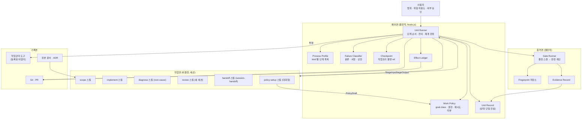
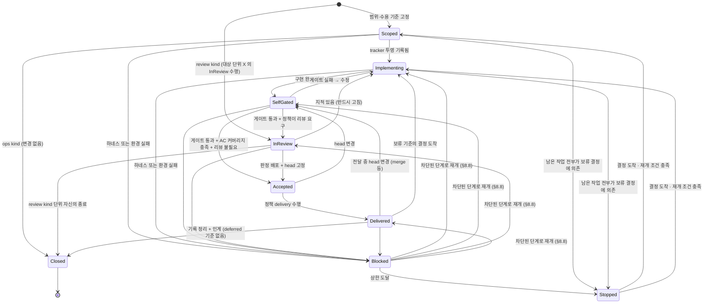
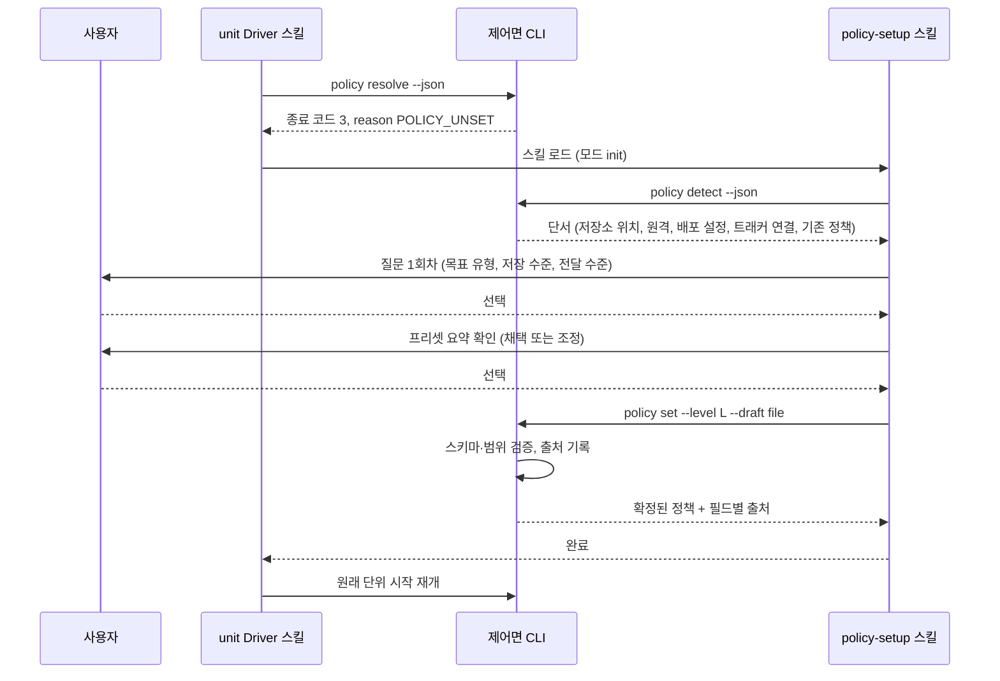

# 개발 프로세스 하네스: TO-BE 스냅샷

이 문서는 하네스의 최종 모습을 현재형으로 정의한다. 현재 구현과의 비교, 진행 상태, 이력은 담지 않는다. 구현 갭은 §12 의 적합성 목록(H-ID)을 기준으로 별도 스캔한 결과에서 도출한다.

## 1. 목적과 범위

하네스는 **개발 작업을 항상 같은 절차와 같은 품질 기준으로 처리**한다. 같은 종류의 작업(`kind`)은 같은 단계, 같은 게이트, 같은 증거 형식, 같은 보고 형식을 거친다. 일관성의 대상은 문서 한 장이 아니라 **작업 단위의 수명주기 전체**다: 범위 확정, 구현, 자체 게이트, 독립 리뷰, 전달(commit·push·PR·merge), 작업관리 기록, 다음 단위 인계.

| 포함                               | 제외                               |
| -------------------------------- | -------------------------------- |
| 작업 단위(Unit) 수명주기와 단계 계약          | 제품 코드의 설계 내용                     |
| 결정 로직(스크립트)과 비결정 로직(스킬·프롬프트)의 경계 | 특정 레포의 빌드·테스트 명령 자체(레포가 계약으로 선언) |
| 실패 분류, 복구, 중단 정책                 | LLM 모델 품질 개선                     |
| 증거·상태·원장의 단일 진실                  | 병렬 단위 간 스케줄링 최적화                 |

## 2. 설계 원칙

| # | 원칙 | 의미 |
|---|---|---|
| P1 | 결정/비결정 분리 | 흐름·상태·게이트·재시도·증거 해시는 스크립트가 소유한다. 생성·판단·진단은 LLM 이 소유한다. 섞지 않는다. |
| P2 | 상태 단일 진실 | 단위의 상태는 Unit Record 하나에 있다. 대화, 작업관리 도구, 화면 문구는 상태의 근거가 아니라 그 투영이다. |
| P3 | 생산자 ≠ 검증자 | 구현 세션은 자기 산출의 수용을 선언하지 않는다. 수용의 근거는 결정적 게이트 증거(수용 기준 커버리지 포함)이고, 정책이 요구하면 독립 리뷰 판정이 더해진다. |
| P4 | 증거 단일 생산 | 게이트 원문(명령·fingerprint·종료 상태·보고서 경로·digest)은 러너가 한 곳에 한 번 만든다. 다른 곳은 경로와 digest 만 참조한다. |
| P5 | 앞으로 고친다(fix-forward) | 실패한 변경을 과거 상태로 되돌려 복구하지 않는다. 원인을 진단해 새 변경으로 고친다. 되돌리기는 사용자가 명시한 경우에만 있다. |
| P6 | 부작용은 원장에 기록하고 멱등으로 만든다 | 작업트리 밖에 영향을 주는 모든 행위는 Effect Ledger 에 남기고, 재실행이 같은 결과를 내도록 확인 후 수행한다. |
| P7 | 실패는 분류하고 서명한다 | 제품·하네스·환경으로 나누고 원인 서명으로 중복과 상한을 센다. 하네스·환경 실패를 제품 진척으로 기록하지 않는다. |
| P8 | 승인 경계는 정책이 정한다 | 허용 범위는 작업 종류(`kind`)가 아니라 **최종 목표의 유형(`goal.class`)** 과 정책 값이 정한다. 하네스는 위임된 범위 안에서 끝까지 진행하고, 사용자만 정할 수 있는 것에서만 멈춘다. |
| P9 | 범위는 정본이 정한다 | 수용 기준은 착수 때 고정한다. 진척은 그 목록 대비로만 보고한다. |
| P10 | 방향이 정해지면 추론으로 결정한다 | 정본의 방향, 수용 기준, 기존 코드 규약으로 선택지가 하나로 좁혀지면 묻지 않고 진행하고 근거를 기록한다. 사용자에게 알리는 것은 추론할 수 없는 실제 이슈뿐이다(§8.10). |

## 3. 구성 요소



| 면 | 소유 | 결정성 |
|---|---|---|
| 제어면 | 단위의 상태, 전이, 재개, 실패 분류, 체크포인트, 부작용 원장 | 결정적. LLM 을 호출하지 않는다 |
| 증거면 | 게이트 실행, fingerprint, 증거 레코드 | 결정적 레인 + 필요한 항목만 판정 레인(LLM) |
| 작업면 | 범위 분석, 구현, 진단, 리뷰, 인계 서술 | 비결정. 스킬(프롬프트·규칙)로 정의한다 |
| 기록면 | 작업관리 도구, 정본, Git | 상태의 투영. 진실은 Unit Record |

## 4. 작업 단위(Unit) 수명주기



Stopped 로의 진입과 복귀는 Scoped·Implementing 과 Blocked 에서만 있다. 보류 기준(`deferred`)만 남은 단위는 SelfGated 이후로도 진행해 Delivered 에 머문다. Delivered 에서 결정이 오면 그 기준을 구현하기 위해 Implementing 으로 돌아가고(아래 규칙 4), 거기서부터 정상 경로를 다시 밟는다.

| 상태 | 진입 조건 | 소유 | 산출물 | 나가는 조건 |
|---|---|---|---|---|
| Scoped | 수용 기준 목록과 정본 경로가 Unit Record 에 고정됨 | scope 스킬 + 사용자 | 수용 기준, `kind`, 정책 해석 결과 | 구현 시작 (`ops` 는 바로 Closed) |
| Implementing | Unit Record 의 `tracker` 에 투영 요청이 기록됨 (실제 도구 반영은 §8.7 Closed 행의 멱등 동기화와 같은 방식으로 뒤따른다) | implement 스킬 | 작업트리 변경 | 구현 완료 선언 |
| SelfGated | 마지막 수정 이후, 또는 Accepted·Delivered 에서 head 변경 | Gate Runner | Evidence Record | 모든 필수 게이트 통과 |
| InReview | 정책이 리뷰를 요구하고 증거가 있음, 새 세션 (`review` kind 단위가 이 단계를 수행한다) | review 스킬 | 리뷰 보고 + 판정 (대상 단위의 `verdict`) | 판정 `배포` 또는 지적 목록 |
| Accepted | 수용 근거(게이트 증거 + AC 커버리지, 또는 리뷰 판정)가 특정 head 에 고정됨 | 제어면 | 수용 레코드 (head sha, `basis`) | 정책의 delivery 수준 실행 |
| Delivered | delivery 수준(none/commit/push/PR/merge)까지 완료 | 제어면 + Git | Effect Ledger 항목 | `deferred` 기준이 없으면 기록 정리, 있으면 결정 도착 시 Implementing |
| Closed | 태스크 terminal, 도구 정리, 인계 또는 종료 보고. `deferred` 기준이 없어야 한다 | 제어면 | 결과 파일 `단위 종료` 줄 | - |
| Blocked | 하네스·환경 실패 분류됨 (Scoped 포함 모든 활동 단계에서) | 제어면 | Failure Record (`blockedStage` 포함) | 해결 조건 충족 → `blockedStage` 로 재개 |
| Stopped | 재시도·해결 세션 상한 도달, 또는 Scoped·Implementing 에서 남은 작업 전부가 보류 결정에 의존 | 제어면 | 중단 보고 (재개 조건 포함) | 재개 조건 충족 → 중단 직전 단계로 |

규칙:
1. 상태 전이는 제어면만 쓴다. 스킬은 전이를 요청하는 StageOutput 만 낸다.
2. `Accepted` 의 근거는 생산자 세션의 자기 선언이 아니라 결정적 게이트 증거와 AC 커버리지(`basis: gates`), 또는 리뷰 세션의 `배포` 판정(`basis: review`)과 head sha 다. head 가 바뀌면 `Accepted` 는 무효가 되고 `SelfGated` 로 돌아간다. Delivered 안에서 merge 등으로 head 가 바뀌어도 같다.
3. 한 세션은 하나의 단위만 다룬다. `Closed` 뒤 다음 단위는 새 세션에서 시작한다.
4. 사용자 결정 대기는 상태가 아니라 **수용 기준 단위의 보류**다. `openDecisions[].blocks` 에 적힌 수용 기준만 보류하고 나머지는 계속한다. Scoped·Implementing 에서 보류되지 않은 작업이 없을 때만 `Stopped` 로 들어간다. SelfGated 이후에는 보류 기준을 남긴 채 Delivered 까지 진행하고 거기 머문다. 결정이 도착하면 Delivered → Implementing 으로 돌아가 그 기준을 구현하고 정상 경로를 다시 밟는다. `Closed` 는 `deferred` 기준이 없어야 열린다(§8.10).
5. `Blocked` 와 `Stopped` 는 재개 지점을 Unit Record 의 `blockedStage` 와 단계 이력에서 읽는다(§8.8). 항상 구현 단계로 돌아가지 않는다.
6. 작업관리 도구는 투영이므로 그 가용성은 전이 조건이 아니다. 투영 요청은 Unit Record 에 기록되고 도구 반영은 멱등 동기화가 뒤따른다. 동기화 실패는 하네스·환경 실패로 `Blocked` 가 된다.

Process Profile(§5.1)은 이 상태 집합의 부분집합을 고른다. `ops` 는 Scoped → Closed 만, `design` 은 Scoped → Implementing(정본 작성) → SelfGated(정합성 검사) → Accepted → Delivered(문서 commit) → Closed 를 거친다. `review` kind 는 **다른 단위 X 의 InReview 단계를 수행하는 세션의 단위**다. 자기 Unit Record 는 `[*] → InReview → Closed` 만 거치고, 산출물(`findings`, `verdict`)은 X 의 Unit Record 에 쓴다. 따라서 `review` 의 `reads` 는 X 의 필드를 가리키며 계약 검사(§7.4)도 X 기준으로 한다.

## 5. Process Profile 과 Work Policy

두 축이 서로 다른 것을 결정한다.

| 축 | 질문 | 결정하는 것 |
|---|---|---|
| `kind` | 이 단위는 어떤 **종류의 작업**인가 | 단계 계획, 필수 게이트 |
| `goal.class` | 이 단위가 속한 **최종 목표**는 무엇인가 | 허용 권한, 리뷰 기본값, 알림 기준 |

### 5.1 Process Profile (kind → 단계 계획)

같은 `kind` 는 항상 같은 계획을 따른다. 리뷰 여부는 kind 가 아니라 §5.4 의 리뷰 정책이 정한다.

| kind | 거치는 상태 | 필수 게이트 |
|---|---|---|
| `ops` | Scoped → Closed (변경 없음) | 없음 |
| `chore` | Scoped → Implementing → SelfGated → (InReview) → Accepted → Delivered → Closed | 변경 범위의 린트·타입, 영향 테스트 + AC 커버리지 |
| `impl` | chore 와 같음 | 타입체크·린트·테스트·빌드 (pre-commit 훅과 같은 범위) + AC 커버리지 |
| `impl-risk` | impl + Implementing 안의 위협·경계 점검 단계 | impl + 보안·결제·권한·정합성 시나리오 테스트 |
| `design` | Scoped → Implementing(정본 작성) → SelfGated(정합성 검사) → Accepted → Delivered → Closed | 문서 정합성 검사 + AC 커버리지 |
| `review` | [*] → InReview → Closed (대상 단위 X 의 InReview 를 수행) | 없음 (X 의 증거를 재사용) |

AC 커버리지는 변경이 있는 모든 kind(`chore`·`impl`·`impl-risk`·`design`)의 필수 게이트다. `ops` 와 `review` 는 변경이 없으므로 제외한다.

게이트 결과는 입력 fingerprint(대상 소스·lockfile·명령·설정·도구 버전의 내용 해시)가 같으면 재사용하고, 하나라도 바뀌면 무효다. fingerprint 를 확인할 수 없으면 재실행한다. 재사용은 통과 증거에만 적용하며, **실패 증거는 같은 fingerprint 라도 재실행한다**. 같은 fingerprint 의 두 실행이 다른 결과를 내면 비결정 게이트로 분류한다(§8.4). 리뷰 세션은 `evidence rerun --gate <id>` 로 통과 증거도 독립 재실행할 수 있고, 그 결과가 다르면 같은 분류를 받는다.

**AC 커버리지**는 수용 기준마다 통과한 검증 증거가 하나 이상 연결됐는지 보는 결정적 게이트다. 연결은 다음 규약으로 만든다.

1. 테스트·검증 코드는 이름이나 주석에 수용 기준 ID 를 적는다(예: 테스트 이름 `AC-2: 자정 마감은 상점 시간대`, 또는 `// covers: AC-2`). 형식은 프로젝트 게이트 설정이 정규식으로 선언한다.
2. 게이트 러너는 실행한 테스트 파일에서 그 패턴을 읽어 Evidence Record 의 `covers` 에 수용 기준 ID 목록을 쓴다. 통과한 증거의 `covers` 합집합이 커버 집합이다.
3. 구현 스킬은 StageOutput 의 `coverage` 에 "어느 기준을 어느 테스트가 덮는다"를 제안할 수 있지만, 집계는 2 의 결과로만 한다.
4. 테스트로 검증할 수 없는 기준(예: 문서 존재, 설정값, 정본 문서의 절 존재)은 `exec` 또는 `module` 게이트가 같은 방식으로 `covers` 를 낸다. 예: `design` 단위의 기준 "AC-1: 상태도에 Blocked 복귀 전이가 있다"는 `module` 게이트 `docs/gates/state-diagram.mjs` 가 mermaid 블록을 파싱해 전이를 확인하고 `{ok: true, covers: ["AC-1"]}` 를 낸다. `chore` 단위의 기준 "AC-1: 린트 경고 0"은 린트 게이트 설정의 `covers: ["AC-1"]` 선언으로 연결한다.
5. 커버되지 않은 기준은 `uncovered` 목록으로 구현 단계에 피드백되어 검증을 추가하게 한다.

### 5.2 Work Policy 필드

정책은 명시 사용자 변경 > 현재 단위 > 프로젝트 > workspace > global 순으로 **필드별** 상속한다. 각 값의 출처 수준을 Unit Record 의 `policySources: {<field>: <level>}` 에 남긴다.

| 필드 | 값 | 기본값 | 설명 |
|---|---|---|---|
| `goal.class` | `task` \| `product-prelaunch` \| `product-live` | 없음 (§5.5 초기 설정; 비대화형만 `task` 를 `unconfirmed-default` 로) | 최종 목표 유형 (§5.3) |
| `goal.defaults` | `[{match, class}]` | 없음 | workspace·global 정책이 기본 유형을 제공하는 데 쓴다. `match` 는 `{cwd: <glob>}` 또는 `{remote: <glob>}` 이며 둘 다 있으면 모두 맞아야 한다. 여러 규칙이 맞으면 먼저 적힌 것이 이긴다 |
| `authority.allow` / `authority.deny` | 부작용 종류 목록 | 없음 | `goal.class` 의 권한을 단위·프로젝트 단위로 조정 |
| `retry.maxPerSignature` | 정수 1–5 | 2 | 같은 원인 서명에 대한 **재시도** 상한. 원 시도는 세지 않는다 (§8.3) |
| `retry.maxResolver` | 정수 1–5 | 2 | 같은 원인에 대한 해결 세션(R) 기동 상한 |
| `review.mode` | `none` \| `conditional` \| `required` | `goal.class` 별 (§5.4) | 독립 리뷰 사용 정책 |
| `review.by` | `session` \| `user` | `session` | 리뷰 주체. 사람 리뷰는 정책이 지정할 때만 |
| `review.triggers` | 목록 | §5.4 | `conditional` 일 때 리뷰를 여는 조건 |
| `delivery` | `none` \| `commit` \| `push` \| `pr` \| `merge` | `none` | 전달 수준 상한. 어느 수준에도 값이 없으면 `none` |
| `checkpoint.retain` | `keep` \| 기간 | `keep` | 체크포인트 ref 보존 (§8.5) |
| `checkpoint.exclude` | glob 목록 | `**/.env*`, `**/*.pem`, `**/*.key`, `**/id_*` | `.gitignore` 에 없어도 체크포인트에 담지 않는 경로 (§8.5) |
| `escalation.canonReviewAt` | 정수 | 5 | 같은 정본(경로 기준) 아래 사용자 알림이 이 수에 이르면 정본 재검토 권고. 정본 내용이 바뀌면 0 으로 돌아간다 (§8.10) |
| `isolation` | `worktree` \| `shared` | `worktree` | 단위가 전용 작업트리를 갖는지. `shared` 면 변경 귀속에 §8.5 의 병행 제외 규칙을 쓴다 |

정책 파일 위치:

| 수준 | 경로 | 소유 |
|---|---|---|
| global | 계정 config 디렉터리의 `work-policy.json` 하나 (예: `$CLAUDE_CONFIG_DIR/work-policy.json`). 하네스 프로필의 계정 레이어가 설치 때 복사한다. 레이어 간 병합은 없다 | 계정 |
| workspace | project 루트에서 상위로 올라가며 처음 만나는 `.local/work-policy.json` 중 `scope: "workspace"` 가 적힌 것. 없으면 workspace 수준은 비어 있다 | workspace |
| project | 현재 작업트리의 Git 최상위(`git rev-parse --show-toplevel`)에 있는 `.local/work-policy.json` (`scope` 가 없거나 `"project"`) | 프로젝트 |
| unit | Unit Record 의 `policyOverrides` | 단위 |

같은 경로에 두 수준이 겹치지 않도록 `scope` 필드가 구분한다. `/a/.local/work-policy.json` (`scope: workspace`) 와 `/a/b/.local/work-policy.json` 이 있고 작업트리가 `/a/b` 이면 전자가 workspace, 후자가 project 다. Git 작업트리 밖에서는 project 수준이 비어 있다.

`unit` Driver 의 정책 오버라이드 인자는 "명시 사용자 변경" 수준으로 Unit Record 의 `policyOverrides` 에 기록되며 그 단위에만 적용된다. 모든 정책 파일은 `policy set` 만 쓴다.

### 5.3 목표 유형과 권한

`goal.class` 는 정책 값에서만 읽는다. 경로·티켓 유무 같은 단서로 하네스가 결정하지 않는다(단서는 §5.5 에서 사용자에게 제안하는 데만 쓴다). 어느 수준에도 값이 없으면 단위를 시작하지 않고 §5.5 정책 초기 설정을 먼저 수행한다. 비대화형 실행에서 설정할 수 없으면 가장 보수적인 `task` 로 간주하고 `source: unconfirmed-default` 로 기록한다. 유형 전환(예: 출시)은 정책 값 변경으로만 일어난다.

| 유형 | 의미 |
|---|---|
| `task` | 외부 요청·티켓이 범위를 정하는 단건 작업. 더 큰 목표의 일부 |
| `product-prelaunch` | 출시 전 완제품 개발. 사용자가 없고 제품의 모든 자원이 개발자 소유 |
| `product-live` | 출시되어 사용자가 있는 제품 |

권한 매트릭스(기본값)는 부작용 등급(§8.1)별로 정의한다. `authority.allow/deny` 와 사용자의 명시 지시가 이 기본값보다 우선한다.

| 등급 | `task` | `product-prelaunch` | `product-live` |
|---|---|---|---|
| E0 읽기·계산 | 허용 | 허용 | 허용 |
| E1 작업트리 변경 | 단위 범위 경로 | 제품 전체 | 단위 범위 경로 |
| E2 로컬 영속 변경 | 단위 범위 경로 | 제품 전체 | 단위 범위 경로 |
| E3 공유·외부 변경 | `delivery` 정책과 명시 지시가 정한 만큼 | 제품 소유 자원 전부 (push·PR·머지·배포·마이그레이션·티켓) | 비운영 변경 허용, 운영 배포·운영 데이터 변경은 사용자 승인 |
| E4 되돌릴 수 없음 | 사용자 승인 | 제품 소유 자원은 허용 | 사용자 승인 |
| E3 보정(compensate) | 정책에 명시된 것만 | 제품 소유 자원은 허용 | 사용자 승인 |

`goal.class` 로 완화되지 않는 불변 조건: ① 대상 제품이 소유하지 않은 자원(타인 저장소, 공유 환경, 제3자 계정)의 변경, ② 비밀의 기록·노출, ③ 계정 규칙이 금지한 명령(과거로 되돌리는 Git 명령, `--no-verify`, 게이트 우회). 이 셋은 해당 규칙을 고치는 방법으로만 바뀐다.

### 5.4 리뷰 정책

독립 리뷰는 **새 LLM 세션**이 diff·증거·인계 파일만 읽고 하는 점검이며, 사람 리뷰가 아니다. 사람 리뷰는 `review.by: user` 를 정책이 지정한 경우에만 있다.

| 유형 | `review.mode` 기본값 | `review.triggers` 기본값 |
|---|---|---|
| `task` | `conditional` | `risk-kind`(`impl-risk`), `out-of-scope`, `unproven-gate` |
| `product-prelaunch` | `none` | (없음) |
| `product-live` | `conditional` | `risk-kind`, `out-of-scope`, `unproven-gate`, `repeated-signature` |

- `none`: 리뷰 단계를 건너뛴다. 수용은 게이트 증거와 AC 커버리지로 한다(`basis: gates`). 세부 리뷰는 열지 않고, 사용자에게 알릴 실제 이슈만 §8.10 으로 올린다.
- `conditional`: 트리거 조건이 하나라도 참일 때만 리뷰를 연다.
- `required`: 항상 연다.
- 트리거 정의: `risk-kind` 는 `kind` 가 `impl-risk`, `out-of-scope` 는 이 단위의 이력에 `scope-guard` Finding 이 하나라도 있었음(해소 여부 무관), `unproven-gate` 는 필수 게이트에 결정적 증거가 없는 항목 존재, `repeated-signature` 는 같은 서명이 재발한 이력 존재. 이력 기반 트리거는 Unit Record 의 `findings`(추가 전용, `resolvedAt` 로 해소 표시)와 `failures` 에서 읽는다.

### 5.5 정책 초기 설정 (policy-setup)

정책이 없는 상태에서는 단위를 시작하지 않는다. 제어면이 부재를 판정하고, 대화형 스킬 `policy-setup` 이 도구(`AskUserQuestion`)로 사용자에게 묻고, 결과는 제어면 CLI 가 검증해 기록한다.



**판정 (결정적)**: `policy resolve` 가 `goal.class` 를 어느 수준(단위·프로젝트·workspace·global)에서도 찾지 못하면 종료 코드 3, `reason: POLICY_UNSET` 으로 끝난다. 다른 필드는 기본값이 있으므로 부재 판정에 쓰지 않는다. 세션 시작 훅은 미설정 상태일 때 한 줄 알림만 주입하고 질문하지 않는다.

**단서 수집 (결정적)**: `policy detect` 는 읽기 전용으로 아래를 모아 JSON 으로 낸다. 단서는 제안의 근거일 뿐 결정이 아니다.

| 단서 | 예 |
|---|---|
| 저장소 위치·원격 | 원격 소유자, 로컬 경로 패턴 |
| 배포 흔적 | 배포 설정 파일, 릴리즈 태그 |
| 트래커 연결 | 활성 작업관리 도구, 외부 티켓 키 패턴 |
| 기존 정책 | 다른 수준에 이미 있는 정책 파일과 그 값 |

**질문 (비결정, 스킬)**: 사용자만 정할 수 있는 것만 묻는다. 한 번에 최대 4개를 묻는다.

| 회차 | 질문 | 선택지 | 비고 |
|---|---|---|---|
| 1 | 이 작업의 최종 목표 유형 | `task` / `product-prelaunch` / `product-live` | 단서로 가장 가능성 높은 안을 권고 표시 |
| 1 | 정책을 어느 수준에 저장할지 | 이 프로젝트만 / workspace 패턴 / global | workspace·global 선택 시 `goal.defaults` 규칙(`match`)을 함께 만든다 |
| 1 | 전달 수준 상한 | `none` / `commit` / `push` / `pr` / `merge` | 유형별 프리셋을 기본으로 제시 |
| 2 | 선택한 유형의 프리셋 요약(권한, 리뷰, 재시도)을 채택할지 | 채택 / 항목 조정 | 조정을 고르면 `review.mode`, `retry.*` 를 이어서 묻는다 |

**기록 (결정적)**: 스킬은 정책 파일을 직접 쓰지 않는다. 답을 `PolicyDraft` JSON 으로 만들어 `policy set` 에 넘기면 제어면이 스키마(필드, 열거값, 범위 1–5), 저장 수준, 충돌을 검증하고 `confirmedBy: user`, `confirmedAt`, 출처 수준을 붙여 기록한다.

**재진입**: `policy-setup` 은 세 모드로 열린다. `init`(정책 부재 시 자동), `change`(예: 출시 전 → 출시 후 전환 요청), `show`(해석 결과와 필드별 출처 표시). 모든 변경은 사용자 요청이 있을 때만 쓴다.

**비대화형**: 사용자에게 물을 수 없는 실행(헤드리스, 자동 인수된 하위 세션)은 질문하지 않는다. 상위 수준 정책이 있으면 상속하고, 없으면 `task` 프리셋을 `unconfirmed-default` 로 적용한다. 이 값으로는 §5.3 `task` 열이 허용하는 범위만 수행하고, 다음 대화형 세션에서 `policy-setup` 이 확정을 요청한다.

## 6. 결정/비결정 책임 분할

| 책임 | 소유 | 형태 |
|---|---|---|
| 단계 순서, 상태 전이, 재개 지점 | 제어면 | 스크립트 |
| kind → 단계 계획, 정책 상속 해석 | 제어면 | 스크립트 + 데이터 |
| 게이트 실행, fingerprint, 증거 레코드 | 증거면 | 스크립트 (판정 필요 항목만 판정 레인) |
| 실패 분류, 서명, 상한, 중복 검사 | 제어면 | 스크립트 |
| 체크포인트, 변경 범위 가드 | 제어면 | 스크립트 (작업트리·인덱스를 바꾸지 않는 Git 연산) |
| Effect Ledger 기록, 멱등 확인 | 제어면 | 스크립트 |
| 작업관리·정본에 대한 투영 | 제어면 | 스크립트 |
| 목표 유형별 권한 판정, 리뷰 정책 해석, 재시도 상한 | 제어면 | 스크립트 + 정책 데이터 |
| AC 커버리지 계산 | 증거면 | 스크립트 |
| 수용 기준 분석, 범위 초안 | LLM | scope 스킬 |
| 코드 작성·수정 | LLM | implement 스킬 + 상주 규칙 |
| 원인 진단, 수정안 | LLM | diagnose 스킬 |
| 리뷰, 판정 서술 | LLM | review 스킬 |
| 인계 요약, 결과 서술 | LLM | 스키마가 있는 필드 + 짧은 서술 |
| 추론 가능한 방향·기술 결정 | LLM + 기록 | `assumptions` 에 근거와 함께 기록 (§8.10) |
| 추론할 수 없는 범위·위험·외부 승인 결정 | 사용자 | 알림 |

LLM 이 제어면의 결정을 우회하지 못하도록 두 가지를 둔다: ① 단계 산출물은 스키마가 있는 StageOutput 으로만 받는다. ② 전이·상태·원장·증거 파일은 스킬이 아닌 제어면 CLI 만 쓴다.

단계 입출력의 통로:

| 방향 | 명령 | 동작 |
|---|---|---|
| 제어면 → 스킬 | `unit stage open <unit> <stage>` | StageInput 을 `.local/units/<unit>/stages/<stage>.<attempt>.input.json` 에 쓰고 경로를 출력한다. 세션에는 이 경로와 Stage 스킬 이름만 전달한다 |
| 스킬 → 제어면 | `unit stage submit <unit> <stage> --output <file>` | 스킬이 작성한 StageOutput 파일을 스키마 검증 후 Unit Record 에 반영하고 전이를 판정한다. 검증 실패는 종료 코드 2 와 위반 경로 목록 |
| 스킬 → 제어면 (단계 중) | `unit effect <unit> --class E2\|E3 --effect <종류> --key <k=v …> [--done --result <json>]` | Implementing 안에서 스킬이 E2 이상 부작용(의존성 설치, 생성기 실행, 로컬 DB 변경)을 수행하기 **전에** 의도를, 수행 **후에** 결과를 원장에 적는다. 권한 매트릭스(§5.3)가 거부하면 종료 코드 3 이고 스킬은 수행하지 않는다 |
| 사람 → 제어면 | `unit stage submit <unit> InReview --output <file> --by user` | `review.by: user` 일 때 사람이 작성한 판정 파일(같은 StageOutput 스키마, `verdict` 필수)을 들여보낸다 |

스킬은 `.input.json` 을 읽고 자기 출력 파일을 쓸 뿐, `unit.json`·원장·증거 파일을 직접 열지 않는다. 원장 기록은 `unit effect` 를 통해서만 한다.

## 7. 스킬 구성과 계약

### 7.1 스킬 종류

| 종류 | 정의 | 본문 | 호출 주체 |
|---|---|---|---|
| Driver 스킬 | 제어면 CLI 를 호출하고 출력을 그대로 보여준다 | 명령 한 줄, 가공 금지 | 사용자 또는 상위 스킬 |
| Stage 스킬 | 한 단계의 LLM 작업을 정의한다 | 역할, 입력 계약, 출력 계약, 금지 사항 | 제어면이 세션에 주입 |
| Interactive 스킬 | 사용자에게 도구로 질문해 결정을 모으고 초안을 낸다. 기록은 제어면 CLI 가 한다 | 질문 목록, 선택지, 초안 스키마 | Driver 스킬이 제어면의 차단 사유를 받아 로드 |
| 원칙 스킬 | 사람이 읽는 절차·원칙 | 규칙 | 필요할 때 로드 |

### 7.2 단계 스킬 목록

| 스킬 | 종류 | 단계 | 입력 | 출력 |
|---|---|---|---|---|
| `unit` | Driver | 전체 | `kind`, 정본 경로, 정책 오버라이드(단위 한정 "명시 사용자 변경") | 단위 시작·재개·상태 조회 결과 |
| `policy-setup` | Interactive | 단위 시작 전 | `policy detect` 결과, 모드(`init`·`change`·`show`) | `PolicyDraft` (`policy set` 이 검증·기록) |
| `scope` | Stage | Scoped | 요청, 정본 | 수용 기준 목록, 열린 결정 목록 |
| `implement` | Stage | Implementing | 수용 기준, 변경 허용 경로 | 변경 요약, 자체 점검 메모 |
| `root-cause` | Stage | 실패 진단 | Failure Record | 서면 진단 (증상·인과 사슬·분류·수정안) |
| `review` | Stage | InReview | 인계 파일, diff, 증거 경로 | 지적 목록 + 판정 + head sha |
| `session-handoff` / `work-session` | Driver | Closed | 승인된 다음 단위 | 인수·착수·부모 종료 증거 |
| `gate-run` | Driver | SelfGated | 게이트 구성 | Evidence Record |
| `work-tracking`, `harness-building` | 원칙 | 전체 | - | - |

### 7.3 단계 계약 (공통 봉투)

모든 Stage 스킬은 같은 봉투로 입출력한다. 봉투는 JSON 스키마로 고정되고 제어면이 검증한다.

**StageInput**

| 필드 | 설명 |
|---|---|
| `unit` | 단위 ID |
| `stage` | 단계 이름 |
| `attempt` | 이 단계의 시도 번호 |
| `acceptance` | 수용 기준 목록 (ID 포함) |
| `scopePaths` | 변경 허용 경로 |
| `canon` | 읽을 정본·ADR 경로 |
| `feedback` | 이전 시도의 Finding 목록 (없으면 빈 배열) |
| `evidence` | 참조할 Evidence Record 경로·digest |
| `policy` | 해석된 Work Policy 요약 (`goal.class`, `review`, `delivery`, `retry`) |
| `assumptions` | 이전 단계까지 기록된 추론 결정 |

**StageOutput**

| 필드 | 타입 | 규칙 |
|---|---|---|
| `status` | `done` \| `blocked` \| `needs-decision` \| `needs-diagnosis` | 전이 요청. 전이 자체는 제어면이 결정한다. `done` 은 `openDecisions` 가 있어도 쓸 수 있다(비차단). `needs-decision` 은 이 단계가 그 결정 없이는 끝날 수 없을 때만 쓴다. `needs-diagnosis` 는 첫 실패라도 원인이 자명하지 않아 `root-cause` 를 먼저 요청할 때 쓴다 |
| `summary` | string | 3문장 이내 |
| `changedPaths` | string[] | 제어면이 Git 으로 교차 확인한다 |
| `coverage` | `[{acceptanceRef, evidenceHint}]` | 구현 스킬이 제안하는 기준↔검증 연결. 집계는 게이트가 한다(§5.1) |
| `findings` | Finding[] | 리뷰·진단 단계의 지적 |
| `assumptions` | object[] | 추론으로 정한 결정. `decision`, `basis`, `reversible` |
| `openDecisions` | `[{id, question, options, blocks: [AC-id]}]` | 추론할 수 없어 사용자에게 알릴 항목. `blocks` 에 적힌 수용 기준만 보류된다 (§8.10) |
| `blocker` | object \| null | 있으면 `class`, `site`, `message` |

**Finding**

```json
{
  "id": "R-3",
  "kind": "review | diagnosis | scope-guard | coverage | shared-path",
  "severity": "must-fix | should-fix | nice",
  "site": "src/billing/close_day.ts:40-52",
  "claim": "자정 마감이 UTC 날짜를 쓴다",
  "case": "베를린 00:30 주문이 전날로 청구된다",
  "fix": "상점 시간대로 날짜를 한 번 계산한다",
  "acceptanceRef": "AC-2",
  "classification": "product | harness | environment | user-domain",
  "resolvedAt": null
}
```
지적마다 `case`(구체적 사례)가 필수다. 사례 없는 지적은 제어면이 거부한다. 제어면이 만드는 Finding 의 등급은 고정이다: `scope-guard`(범위 이탈)·`coverage`(미커버 기준)·`shared-path`(병행 단위와 같은 경로)는 `must-fix` 다. `classification` 은 `diagnosis` Finding 에서만 쓰며, 제어면이 "불명"으로 분류한 실패를 `root-cause` 가 확정해 돌려주는 통로다. 제어면은 이 값을 입력으로 Failure Record 의 `class` 를 확정하고, 그 뒤 재시도·해결 세션·보고 중 하나를 고른다. Finding 은 추가 전용이고 해소는 `resolvedAt` 로 표시한다.

### 7.4 스킬 간 연결 규칙

1. 단계 간 데이터는 StageOutput → Unit Record → 다음 StageInput 으로만 흐른다. 스킬이 다른 스킬의 출력을 직접 읽지 않는다.
2. 한 단계의 `reads` 는 그 단계 이전에 쓰인 `writes` 합집합(제어면·증거면이 쓰는 필드 포함)에 포함돼야 한다. 계약 파일(`contract.json`)로 선언하고 시작 시 제어면이 검증한다. `reads`/`writes` 의 어휘는 **Unit Record 의 필드 이름**이다. 제어면과 증거면의 `writes` 는 하네스 자체의 계약 파일에 선언되어 검사 합집합의 출발점이 된다.

   | 작성자 | 쓰는 시점 | writes |
   |---|---|---|
   | 제어면 (단위 생성) | Scoped 진입 전 | `unit`, `kind`, `goal`, `policy`, `policySources`, `canon`, `tracker`, `isolation` |
   | 제어면 (매 단계) | 단계 시작·종료 | `state`, `blockedStage`, `stages`, `feedback`(직전 Finding 목록), `failures`, `accepted`, `next` |
   | 증거면 | SelfGated | `evidence`, `acceptance[].status`(`covered`) |
   | 제어면 (결정 처리) | 알림·결정 도착 | `acceptance[].status`(`deferred`·`dropped`), `openDecisions[].answer` |

   | 단계 | reads | writes |
   |---|---|---|
   | scope | `canon`, `policy` | `acceptance`, `assumptions`, `openDecisions` |
   | implement | `acceptance`, `canon`, `feedback`, `assumptions` | `changedPaths`(제어면이 교차 확인), `coverage`, `assumptions`, `openDecisions` |
   | root-cause | `failures`, `evidence`, `changedPaths` | `findings`, `assumptions` |
   | review | `acceptance`, `changedPaths`, `evidence`, `assumptions` | `findings`, `verdict` |

   검사 예: `scope` 의 `reads: canon, policy` 는 "제어면(단위 생성)"의 `writes` 에 있으므로 통과한다. `review` 가 `reads: coverage` 를 선언하면 `implement` 의 `writes` 에 있어 통과하지만, `reads: verdict` 를 선언하면 어떤 선행 작성자도 쓰지 않아 종료 코드 2 다.
3. 리뷰 스킬은 구현 대화를 읽지 않는다. 인계 파일, diff, 증거 경로만 입력이다.

## 8. 실패 처리 정책

### 8.1 개발 작업에서 "되돌리기"를 쓰지 않는 이유

작업 단위의 부작용은 파일 한 장이 아니다. 실패 시 복구 방식은 부작용의 종류가 정한다.

| 등급 | 부작용 | 예 | 복구 방식 |
|---|---|---|---|
| E0 | 읽기, 계산 | 조회, 테스트 실행 | 재실행 |
| E1 | 작업트리 변경 (미커밋) | 구현 중 편집 | 앞으로 고침. 체크포인트는 읽기 전용 참조 |
| E2 | 로컬 영속 변경 | 커밋, 의존성 설치, 생성 파일, 로컬 DB | 새 변경으로 고침. 과거로 되돌리는 명령은 사용자가 `git` 을 명시한 경우만 |
| E3 | 공유·외부 변경 | push, PR, 티켓 상태, 알림, 배포, 마이그레이션 | 멱등 확인 후 보정 변경. 보정 가능 여부는 §5.3 권한 매트릭스 |
| E4 | 되돌릴 수 없음 | 데이터 삭제, 비밀 노출, 운영 변경 | 수행 가능 여부는 §5.3 권한 매트릭스. 수행 전 원장에 의도 기록, 자동 재시도 없음 |

백업 파일 복원은 E1 의 일부에만 맞고, 다른 작업자의 변경이 같은 작업트리에 있을 수 있어 비파괴 원칙과도 충돌한다. 그래서 하네스의 기본 복구 방식은 복원이 아니라 **진단 → 앞으로 고침 → 재검증**이다.

### 8.2 실패 분류

| 분류 | 정의 | 예 | 기본 처리 |
|---|---|---|---|
| 제품 | 수용 기준 미충족 | 테스트 실패, 타입 오류, 리뷰 must-fix | 같은 단위에서 수정 |
| 하네스 | 러너·게이트·작업관리 도구·세션 제어·인계 결함 | 게이트 오분류, 세션 인수 실패, 도구 차단 오작동 | 해결 세션(R)으로 수리 후 같은 세션 재개 |
| 환경 | 디스크·네트워크·인증·외부 서비스 | 의존성 서버 장애, 토큰 만료 | 환경 복구 후 재개. 인증·한도는 사용자 |
| 사용자 영역 | 제품 의미·UX·가격·위험·외부 정책·권한 | 범위 모호, 승인 대기 | 알림 한 번(비차단). 의존하는 수용 기준만 보류하고 나머지는 계속 (§8.10) |
| 불명 | 분류 근거 부족 | 재현 안 됨 | 진단 단계로 보내 분류부터 확정 |

하네스·환경 실패를 제품 결함이나 제품 진척으로 기록하지 않는다.

### 8.3 원인 서명과 상한

- 서명 = 분류 + 실패 지점(file:line 또는 명령) + 정규화한 오류 요지. 태스크 이름·ID 는 넣지 않는다.
- 같은 서명의 **재시도**는 태스크·방법 이름을 가로질러 `retry.maxPerSignature`(기본 2, 범위 1–5)회까지다. 원 시도는 세지 않는다. 서명의 n 번째 발생은 "재시도 n−1 회를 소진한 상태"다.
  - 1 번째 발생: Finding 피드백으로 재시도 1.
  - 2 번째 발생(재발): `root-cause` 진단 후 재시도 2.
  - 상한+1 번째 발생: 상한 도달, 중단 보고. 기본값 2 에서는 3 번째 발생이다.
  - `maxPerSignature: 1` 이면 2 번째 발생이 곧 상한이라 진단 단계 없이 보고한다.
- 상한에 이르면 그 서명에 의존하는 작업을 멈추고 서명·재현·진단을 한 번 보고한다. 독립 작업은 계속한다.
- 첫 발생이라도 구현 스킬이 `needs-diagnosis` 를 내면 재시도 전에 `root-cause` 를 먼저 한다. 그 진단은 재시도 횟수를 쓰지 않는다.
- 해결 세션(R)은 깊이 1, 동일 원인 중복 기동 금지, 최대 `retry.maxResolver`(기본 2, 범위 1–5)회다.
- 두 상한은 Work Policy 의 일반 상속 순서로 바꾼다. 상한을 올려도 서명 단위 집계와 중복 기동 금지는 유지된다.

### 8.4 복구 사다리 (제품 실패)


- 원인이 자명하지 않거나 여러 모듈에 걸치면 수정 전에 `root-cause` 서면 진단을 쓴다. 구현 스킬은 이를 StageOutput `status: needs-diagnosis` 로 요청한다. 임시 우회는 사용자가 hotfix 를 명시했거나 운영 장애가 진행 중일 때만 쓴다.
- 반복 중에는 다음 결정에 필요한 가장 좁은 검사만 한다. 전체 게이트는 마지막 수정 뒤 한 번, pre-commit 훅과 같은 범위로 실행한다.
- 같은 fingerprint 에서 게이트 결과가 다르면 비결정 게이트다. 그 결과를 증거로 쓰지 않고 하네스 결함으로 등록한다. 비교 기회는 두 곳에서 생긴다: ① 실패 증거는 재사용하지 않고 재실행하므로 "실패 → 같은 fingerprint 로 통과"가 관측되고, ② 리뷰 세션의 `evidence rerun` 이 통과 증거를 독립 재실행한다(§5.1). 비결정으로 분류된 게이트의 통과 증거는 AC 커버리지와 `Accepted` 근거에서 제외된다.

### 8.5 체크포인트: 복원이 아니라 참조

단계 시작 전에 제어면이 작업트리의 읽기 전용 체크포인트를 만든다. (이 문서 전체를 가리키는 "TO-BE 스냅샷"과 무관한, 하네스의 실행 기능이다.)

- 방식: 임시 인덱스에 추적·미추적 파일을 담아 트리 객체와 커밋 객체를 만들고 `refs/harness/<unit>/<stage>.<attempt>` 에 기록한다. `.gitignore` 대상과 `checkpoint.exclude`(비밀 파일 패턴, §5.2)는 담지 않는다. 작업트리와 실제 인덱스는 바꾸지 않는다. `.git` 에 객체와 ref 를 쓰는 연산이므로 "읽기 전용"은 작업트리·인덱스 기준이다.
- 용도:
  1. **변경 귀속**: 시도별 diff(`stages[].attempts[].changedPaths`) = 그 시도의 체크포인트 대비 시도 종료 시점의 작업트리 diff. 단위의 `changedPaths` = **단위 첫 체크포인트** 대비 현재 작업트리 diff 이며, 리뷰와 범위 가드는 이것을 쓴다. 시도 1 이 `a.ts`·`b.ts` 를, 시도 2 가 `a.ts` 만 바꿨으면 단위 `changedPaths` 는 `[a.ts, b.ts]` 다. 시도 1 에서 범위를 벗어났다가 시도 2 에서 원래대로 되돌린 경로는 첫 체크포인트와 같아져 diff 에서 빠지므로 다시 이탈로 보지 않는다. `isolation: worktree`(기본)에서는 그대로 쓴다. `isolation: shared` 에서는 같은 작업트리에서 활성 상태인 다른 단위의 `changedPaths` 와 그 단위들의 체크포인트 간 diff 를 뺀 나머지만 이 단위의 변경으로 본다. 두 단위가 같은 경로를 바꿨으면 귀속하지 않고 `shared-path` Finding 으로 양쪽에 알린다.
  2. **범위 가드**: 바뀐 경로가 `scopePaths` 밖이면 Finding(`out-of-scope`)을 만들고 앞으로 고치게 한다. 자동으로 되돌리지 않는다.
  3. **읽기 참조**: 이전 상태가 필요하면 `git show <ref>:<path>` 로 읽고 현재 트리를 고친다.
  4. **리뷰 입력**: 리뷰 세션이 단계별 diff 를 본다.
- 복원 명령(`git reset`, `git checkout <ref> -- <path>`, `git restore --source`)은 제어면이 실행하지 않는다. 사용자가 "git"을 명시한 경우에 한해 사용자 지시로만 쓴다.
- 다른 작업자의 변경은 되돌리지 않는다.
- 체크포인트 ref 는 하네스가 지우지 않는다(`checkpoint.retain` 기본 `keep`). 정리는 별도의 정리 작업이 정책으로 수행한다. 원격에는 push 하지 않는다.

### 8.6 Effect Ledger

E2 이상의 부작용은 수행 전에 의도를, 수행 후 결과를 원장에 기록한다. 원장은 단위별 `.local/units/<unit>/ledger.ndjson` 이며 추가 전용이다. `key` 는 `effect` 종류별로 정해진 필드를 `k=v` 로 공백 구분해 정렬한 문자열이다(예: `pr.create` 는 `repo`, `head`, `base`).

```json
{
  "unit": "UNIT-…",
  "seq": 7,
  "class": "E3",
  "effect": "pr.create",
  "key": "repo=org/app head=feat/x base=main",
  "intent_at": "2026-10-28T10:02:11Z",
  "result": { "pr": 412, "url": "…" },
  "done_at": "2026-10-28T10:02:14Z",
  "verify": "gh pr view 412 --json state,headRefOid"
}
```

- 멱등 규칙: 수행 전에 `key` 로 원장과 원격 상태를 확인한다. 이미 있으면 새로 만들지 않고 결과를 연결한다.
- `intent` 만 있고 `result` 가 없는 항목은 불확실(uncertain)이다. 재시도하지 않고 `verify` 로 실제 상태를 조사한 뒤 원장을 확정한다. 중복 기동을 만들지 않는다.
- 보정이 필요한 E3 는 원장의 `compensate` 정의가 있고 §5.3 권한 매트릭스가 허용할 때만 제어면이 수행한다. 허용되지 않으면 사용자에게 보고한다.

### 8.7 단계별 실패 정책

| 단계 | 실패 | 분류 | 처리 | 상한 후 |
|---|---|---|---|---|
| Scoped | 일부 수용 기준을 확정할 수 없음 | 사용자 영역 | `openDecisions` 로 알리고 그 기준만 보류. 확정된 기준으로 진행 | 전부 보류면 Stopped |
| Scoped | 정본과 코드 모순 | 사용자 영역(정본 오류 가능) | 모순 목록을 `openDecisions` 하나로 알림. 정본을 코드에 맞춰 낮추지 않음. 모순과 무관한 기준은 진행 | 전부 보류면 Stopped |
| Implementing | 변경 범위 이탈 | 제품 | Finding 후 수정 | 재발 시 `design` 세션 |
| Implementing | 작업관리 게이트 차단 | 하네스 가능 | 차단 원문 보고, 우회·disable 금지, 읽기 전용 명령 차단이면 분류기 결함 등록 | 중단 |
| SelfGated | 테스트·타입·린트·빌드 실패 | 제품 | §8.4 사다리 | 상한 도달 시 보고 |
| SelfGated | AC 커버리지 미충족 | 제품 | 검증 추가를 구현 단계에 피드백 | 재발 시 진단 |
| SelfGated | 게이트 러너 오류, 판정 대기 미해결 | 하네스 | 통과 아님. 해결 세션 | R 상한 후 보고 |
| SelfGated | 디스크·네트워크·의존성 서버 | 환경 | 환경 복구 후 해당 게이트만 재실행 | 보고 |
| InReview (정책이 리뷰를 연 경우) | must-fix 지적 | 제품 | Implementing 으로, 지적 ID 별 수정 후 재리뷰 | 상한 도달 시 보고 |
| InReview (정책이 리뷰를 연 경우) | 리뷰 세션 인수 실패·중단 | 하네스 | 기존 대상 조사 후 같은 단위로 재기동 (중복 금지) | R 상한 후 보고 |
| Accepted | head 변경 | 제품 | Accepted 무효, SelfGated 로 | - |
| Delivered | commit 훅 실패 | 제품/하네스 | 훅 원인 수정 후 새 커밋. `--no-verify` 금지 | 재발 시 진단 |
| Delivered | push 거부(원격 앞섬) | 정상 동시성 (실패 아님) | 원격 반영분을 merge → head 변경 → SelfGated → (정책에 따라 InReview) → Accepted → push. force push 는 §5.3 매트릭스의 E3 로 판정 | - |
| Delivered | PR 생성 중 응답 불명 | uncertain | 원장 조회로 확정, 중복 생성 금지 | 보고 |
| Delivered | 머지 충돌 | 제품 | merge commit 으로 해소 → head 변경 → SelfGated 부터 재수용 → merge | 재발 시 진단 |
| Closed | 작업관리 기록 불일치 | 하네스 | Unit Record 기준으로 멱등 동기화 | 보고 |
| 모든 단계 | 인증·한도·권한 | 사용자 영역 | R 을 만들지 않고 보고 | 중단 |
| 모든 단계 | 작업관리 도구 동기화 실패 (데몬 중단 등) | 하네스/환경 | Blocked. 투영 요청은 Unit Record 에 남아 있으므로 복구 뒤 멱등 동기화 | R 상한 후 보고 |

실패가 아닌 **재개 사건**: 세션 종료·자동 컨텍스트 압축·사용자 `/clear` 는 실패로 분류하지 않고 서명·상한·해결 세션의 대상이 아니다. `00-economy.md` §6 의 단위 경계이며, 새 세션이 §8.8 로 Unit Record 와 원장에서 같은 지점을 재개한다. 대화에서 복원하지 않는다.

### 8.8 재개 판정

중단 뒤 재개 지점은 아래 순서의 사실에서만 결정한다. 대화 기록과 화면 문구는 근거가 아니다.

1. Unit Record 의 상태, `blockedStage`, 단계 시도 이력
2. Effect Ledger (불확실 항목은 먼저 확정)
3. Git 상태 (HEAD, 체크포인트 ref, 작업트리 diff)
4. 마지막 Evidence Record 의 fingerprint 와 현재 입력 fingerprint 비교
5. 작업관리 도구 (투영이므로 불일치하면 갱신 대상)

fingerprint 가 달라진 증거는 무효이고 해당 게이트부터 다시 실행한다. 재개 단계는 `blockedStage`(Blocked) 또는 중단 직전 단계(Stopped)이며, 항상 구현 단계로 돌아가지 않는다.

### 8.9 중단 보고

중단은 아래 조건에서만 한다: 전체 목표 완료, 정본 밖 실제 외부 입력, 사용자 일시중지, 크레딧·한도·권한·인증·외부 승인, 같은 서명의 상한 도달, 남은 작업 전부가 보류 결정에 의존. 보고는 한 번이고 아래를 담는다.

| 항목 | 내용 |
|---|---|
| 서명 | 분류 + 실패 지점 + 요지 |
| 재현 | 명령 또는 절차 |
| 진단 | `root-cause` 결과 요약과 경로 |
| 시도 이력 | 시도별 변경과 결과 |
| 재개 조건 | 객관적으로 검사 가능한 조건 |
| 다음 소유자 | 사용자 또는 해결 세션 |

결과 파일의 마지막 줄은 다음 셋 중 하나다. `work-session` 스킬의 child 계약과 같은 어휘다.

| 상황 | 마지막 줄 |
|---|---|
| 단위 완료, 승인된 다음 단위 있음 | `단위 종료 — 인계: <경로> · 다음: <단위>` |
| 단위 완료, 전체 목표 완료 | `단위 종료 — 완료` |
| Blocked·Stopped 로 멈춤 | `단위 종료 — 중단: <분류> · 재개: <객관 조건>` |

### 8.10 사용자 알림과 추론 결정

제품의 방향과 수용 기준이 정본에 정해져 있으면 하네스는 질문하지 않고 추론으로 결정해 진행한다.

**추론 가능**: 정본의 방향, 수용 기준, 기존 코드 규약, 명명된 설계 원칙으로 선택지를 소거해 하나가 남는 경우, 또는 남은 선택지가 제품 의미·UX·가격·위험 허용도에 영향이 없는 기술적 동등안인 경우(가장 작은 변경을 택한다). 결정은 `assumptions[]` 에 `{decision, basis, reversible}` 로 기록하고 계속한다.

**사용자 알림 대상**(`openDecisions`): 
1. 소거 후에도 둘 이상이 남고 제품 의미·UX·가격·위험 허용도에 영향이 있는 결정
2. `goal.class` 권한상 승인이 필요한 부작용 (§5.3)
3. 정본 간 또는 정본과 코드 사이의 실제 모순
4. 인증·한도·외부 승인
5. 같은 서명의 재시도 상한 도달 (§8.9)

알림은 한 번이고 비차단이다. `openDecisions[].blocks` 에 적힌 수용 기준만 보류하고 그 밖의 작업은 계속한다. 보류된 기준은 수용 판정에서 `deferred` 로 집계되어, 단위는 나머지 기준으로 Accepted 까지 갈 수 있되 Closed 는 보류가 해소되거나 사용자가 그 기준을 범위에서 뺄 때까지 열리지 않는다. 보류되지 않은 작업이 없으면 Stopped 로 들어가고(§4 규칙 4), 결정이 도착하면 중단 직전 단계에서 재개한다.

**정본 재검토 신호**: 같은 정본(경로 기준) 아래 사용자 알림의 누적 수가 `escalation.canonReviewAt`(기본 5)에 이르면, 하네스는 알림을 더 올리는 대신 "정본이 이 영역의 결정을 담지 못한다"는 보고를 한 번 하고 정본 보완 단위를 제안한다. 이 보고는 위 5종 알림과 별개의 산출물이며 알림 수에 세지 않는다. 정본 내용(해시)이 바뀌면 그 경로의 누적은 0 으로 돌아간다. 알림은 `.local/escalations.ndjson` 에 추가 전용으로 기록한다.

## 9. 데이터 모델

### 9.1 Unit Record (상태 단일 진실)

```json
{
  "schema": "harness.unit/1",
  "unit": "UNIT-…",
  "kind": "impl",
  "goal": { "class": "product-prelaunch", "source": "project" },
  "state": "SelfGated",
  "blockedStage": null,
  "isolation": "worktree",
  "policyRef": ".local/work-policy.json#sha256:…",
  "policyOverrides": {},
  "policySources": { "goal.class": "project", "delivery": "workspace", "retry.maxPerSignature": "default" },
  "canon": ["docs/spec.md@sha256:…"],
  "acceptance": [{ "id": "AC-1", "text": "…", "status": "open | covered | deferred | dropped" }],
  "stages": [
    { "name": "implement", "attempts": [
        { "n": 1, "checkpoint": "refs/harness/UNIT/implement.1", "result": "done",
          "changedPaths": ["src/a.ts", "src/b.ts"], "startedAt": "…", "endedAt": "…" } ] }
  ],
  "changedPaths": ["src/a.ts", "src/b.ts"],
  "coverage": [{ "acceptanceRef": "AC-1", "evidenceHint": "test/a.test.ts" }],
  "evidence": [{ "gate": "test", "fingerprint": "sha256:…", "path": "…", "digest": "…", "exit": 0, "covers": ["AC-1"] }],
  "findings": [{ "id": "G-1", "kind": "scope-guard", "severity": "must-fix", "resolvedAt": "…" }],
  "verdict": null,
  "accepted": { "head": "abc123", "basis": "gates | review", "verdictBy": null },
  "assumptions": [{ "decision": "…", "basis": "AC-2, 기존 모듈 규약", "reversible": true }],
  "openDecisions": [{ "id": "OD-1", "question": "…", "options": ["…"], "blocks": ["AC-3"], "notifiedAt": "…", "answer": null }],
  "failures": [{ "signature": "product|src/a.ts:12|TypeError x", "count": 1 }],
  "tracker": { "adapter": "<등록된 작업관리 어댑터 ID>", "ref": "<어댑터가 정한 태스크 참조>", "projected": true },
  "next": { "unit": null, "handoff": null }
}
```

`goal.source` 와 `policySources` 의 값은 `unit` | `project` | `workspace` | `global` | `user` | `default` | `unconfirmed-default` 중 하나다. `tracker.adapter` 는 §11 `adapters` 에 등록된 작업관리 어댑터의 ID 이고, 하네스 코어는 특정 도구 이름을 알지 못한다. `tracker.projected` 는 마지막 동기화가 성공했는지이며 false 면 Blocked 사유가 된다. `acceptance[].status` 는 게이트가 `covered`, 보류 결정이 `deferred`, 사용자가 범위에서 빼면 `dropped` 로 바꾼다. 위치는 단위별 `.local/units/<unit>/unit.json` 이고, 원자적 갱신(임시 파일 후 교체)만 허용한다. 작업관리 도구의 태스크, 대화, 인계 파일은 이 레코드의 투영이거나 입력이다.

### 9.2 Evidence Record (러너가 한 번 생성)

| 필드 | 설명 |
|---|---|
| `gate` | 게이트 ID |
| `command`, `cwd` | 실행 계약 |
| `fingerprint` | 입력 내용 해시 (소스·lockfile·명령·설정·도구 버전) |
| `exit` | 종료 상태 (0 통과, 1 실패, 3 차단, 20 판정 필요, 2 사용법) |
| `report` | 원문 보고서 경로 |
| `digest` | 보고서 해시 |
| `judge` | 판정 레인을 거쳤다면 요청·답변 경로 |
| `covers` | 이 증거가 덮는 수용 기준 ID 목록. 러너가 §5.1 규약으로 추출한다 |

판정 대기가 남은 증거는 통과가 아니다. AC 커버리지 = 통과(`exit: 0`)한 증거의 `covers` 합집합.

### 9.3 Failure Record

```json
{
  "unit": "UNIT-…", "stage": "SelfGated", "attempt": 2,
  "blockedStage": "SelfGated",
  "class": "product",
  "signature": "product|src/a.ts:12|TypeError: x is undefined",
  "evidence": "…/test.report",
  "findings": ["F-1"],
  "decision": "retry | diagnose | resolver | stop",
  "reason": "서명 2회째, 진단 단계로"
}
```

## 10. 결과 출력과 보고 형식

| 산출물 | 형식 | 소비자 |
|---|---|---|
| 단위 결과 파일 `.local/handoff/<slug>-result.md` | 30줄 이내, 마지막 줄은 §8.9 의 세 형식 중 하나 | 다음 세션, 디스패처 |
| 인계 파일 | 목표·수용 기준·작업관리·결정·변경·검증·남은 일·다음 첫 행동 | 새 세션 |
| 리뷰 보고 | `이 변경이 하는 일` → 반드시 고침 / 고치는 게 좋음 / 있으면 좋음 → `판정` → `군살` → `확인 못 함` | 사용자, 제어면 |
| 완료 보고 | 바꾼 것, 실행한 검증과 결과, 마지막 한두 줄에 하지 않은 것·위험 | 사용자 |
| 진척 보고 | 착수 때 고정한 수용 기준 대비 | 사용자 |
| 제어면 CLI 종료 코드 | 0 성공, 1 단계 실패, 2 사용법·계약 오류, 3 차단(결론 불가), 20 판정 필요, 4 외부 의존 부재 | 스킬, 스크립트 |

CLI 는 사람용 출력의 마지막 줄에 기계용 한 줄 `RESULT {json}` 을 낸다. Driver 스킬은 사람용 출력을 가공하지 않고 보여준다.

## 11. 구현 구조 (결정 로직)

언어는 Node.js(`.mjs`, 무의존성, `node:test`)다. 결정 로직 모듈은 `core/` 의 디스패처와 같은 위치·규약을 따른다.

| 모듈 | 책임 |
|---|---|
| `unit-state` | Unit Record 읽기·원자 갱신, 전이 검증 |
| `profile` | kind → 단계 계획 |
| `policy` | Work Policy 상속 해석 (명시 사용자 변경 > 현재 단위 > 프로젝트 > workspace > global), `goal.class` 권한 판정, 리뷰 정책 해석, `resolve`(부재 판정 포함)·`detect`(읽기 전용 단서 수집)·`set`(초안 검증과 기록) |
| `classify` | 실패 분류, 서명 생성, 상한 판정 |
| `checkpoint` | 체크포인트 ref 생성(작업트리·인덱스 불변), 변경 귀속(병행 제외 포함), 범위 가드 |
| `ledger` | Effect Ledger 추가·조회, 멱등 키 확인, 불확실 확정 |
| `evidence` | 게이트 실행 호출, fingerprint, Evidence Record, `covers` 추출과 AC 커버리지 집계, `rerun`(독립 재실행)과 비결정 판정 |
| `contract` | StageInput/Output·Finding 스키마 검증, 스킬 계약 연쇄 검사(제어면·증거면 `writes` 포함), `stage open`/`stage submit`/`effect` |
| `decisions` | `openDecisions` 보류 집계, 알림 기록(`escalations.ndjson`), 정본 재검토 카운터 |
| `resume` | §8.8 재개 판정 |
| `project` | 작업관리·정본에 대한 투영과 동기화 |
| `report` | 결과 파일·`RESULT` 줄·종료 코드 |
| `adapters` | `git`, `gh`, 작업관리 CLI, 게이트 러너, 세션 runner 호출의 단일 진입점 |

외부 호출은 `adapters` 한 곳에 모으고, 테스트는 stub 실행 파일로 대체한다. 다른 언어가 필요한 검증기(예: 기존 Python 스크립트)는 `GateResult` JSON 을 stdout 으로 내는 외부 게이트로 연결한다. 엔진을 두 언어로 나누지 않는다.

## 12. 적합성 목록 (수용 기준)

이 목록이 구현 갭 판정의 기준이다. 각 항목은 검증 방식이 있고, 통과·실패·미검증을 스크립트나 독립 리뷰로 가린다.

검증 방식: `T` 테스트, `S` 정적 검사(grep·스키마), `R` 독립 리뷰, `L` 실제 실행 관찰.

| ID | 진술 | 검증 |
|---|---|---|
| **상태·계약** | | |
| H-ST-01 | 단위 상태의 쓰기 경로는 `unit-state` 하나다 | S |
| H-ST-02 | Unit Record 갱신은 원자적이며 동시 단위 간 서로의 키를 보존한다 | T |
| H-ST-03 | 허용되지 않은 전이는 거부되고 이유가 기록된다 | T |
| H-ST-04 | 작업관리 도구 상태가 Unit Record 와 다르면 Unit Record 기준으로 동기화된다 | T |
| H-ST-05 | `Accepted`·`Delivered` 에서 head 가 바뀌면 `SelfGated` 로 전이되고, 재수용 없이는 push·merge 가 수행되지 않는다 | T |
| H-ST-06 | `Blocked`·`Stopped` 에서의 재개는 `blockedStage` 또는 중단 직전 단계로 가며 구현 단계로 고정되지 않는다 | T |
| H-ST-07 | Process Profile 이 고른 상태 부분집합 밖의 전이는 거부되고, 부분집합 안의 경로(`ops`: Scoped→Closed, `review`: [*]→InReview→Closed)는 허용된다 | T |
| H-ST-08 | `review` kind 단위의 `findings`·`verdict` 는 대상 단위 X 의 Unit Record 에 쓰이고, 계약 검사는 X 의 필드를 기준으로 한다 | T |
| H-ST-09 | Scoped 에서 하네스·환경 실패가 나면 `Blocked` 로 전이되며, 작업관리 도구의 가용성은 어떤 전이의 조건도 아니다 | T |
| H-ST-10 | `deferred` 기준만 남은 단위는 SelfGated 이후 Delivered 까지 진행해 머물고, 결정 도착 시 Implementing 으로 돌아간다 | T |
| H-CT-01 | 모든 Stage 스킬은 `contract.json` 과 입출력 스키마를 가진다 | S |
| H-CT-02 | StageOutput 이 스키마를 어기면 제어면이 거부하고 사유를 피드백한다 | T |
| H-CT-03 | `reads` 가 선행 작성자(제어면·증거면·앞 단계)의 `writes` 합집합(Unit Record 필드 이름)에 포함되지 않으면 시작 전에 종료 코드 2 로 막는다. §7.4 의 표대로 `scope` 는 통과하고 `reads: verdict` 를 선언한 `review` 는 막힌다 | T |
| H-CT-04 | 사례(`case`)가 없는 Finding 은 거부된다 | T |
| H-CT-05 | StageInput 은 `unit stage open` 으로만 만들어지고 StageOutput 은 `unit stage submit` 으로만 들어온다. 스킬이 `unit.json` 을 직접 읽거나 쓰는 경로가 없다 | S |
| H-CT-06 | `status: done` 과 비어 있지 않은 `openDecisions` 는 함께 올 수 있고, `needs-decision` 은 단계를 끝내지 않는다 | T |
| H-CT-07 | `review.by: user` 일 때 사람의 판정은 `unit stage submit … --by user` 로만 들어오고 같은 StageOutput 스키마를 따른다 | T |
| H-CT-08 | `diagnosis` Finding 의 `classification` 이 "불명" 실패의 `class` 를 확정하고, 그 전에는 재시도·해결 세션이 열리지 않는다 | T |
| **일관성** | | |
| H-PF-01 | 같은 `kind` 는 항상 같은 단계 계획과 필수 게이트를 갖는다 | T |
| H-PF-02 | 정책 상속은 명시 사용자 변경 > 현재 단위 > 프로젝트 > workspace > global 순으로 필드별 해석되고 출처가 기록된다 | T |
| H-PF-03 | 진척 보고는 착수 때 고정한 수용 기준 목록 대비로만 계산된다 | T |
| **정책** | | |
| H-PO-01 | `goal.class` 는 정책 값에서만 읽힌다. 어느 수준에도 없으면 대화형 실행은 시작을 차단(종료 코드 3, `POLICY_UNSET`)하고, 비대화형 실행은 `task` 를 `unconfirmed-default` 로 적용한다 | T |
| H-PO-02 | `goal.defaults` 의 `match`(`cwd`·`remote` glob)로 기본 유형이 정해지고, 여러 규칙이 맞으면 첫 규칙이 이기며 출처가 기록된다 | T |
| H-PO-02a | `delivery` 는 어느 수준에도 값이 없으면 `none` 으로 해석된다 | T |
| H-PO-02b | 정책은 §5.2 의 네 수준 경로에서만 읽힌다. global 은 계정 config 의 파일 하나, workspace 는 `scope: workspace` 가 적힌 상위 `.local/work-policy.json`, project 는 Git 최상위의 것, `unit` 은 `policyOverrides` 다. 필드별 출처가 `policySources` 에 기록된다 | T |
| H-PO-02c | `/a/.local/work-policy.json`(`scope: workspace`)과 `/a/b/.local/work-policy.json` 이 있고 작업트리가 `/a/b` 이면 전자가 workspace, 후자가 project 로 해석된다 | T |
| H-PO-03 | 부작용 수행 여부는 §5.3 매트릭스와 `authority.allow/deny` 로만 결정된다 (사용자 명시 지시가 최우선) | T |
| H-PO-04 | 대상 제품이 소유하지 않은 자원, 비밀 기록·노출, 계정 규칙 금지 명령은 `goal.class` 와 무관하게 실행되지 않는다 | T |
| H-PO-05 | `retry.maxPerSignature`, `retry.maxResolver` 는 정책으로 바뀌고 범위(1–5) 밖 값은 거부된다 | T |
| H-PO-06 | `review.mode` 가 `none` 이면 리뷰 단계가 열리지 않고, `conditional` 이면 트리거가 참일 때만, `required` 이면 항상 열린다. `out-of-scope` 트리거는 해소된 `scope-guard` Finding 이력에도 참이다 | T |
| H-PO-07 | 리뷰 주체는 `review.by` 가 `user` 가 아니면 사람을 요구하지 않는다 | T |
| H-PO-08 | 추론으로 정한 결정은 `assumptions` 에 근거와 함께 기록되고 사용자 질문을 만들지 않는다 | T |
| H-PO-09 | 사용자 알림은 §8.10 대상 5종에서만 생성되고 비차단이다(정본 재검토 보고는 알림 수에 세지 않는다). `blocks` 에 적힌 수용 기준만 `deferred` 가 되고 나머지 작업은 계속된다 | T |
| H-PO-09a | Scoped·Implementing 에서 보류되지 않은 작업이 없을 때만 `Stopped` 로 들어가고, 결정이 도착하면 중단 직전 단계에서 재개된다 | T |
| H-PO-09b | `deferred` 기준이 남은 단위는 `Accepted` 까지는 가지만 `Closed` 되지 않는다 | T |
| H-PO-10 | 같은 정본 경로의 알림 누적이 `escalation.canonReviewAt` 에 이르면 정본 재검토 보고가 한 번 생성되고, 정본 해시가 바뀌면 누적이 0 이 된다 | T |
| **정책 초기 설정** | | |
| H-PS-01 | `policy resolve` 는 `goal.class` 부재를 결정적으로 판정하고, 다른 필드의 부재는 기본값으로 처리한다 | T |
| H-PS-02 | `unit` Driver 는 `POLICY_UNSET` 을 받으면 `policy-setup` 을 로드하고, 설정 완료 뒤 원래 단위 시작을 재개한다 | L |
| H-PS-03 | `policy detect` 는 읽기 전용이며 어떤 파일도 쓰지 않는다 | T |
| H-PS-04 | `policy-setup` 은 `AskUserQuestion` 으로 질문하며 한 번에 4개 이하를 묻고, 단서로 제안한 안은 권고로만 표시한다 | R |
| H-PS-05 | 정책 파일은 `policy set` 만 쓴다. 스킬은 정책 파일을 직접 쓰지 않는다 | S |
| H-PS-06 | `policy set` 은 열거값·범위(1–5)·저장 수준을 검증하고 `confirmedBy`, `confirmedAt`, 출처 수준을 기록한다 | T |
| H-PS-07 | 비대화형 실행은 질문하지 않고 `unconfirmed-default` 의 `task` 권한 범위 안에서만 동작하며, 다음 대화형 세션에서 확정 요청이 생성된다 | T |
| H-PS-08 | 세션 시작 훅은 정책 미설정일 때 한 줄 알림만 주입하고 질문하지 않는다 | T |
| H-PS-09 | `change` 모드는 사용자 요청이 있을 때만 정책을 바꾸고 변경 전 값과 이유를 기록한다 | T |
| **증거** | | |
| H-EV-01 | 게이트 증거는 러너만 만들고 다른 곳은 경로·digest 만 참조한다 | S |
| H-EV-02 | fingerprint 가 같으면 통과 증거를 재사용하고, 다르면 무효 처리한다. 실패 증거는 같은 fingerprint 라도 재실행한다 | T |
| H-EV-03 | 판정 대기가 남은 증거는 통과로 취급되지 않는다 | T |
| H-EV-04 | 같은 fingerprint 의 두 실행(실패 후 재실행, 또는 `evidence rerun`)이 다른 결과를 내면 비결정 게이트로 분류되고 그 통과 증거는 커버리지·수용 근거에서 제외된다 | T |
| H-EV-04a | `evidence rerun --gate <id>` 는 통과 증거를 독립 재실행하고 결과를 기존 증거와 비교해 기록한다 | T |
| H-EV-05 | 구현 세션의 자기 선언은 `Accepted` 근거가 되지 않는다. 근거는 게이트 증거 + AC 커버리지 또는 리뷰 판정이다 | T |
| H-EV-06 | `Accepted` 는 특정 head sha 에 묶이고 head 가 바뀌면 무효가 된다 | T |
| H-EV-07 | 변경이 있는 kind(`chore`·`impl`·`impl-risk`·`design`)에서 `deferred`·`dropped` 가 아닌 수용 기준마다 통과한 증거의 `covers` 가 연결되지 않으면 `Accepted` 로 전이되지 않는다. `ops`·`review` 는 대상이 아니다 | T |
| H-EV-08 | `covers` 는 러너가 프로젝트 게이트 설정의 패턴으로 테스트·검증 코드에서 추출하며, 스킬의 `coverage` 제안은 집계에 쓰이지 않는다 | T |
| **실패 처리** | | |
| H-FL-01 | 모든 실패는 제품·하네스·환경·사용자 영역·불명 중 하나로 분류된다 | T |
| H-FL-02 | 원인 서명은 분류 + 실패 지점 + 정규화한 요지이며 태스크 이름·ID 를 포함하지 않는다 | T |
| H-FL-03 | 같은 서명의 재시도는 방법 이름을 가로질러 `retry.maxPerSignature` 를 넘지 않는다. 원 시도는 세지 않고, 상한+1 번째 발생에서 중단 보고가 생성된다 | T |
| H-FL-03a | `retry.maxPerSignature` 가 2 이상이면 2 번째 발생에서 재시도 전에 `root-cause` 진단이 실행되고, 1 이면 2 번째 발생이 곧 상한이라 진단 없이 보고한다. 구현 스킬의 `needs-diagnosis` 요청은 재시도 횟수를 소비하지 않는다 | T |
| H-FL-04 | 하네스·환경 실패는 제품 진척으로 기록되지 않는다 | T |
| H-FL-04a | 세션 종료·컨텍스트 압축·`/clear` 는 실패로 분류되지 않고 서명·상한·해결 세션 대상이 아니다 | T |
| H-FL-05 | 상한 도달 시 서명·재현·진단·시도 이력·재개 조건이 한 번 보고되고 독립 작업은 계속된다 | T |
| H-FL-06 | 제어면은 과거로 되돌리는 Git 명령을 실행하지 않는다 | S |
| H-FL-07 | `--no-verify`, 게이트 disable·bypass 는 어떤 경로로도 실행되지 않는다 | S |
| H-FL-08 | 인증·한도·권한·사용자 결정 실패에는 해결 세션이 만들어지지 않는다 | T |
| **체크포인트·원장** | | |
| H-CP-01 | 단계 시작마다 작업트리·실제 인덱스를 바꾸지 않는 체크포인트 ref 가 생성된다 | T |
| H-CP-02 | 단위 `changedPaths`(첫 체크포인트 대비 현재 diff)가 `scopePaths` 밖이면 `scope-guard` Finding(`must-fix`)이 생성되고 자동 복원은 일어나지 않는다. 시도 안에서 되돌린 경로는 다시 이탈로 보지 않는다 | T |
| H-CP-02a | 시도별 diff 는 `stages[].attempts[].changedPaths` 에, 단위 diff 는 `changedPaths` 에 따로 기록되며 리뷰는 단위 diff 를 읽는다 | T |
| H-CP-03 | 다른 작업자의 변경은 어떤 경로로도 되돌려지지 않는다 | T |
| H-CP-04 | 하네스는 체크포인트 ref 를 삭제하지 않는다 (`checkpoint.retain` 기본 `keep`) | T |
| H-CP-05 | `.gitignore` 대상과 `checkpoint.exclude` 패턴은 체크포인트 객체에 들어가지 않는다 | T |
| H-CP-06 | `isolation: shared` 에서 다른 활성 단위의 변경 경로는 이 단위에 귀속되지 않고, 같은 경로를 두 단위가 바꾸면 양쪽에 `shared-path` Finding 이 생긴다 | T |
| H-LG-01 | E2 이상 부작용은 수행 전 intent, 수행 후 result 가 `.local/units/<unit>/ledger.ndjson` 에 기록된다. Implementing 안의 스킬은 `unit effect` 로만 기록하며, 권한이 거부되면(종료 코드 3) 수행하지 않는다 | T |
| H-LG-02 | 같은 `key` 의 부작용은 중복 수행되지 않는다 | T |
| H-LG-03 | result 없는 항목은 재시도 없이 조사 후 확정된다 | T |
| H-LG-04 | E4 부작용은 §5.3 매트릭스가 허용하지 않는 한 사용자 승인 레코드 없이는 실행되지 않고, 허용되더라도 수행 전 의도가 원장에 기록된다 | T |
| **재개** | | |
| H-RS-01 | 재개 지점은 §8.8 순서의 사실에서만 결정되며 대화 기록을 사용하지 않는다 | T |
| H-RS-02 | 세션이 종료돼도 새 세션이 Unit Record 와 원장만으로 같은 지점에서 이어진다 | L |
| **전달·인계** | | |
| H-DL-01 | delivery 수준(none/commit/push/PR/merge)이 정책 값을 넘어 실행되지 않는다 | T |
| H-DL-02 | 머지는 `Accepted` 가 고정한 head 에서만 수행된다 | T |
| H-DL-03 | 다음 단위가 승인돼 있으면 같은 대화에서 구현하지 않고 새 세션으로 인계된다 | L |
| H-DL-04 | 결과 파일은 30줄 이내이며 마지막 줄이 §8.9 의 세 형식(인계·완료·중단) 중 하나다 | T |
| H-DL-05 | 리뷰 없는 수용(`basis: gates`)으로 머지할 때는 `review.mode` 가 `none` 이거나 트리거가 거짓이었음이 Unit Record 에 기록되어 있다 | T |
| **경계 규율** | | |
| H-BD-01 | 스킬이 단위 상태·원장·증거 파일을 직접 쓰는 경로가 없다 | S |
| H-BD-02 | 제어면 모듈은 LLM 을 호출하지 않는다 | S |
| H-BD-03 | 공개 산출물(브랜치·커밋·PR·주석)에 개인 도구 이름·ID·홈 경로가 들어가지 않는다 | S |
| H-BD-04 | 하네스 코어와 이 문서의 규범 문장은 특정 작업관리 도구·경로·조직 이름을 전제하지 않고 어댑터 ID 와 정책 값으로만 참조한다 | S |

## 13. 정책 기본값 요약

| 항목 | `task` | `product-prelaunch` | `product-live` |
|---|---|---|---|
| 권한 (§5.3) | 단위 범위 + 정책·명시 지시 | 제품 소유 자원 전부 | 운영 변경·삭제는 승인 |
| `review.mode` | `conditional` | `none` | `conditional` |
| 수용 근거 | 게이트 + AC 커버리지 (+ 트리거 시 리뷰) | 게이트 + AC 커버리지 | 게이트 + AC 커버리지 (+ 트리거 시 리뷰) |
| `retry.maxPerSignature` | 2 | 2 | 2 |
| `retry.maxResolver` | 2 | 2 | 2 |
| `checkpoint.retain` | `keep` | `keep` | `keep` |
| 사용자 알림 | §8.10 대상 5종 | §8.10 대상 5종 | §8.10 대상 5종 |

유형별 기본값은 모두 정책 필드로 바꿀 수 있다. 어느 경로·저장소가 어느 유형인지는 이 문서가 아니라 workspace·global 정책(`goal.defaults`)이 정한다.
